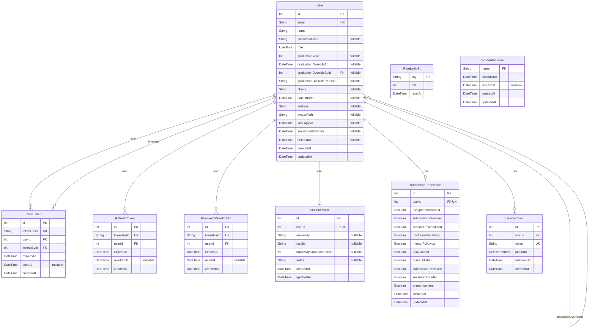
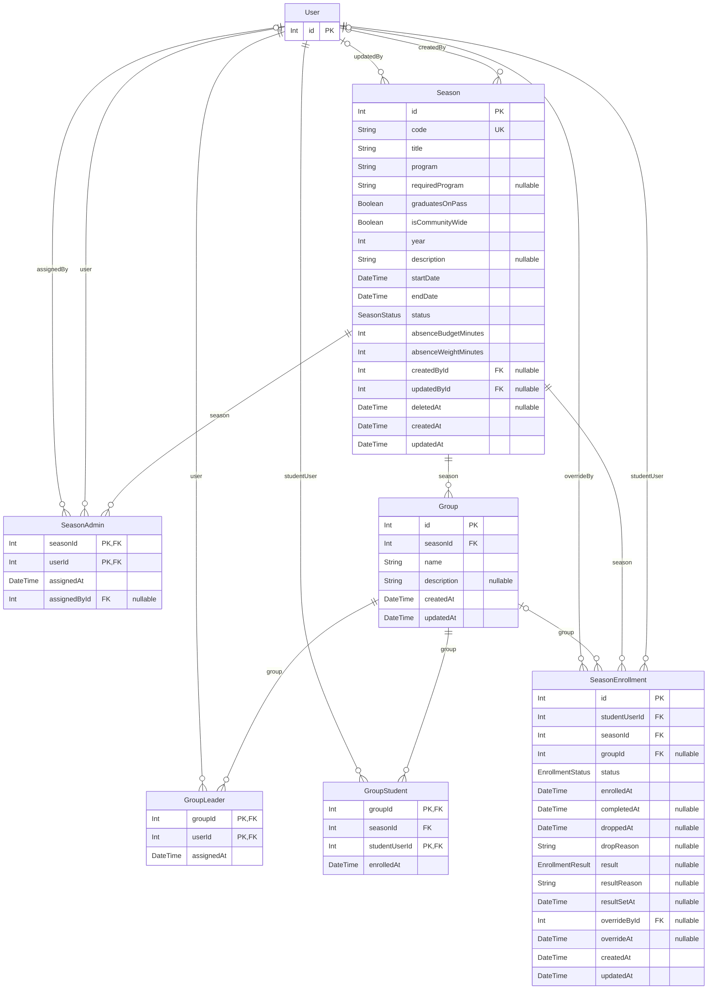
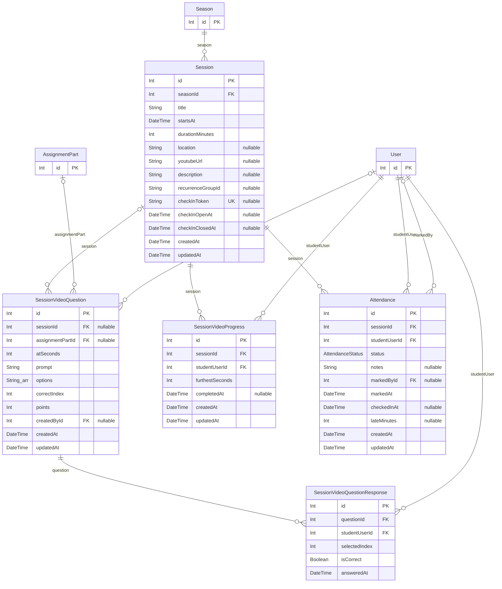
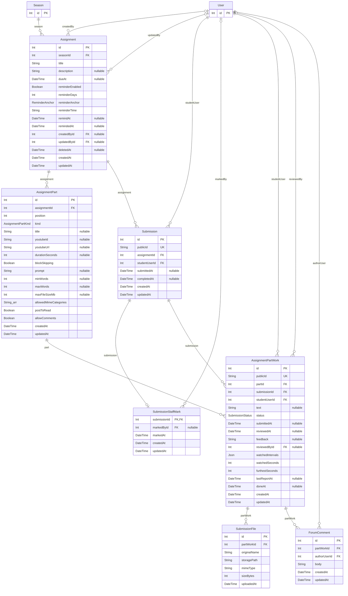
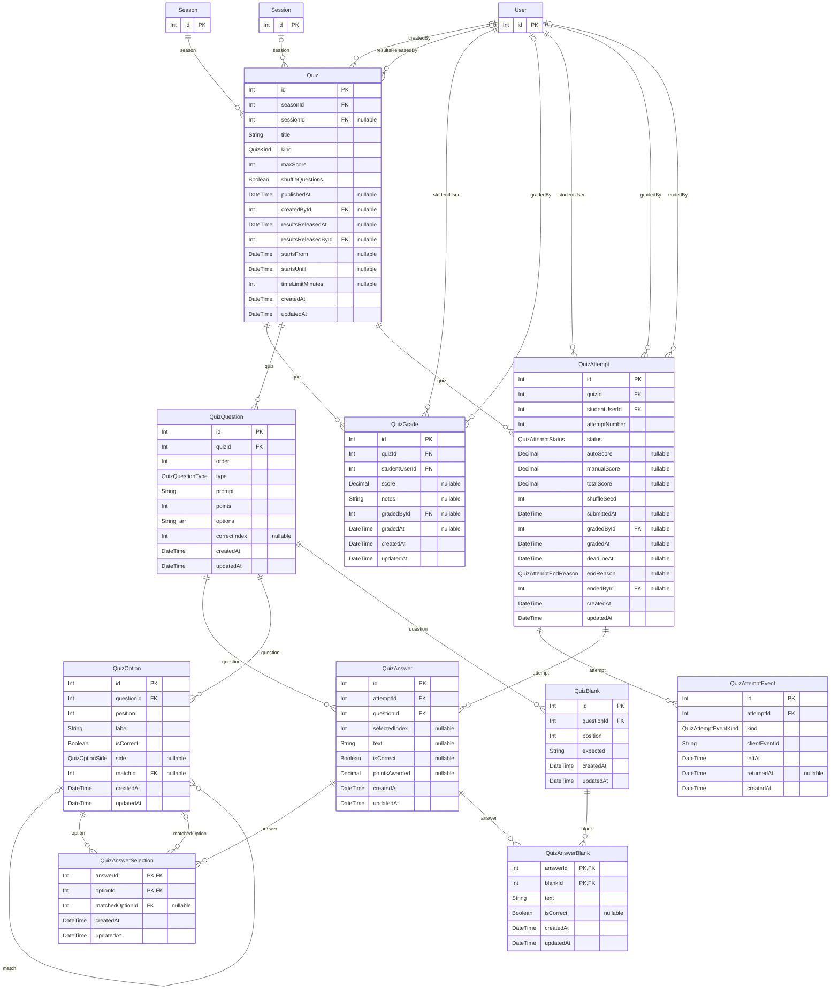
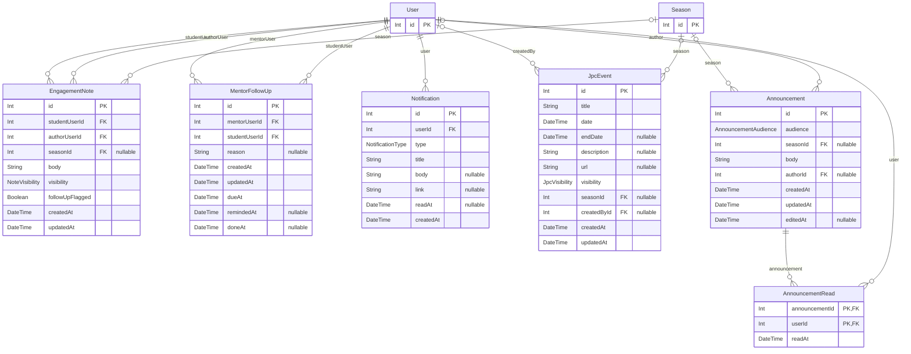
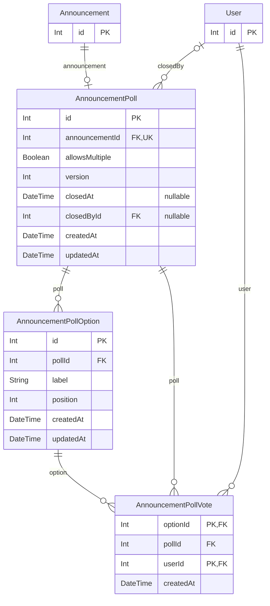

# Database ERD

Generated from `apps/backend/prisma/schema.prisma` by `pnpm --filter @space/backend db:erd`; do not edit by
hand. A unit test (`src/__tests__/erd.test.ts`) fails when this file is stale.

Each diagram draws one domain's tables in full. Tables from another domain appear as `id`-only stubs.
Cardinality: `||--o{` required parent, `|o--o{` nullable FK, `--o|` one-to-one (the FK is unique).
Types ending in `_arr` are arrays.

## 1. Identity & auth

## 2. Seasons, groups & enrolment

## 3. Sessions, attendance & video

## 4. Assignments & submissions

## 5. Quizzes

## 6. Notes, follow-ups, notifications, announcements, events

## 7. Announcement polls

## SQL-only objects

Rules Prisma cannot declare. They live in `prisma/migrations` and are noted on their model in
`schema.prisma`; `schema-snapshot.test.ts` fails if the database has one that is not noted. Never run
`prisma migrate dev` against a migrated database: it would drop them.

| Table | Kind | Name | Definition |
|---|---|---|---|
| Announcement | CHECK | `Announcement_audience_season_check` | `(audience = 'SEASON') = (seasonId IS NOT NULL)` |
| Assignment | CHECK | `Assignment_reminderDays_check` | `reminderDays BETWEEN 1 AND 14` |
| Assignment | CHECK | `Assignment_reminderTime_check` | `reminderTime ~ '^[0-2][0-9]:[0-5][0-9]$'` |
| Assignment | INDEX | `Assignment_remind_due_idx` | `(remindAt) WHERE remindedAt IS NULL AND deletedAt IS NULL` |
| AssignmentPart | CHECK | `AssignmentPart_video_check` | `kind <> VIDEO OR youtubeId IS NOT NULL` |
| AssignmentPart | CHECK | `AssignmentPart_prompt_check` | `kind NOT IN (ESSAY, FORUM) OR prompt IS NOT NULL` |
| AssignmentPart | CHECK | `AssignmentPart_words_check` | `minWords <= maxWords` |
| AssignmentPart | CHECK | `AssignmentPart_allowedMimeCategories_check` | `allowedMimeCategories <@ {image, pdf, doc, audio, video, text}` |
| AssignmentPart | UNIQUE INDEX | `AssignmentPart_one_forum` | `(assignmentId) WHERE kind = FORUM` |
| AssignmentPartWork | INDEX | `AssignmentPartWork_queue_idx` | `(status, submittedAt DESC NULLS LAST, id DESC) WHERE status <> 'DRAFT' (the review queue and the mentor's handed-in feed)` |
| AssignmentPartWork | INDEX | `AssignmentPartWork_reviewed_idx` | `(reviewedAt DESC, id DESC) WHERE reviewedAt IS NOT NULL (the mentor's reviewed feed)` |
| MentorFollowUp | UNIQUE INDEX | `MentorFollowUp_one_open` | `(mentorUserId, studentUserId) WHERE doneAt IS NULL` |
| MentorFollowUp | INDEX | `MentorFollowUp_due_open_idx` | `(dueAt) WHERE doneAt IS NULL AND remindedAt IS NULL` |
| Quiz | CHECK | `Quiz_timeLimitMinutes_check` | `timeLimitMinutes IS NULL OR timeLimitMinutes BETWEEN 1 AND 300` |
| Quiz | CHECK | `Quiz_start_window_check` | `startsFrom IS NULL OR startsUntil IS NULL OR startsFrom < startsUntil` |
| QuizAttempt | UNIQUE INDEX | `QuizAttempt_one_in_progress_key` | `(quizId, studentUserId) WHERE status = 'IN_PROGRESS'` |
| QuizAttempt | INDEX | `QuizAttempt_deadline_open_idx` | `(deadlineAt) WHERE status = 'IN_PROGRESS' AND deadlineAt IS NOT NULL` |
| QuizAttempt | CHECK | `QuizAttempt_totalScore_check` | `totalScore IS NULL OR totalScore = coalesce(autoScore, 0) + coalesce(manualScore, 0)` |
| QuizQuestion | CHECK | `QuizQuestion_points_check` | `points >= 0` |
| Season | CHECK | `Season_endDate_check` | `endDate >= startDate` |
| Season | CHECK | `Season_absenceMinutes_check` | `absenceBudgetMinutes >= 0 AND absenceWeightMinutes > 0` |
| Session | CHECK | `Session_durationMinutes_check` | `durationMinutes > 0` |
| SessionVideoQuestion | CHECK | `SessionVideoQuestion_points_check` | `points >= 0` |
| SessionVideoQuestion | CHECK | `SessionVideoQuestion_correctIndex_check` | `0 <= correctIndex < cardinality(options)` |
| SessionVideoQuestion | CHECK | `SessionVideoQuestion_owner_check` | `num_nonnulls(sessionId, assignmentPartId) = 1` |
| User | CHECK | `User_email_lowercase_check` | `email = lower(email) (so the unique is case-insensitive in effect; write it trimmed and lowercased)` |
