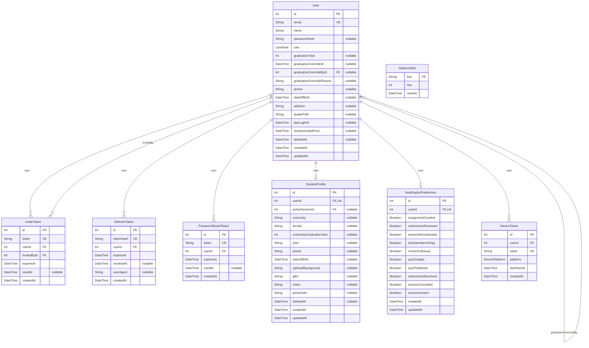
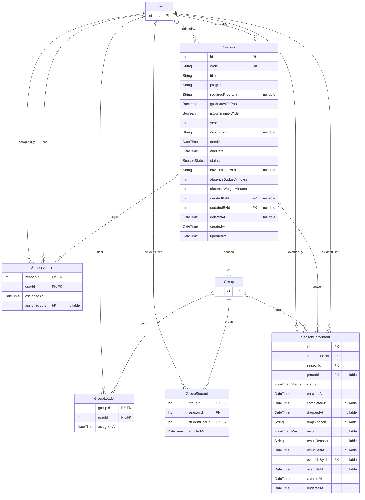
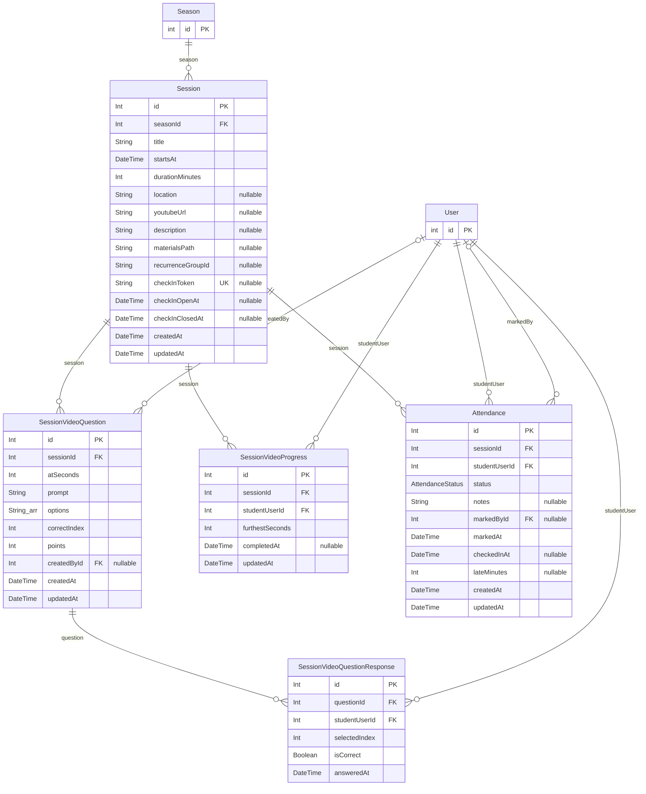
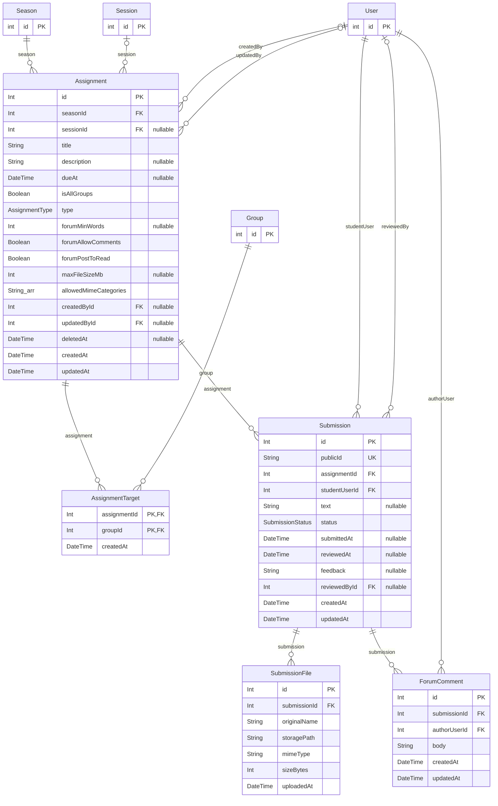
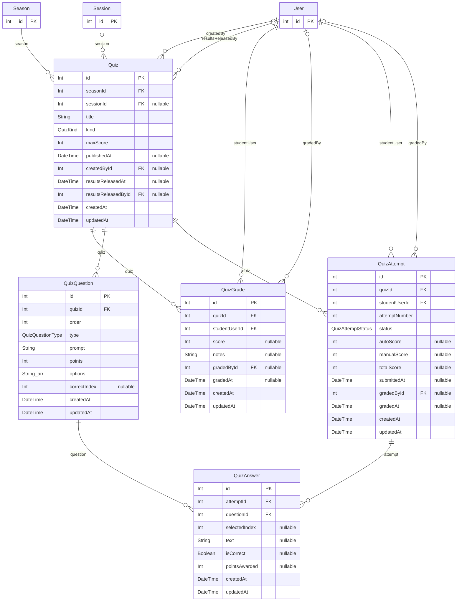
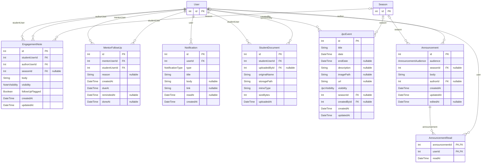
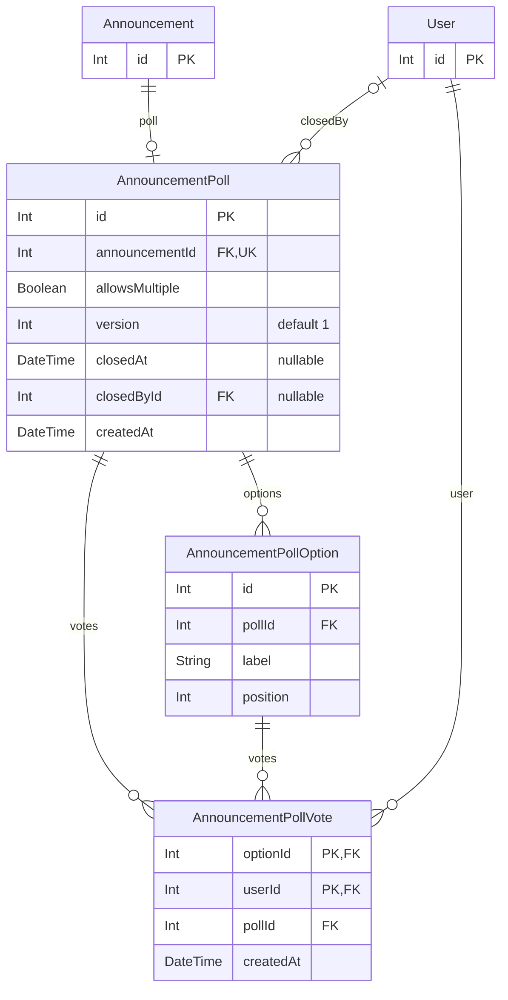

# Whole-app refactor audit — space-v2

Read-only audit for the clean-code and schema refactor. Plan, status and the owner's open questions
live in `docs/refactor-plan.md`; this file is the evidence behind it. **Nothing in the app was changed
for this audit.**

| | |
|---|---|
| Audited tree | `main` @ `4ab858a3` (2026-11-09), worktree `/home/mark/projects/JPC/space-v2-refactor` |
| Delta merged | `main` @ `edc1fad0` (announcement polls: 3 tables, 65 files, +4.6k lines) was merged into the Wave 0 branch on 2026-11-09 (`bcb79a93`, owner request). The areas A–D predate it; the poll schema and code are audited in this file (BE-090/091, FE-080/081, DB-029…031) |
| Method | Four read-only area audits (Appendices A–D), run in parallel, then merged and deduplicated here. Scripts used the `typescript` compiler API (no new dependencies): function length and nesting, import cycles, unused exports, N+1 detection, routes vs mobile call sites; DB findings from `schema.prisma`, all migrations and the Wave 0 schema snapshot (333 columns, 72 FKs, 108 indexes) |
| Not done | No database was connected to and **no row counts were read**: sizes are estimates (§2.15). No tests were run for the audit itself (the Phase 0 baseline is in the plan) |

**Severity.** high = correctness/performance risk, or a pattern repeated more than ~50 times;
medium = real duplication or maintainability cost; low = local or cosmetic.
**Waves.** 1 dead code · 2 shared foundations · 3 schema expand · 4 backend per domain · 5 mobile per
feature area · 6 schema contract · 7 guardrails. "Q*n*" = an owner question in the plan; a finding
whose wave reads "1 if Q7" only happens if the owner approves.
**Data migr.** whether the change moves or rewrites stored data (backfill, copy, archive, type rewrite).

**IDs.** Each finding keeps its area ID so it can be traced to its appendix: `BE-` backend code,
`FE-` mobile, `SH-` packages/shared, `DC-` dead code, `DB-`/`IDX-` database. Where two areas found the
same thing, it is listed **once** under the first ID, and the duplicates are named in *also*.

| Appendix | File | IDs |
|---|---|---|
| A | `docs/refactor-audit/backend.md` | BE-001…BE-081 |
| B | `docs/refactor-audit/mobile.md` | FE-001…FE-073, SH-001…SH-007 |
| C | `docs/refactor-audit/dead-code.md` | DC-001…DC-066 |
| D | `docs/refactor-audit/database.md` | DB-001…DB-028, IDX-1…IDX-7, IDX-D1…D4 |

---

## 0. Summary

**The codebase is in better shape than a whole-app refactor usually finds.** No source file is over
400 lines, there is one import cycle in 1,313 files, `tsc --noUnusedLocals` is clean in all three
packages, there is no commented-out code, no screen fetches data directly and every hook parses with
shared Zod. The work is concentrated in five places:

1. **Repeated small patterns** (backend id/404/400 preambles ×118/×131/×88, four refusal shapes,
   mobile query-state gates ×105, form-error blocks ×12, `apiClient`+`parse` ×146). One helper each,
   in Wave 2, removes most of the length in long handlers and screens.
2. **Business rules in handlers.** 49 `$transaction` sites live in route files (4 in `lib`); 114 write
   calls in routes. Wave 4 moves the transactional ones into `lib/<domain>/` services (decision D1:
   services + reads, no per-table repository layer).
3. **Cross-app rules spelled many times**: "finished season" ~20×, alumnus-not-studying 7×,
   season-admin 6×, ~15 error codes as bare strings on both sides.
4. **Three N+1 hot spots** (attendance notifications, forum `canDelete`, assignment counts) and one
   unbounded window query (mentor's Absent lately).
5. **Schema hygiene**: dead columns (8 on StudentProfile incl. personal data, 3 path columns), one
   unused table, a mirror table (`GroupStudent`), no retention on four growing tables, case-sensitive
   email uniqueness, 25 unindexed FKs (one hot), invariants only in code, `timestamp` without zone,
   and soft delete hand-written at 153 sites.

**The standards in the brief don't all fit this stack as written.** Integer (not BIGINT) ids,
PascalCase/camelCase names, no Prisma model mixins and Prisma 7's `$extends` not filtering nested
relations each need an owner ruling before Wave 3 (Q1–Q5). The audit recommends recording them as
documented exceptions, not forcing them (§2.8, §2.13).

### Metrics (baseline for the final report)

| Metric | Backend | Mobile | Shared | Note |
|---|---|---|---|---|
| Production TS/TSX files (non-test, non-generated) | 256 | ~500 | ~30 | 1,313 files incl. 521 tests; ~163k lines in all |
| Files > 400 lines | 0 source / 1 test | 0 source / 3 tests | 0 | §1.1 |
| Files > 300 lines | 5 | 13 | 2 | largest source file 399 (`shared/src/import.ts`) |
| Functions > 50 lines | 91 of 1,263 | 183 of 3,794 (shared incl.) | — | §1.2 |
| Nesting > 3 | 3 | 0 (ladders flattened) | 0 | |
| Import cycles | 1 | 0 | 0 | BE-060 |
| Dead exports (never referenced) | 119 across the repo (16 values, 103 types) | | | DC-016 |
| Duplication % | **not measured** — needs `jscpd` (Q10) | | | the final report needs a before figure |

---

## 1. Code structure

### 1.1 Files over 400 lines

Command: `git ls-files '*.ts' '*.tsx' '*.js' '*.mjs' | grep -v -e generated/ -e migrations/ | xargs wc -l`
(re-run 2026-11-09 for this merge; lockfiles, generated Prisma client and migrations excluded).

| Lines | File | Proposed split | Wave |
|---|---|---|---|
| 475 | `apps/mobile/src/__tests__/season-people.test.tsx` | by behaviour: selection & auto-tick / source chooser / "Add anyway" & refusals, sharing one fixtures file | 2 |
| 462 | `apps/mobile/src/__tests__/student-today.test.tsx` | by Home state: active season / between seasons / check-in open, shared `student-today.fixtures.ts` | 2 |
| 432 | `apps/mobile/src/__tests__/session-detail.test.tsx` | staff view / student view | 2 |
| 423 | `apps/backend/src/__tests__/integration/people-candidates.test.ts` | regular season / community-wide pools & sources | 2 |

No **source** file is over 400. Files near the cap, to split in their domain's step before they grow:

| Lines | File | Proposed split | ID | Wave |
|---|---|---|---|---|
| 399 | `packages/shared/src/import.ts` | `import/{students,groups,paste,index}.ts` | SH-001 | 2 |
| 385 | `apps/backend/src/routes/me.ts` | `routes/me/{index,account,profile,preferences,dashboard}.ts` | BE-010 | 4 |
| 382 | `packages/shared/src/reports.ts` | `reports/{bands,scope,engagement,organisation,exports,index}.ts` | SH-001 | 2 |
| 370 | `apps/backend/src/lib/exports/season-workbook.ts` | `season-workbook/{load,build,summary}.ts` | BE-013 | 4 |
| 353 | `apps/mobile/src/design/layout/screen.tsx` | leave (kit internals, sweep rules) | FE-007 | — |
| 349 | `apps/backend/src/lib/queries/students/list.ts` | move scope + dropped list to siblings | BE-014 | 4 |
| 338 | `apps/backend/src/lib/queries/dashboard.ts` | `dashboard/{student,staff,mentor}.ts` | BE-012 | 4 |
| 334 | `apps/mobile/src/components/ForumThread.tsx` | `screens/forum/{compose-card,post-card,comments}.tsx` | FE-009 | 5 |
| 331 | `apps/mobile/src/design/ui/date-picker.tsx` | leave (kit) | FE-007 | — |
| 324 | `apps/mobile/src/components/VideoQuizPlayer.tsx` | `useVideoQuizPlayback` + view | FE-004 | 5 |
| 323 | `apps/mobile/src/screens/work/work-model.ts` | after DC-027 removes `workSections` it drops under 300 | FE-010 | 1 |
| 322 | `apps/mobile/src/screens/announcements/post-form.tsx` (polls merge) | poll section into `screens/announcements/poll/` | FE-080 | 5 |
| 321 | `apps/mobile/src/hooks/use-quizzes.ts` | `use-quizzes/{staff,student,grading,index}.ts` | FE-010 | 5 |
| 320 | `apps/mobile/src/hooks/use-students.ts` | list / detail / writes | FE-010 | 5 |
| 317 | `apps/mobile/src/screens/calendar/season-calendars.tsx` | one file per role calendar | FE-010 | 5 |
| 315 | `apps/backend/src/lib/queries/forum.ts` | `forum/{feed,comments}.ts` | BE-015 | 4 |
| 313 | `apps/mobile/src/components/assignment-form.tsx` | sections file + `useSchemaErrors` | FE-006 | 5 |
| 312 | `apps/backend/src/routes/imports.ts` | `routes/imports/{students,season-groups,limits}.ts` | BE-011 | 4 |
| 301 | `apps/mobile/app/(app)/quiz/[id]/grade.tsx` | `screens/quiz-grade/{paper-grid,online-grading}.tsx` | FE-008 | 5 |

### 1.2 Long functions and deep nesting

Backend: 91 of 1,263 functions are over 50 lines (54 routes, 28 lib, 8 scripts, `createApp`); 3 nest
deeper than 3. Mobile + shared: 183 of 3,794 over 50, 57 over 100, 7 over 200; **no real nesting over
3** once `else if` ladders and chained ternaries are flattened (raw count: 44). Full lists: Appendix A §1,
Appendix B §1. Most backend length is the repeated preamble (BE-020/021/02A) plus an in-handler
transaction (§1.7); most mobile length is query-state ladders (FE-020) and inline rule derivation.

| ID | Sev | Evidence | Proposed change | Risk | Data migr. | Wave |
|---|---|---|---|---|---|---|
| BE-001 | medium | `routes/users/accounts.ts:40-190` `updateUser` 151 lines, a 117-line transaction with seven role rules | `lib/users/update-user.ts` `updateUserInTx(tx, actor, id, body)`; handler keeps parse + audit + respond | medium: role/lock rules; covered by users-edge-routes, stored-roles suites | n | 4 |
| BE-002 | medium | `routes/seasons/duplicate.ts:18-190` `duplicateSeason` 172 lines, depth 4 | `lib/seasons/duplicate.ts` `cloneSeasonContent(tx, source, target, shift)`, one helper per entity | low-medium | n | 4 |
| BE-003 | medium | `routes/seasons/end.ts:54-153` `endSeason` 100 lines, own `EndRefused` class (`:33`) | `lib/seasons/end.ts` beside its check; throws `ApiError` | medium (End is the most delicate write) | n | 4 |
| BE-004 | medium | `quizzes/grading.ts:17` (127), `:145` (122), `quizzes/attempts.ts:228` (104), `video-quiz/student.ts:69` (122) | `lib/quizzes/{grading,attempts}.ts`, `lib/video-quiz/answer.ts`; handlers ~20 lines | medium: `studentAttemptStatus` must stay on every student read | n | 4 |
| BE-005 | low | `lib/queries/reports/summary.ts:51` (207, linear), `lib/queries/engagement.ts:49` (149) | split into `load…Rows` + pure `fold…` (unit-testable) | low | n | 4 |
| BE-006 | — | seed scripts `seed-sweep/activity.ts:7` (143), `community.ts:29` (115) | **leave**: linear fixture data | — | — | — |
| FE-001 | high | `app/(app)/seasons/[code]/index.tsx:46-274` one 229-line component: 4 queries, refresh fan-out, season rules, tile list, next step | pure `seasonOverviewModel(season, {isSuper, today})` in `src/screens/season/overview-model.ts` + `<SeasonOverview model/>` | medium: owner-ruled tile copy and order; snapshot tiles per role/status first | n | 5 |
| FE-002 | high | `screens/season-people/people-list.tsx:39-310` 271 lines, 10 `useState`s | `usePeopleSelection` reducer hook with named actions; reducer tests first | medium: auto-tick, "Add anyway" | n | 5 |
| FE-003 | medium | `seasons/[code]/start.tsx:93-138` (9-arm ladder), `end.tsx:90+`, `attendance.tsx:57`, `follow-ups.tsx:21`, `assignment/new.tsx:19` | `QueryGate` (FE-020) + `useSeasonRoute` gate (FE-021) → ≤3 arms each | low | n | 5 |
| FE-004 | medium | `components/VideoQuizPlayer.tsx:62` (262), `VideoQuestionsEditor.tsx:98` (200; `onSave` 52) | `useVideoQuizPlayback`; `src/lib/video-question-form.ts` | medium: YouTube player timing | n | 5 |
| FE-005 | medium | `seasons/[code]/roster/import.tsx:54-270` 217-line route | mirror `screens/user-import/*`: `screens/group-import/{use-group-import-flow,paste-step,preview-step,result-step}`. **No** generic ImportWizard (contracts differ) | low | n | 5 |
| FE-006 | medium | forms of 150–210 lines: `assignment-form.tsx:106`, `GroupForm.tsx:46`, `EventForm.tsx:102`, `UserForm.tsx:45`, `StudentForm.tsx:51`, `session/[id]/edit.tsx:62`, `quiz/new.tsx:32`, `quiz-builder.tsx:95` | `useSchemaErrors` (FE-030) + `*-sections.tsx` per form (as `season-form-sections.tsx`) | low-medium | n | 5 |
| BE-090 | low | polls merge: `routes/announcements/poll-vote.ts:23` `castVote` 88 lines holding a `$transaction`; `poll-write.ts`, `poll-manage.ts:33` likewise hold transactions in routes | `lib/announcements/poll-{vote,write,manage}.ts` services (with BE-035); handlers parse + respond | low; announcements-poll-* integration suites | n | 4 |
| FE-080 | medium | polls merge: `screens/announcements/post-form.tsx:96` `PostForm` 227 lines (file 322) | poll editing state into `screens/announcements/poll/use-poll-draft.ts`; message + poll sections as components | medium: the "sends `poll` only when it differs from the poll as opened" rule must hold → test first | n | 5 |
| FE-081 | low | `screens/announcements/poll/poll-card.tsx:29` `PollCard` 117 lines | split results / choices / footer views (`poll-results.tsx`, `poll-choices.tsx` already exist) | low | n | 5 |
| FE-007 | — | `design/ui/date-picker.tsx:64` (265), `design/layout/screen.tsx:142` (211) | **leave**: kit primitives carrying sweep keyboard/inset rules | — | — | — |

### 1.3 God modules and files with several responsibilities

| ID | Sev | Evidence | Proposed change | Risk | Data migr. | Wave |
|---|---|---|---|---|---|---|
| BE-010 | medium | `routes/me.ts` (385): profile, password + limiter, delete, academic profile, preferences, dashboard, date helpers, two sub-routers | `routes/me/` folder; date helpers to `lib/org-time.ts` | low; paths unchanged (route-inventory snapshot) | n | 4 |
| BE-011 | medium | `routes/imports.ts` (312): two routers, limiter factory, JSON parser, own `requireSuper`, 4 try/catch mappers | `routes/imports/{students,season-groups,limits}.ts` | low | n | 4 |
| BE-012 | medium | `lib/queries/dashboard.ts` (338): four role dashboards | `lib/queries/dashboard/{student,staff,mentor}.ts` + index | low | n | 4 |
| BE-013 | medium | `lib/exports/season-workbook.ts` (370): load, build, size summary | `season-workbook/{load,build,summary}.ts` | low | n | 4 |
| BE-014 | low | `lib/queries/students/list.ts` (349) | move `listDroppedEnrollments`, `studentListScope` to siblings | low | n | 4 |
| BE-015 | low | `lib/queries/forum.ts` (315) | `forum/{feed,comments}.ts` (with BE-024) | low | n | 4 |
| BE-016 | low | writes under `lib/queries/` (`students/writes.ts` 274, `groups/membership.ts`); flat `lib/*.ts` domain files beside folders | adopt `lib/<domain>/` for services: `lib/students/graduation.ts`, `lib/groups/membership.ts` | low (import churn) | n | 4 |
| BE-091 | low | polls merge: `routes/announcements/poll-edit-plan.ts` is pure planning logic (`planPollEdit`, 54 lines, depth 2) living in routes | move to `lib/announcements/poll-edit-plan.ts` (it has no HTTP); poll error codes (`poll_changed`, `poll_closed`, `poll_votes_lost`) join the BE-040 catalogue | low | n | 4 |
| BE-017 | low | `routes/quizzes/notify.ts` (producer in routes), `routes/submissions/editable.ts:46` (a permission verdict), `routes/respond.ts` apart from `lib/api-response.ts` | `lib/quizzes/notify.ts`, `lib/permissions/submission.ts`, `lib/api-response.ts` | low | n | 2 |
| FE-008 | medium | `app/(app)/quiz/[id]/grade.tsx` (301): two screens in one route | `screens/quiz-grade/{paper-grid,online-grading}.tsx`; route picks by `quiz.kind` | low | n | 5 |
| FE-009 | medium | `components/ForumThread.tsx` (334): compose, post, thread, pagination, 3 inline error renders | `screens/forum/{compose-card,post-card,comments}.tsx` | low | n | 5 |
| FE-010 | low | near-cap files: `use-quizzes.ts` 321, `use-students.ts` 320, `work-model.ts` 323, `season-calendars.tsx` 317 | splits in §1.1 | low | n | 5 |
| FE-011 | low | 32 of 78 route files over 100 lines; whole screens in `app/` (`start`, `end`, `community`, `user/[id]`, `session/[id]/edit`, `login`, `events`, `quizzes`, `assignments`) | thin routes (params + one screen component) as each is touched in Wave 5 | low | n | 5 |
| SH-001 | low | `shared/src/import.ts` 399, `reports.ts` 382 (already banner-sectioned) | folders with `index.ts` re-export (as `quiz/`, `student/`) | low | n | 2 |

### 1.4 Duplicated logic

**Backend.**

| ID | Sev | Evidence | Shared helper and home | Risk | Data migr. | Wave |
|---|---|---|---|---|---|---|
| BE-020 | high | 118 `parseId(` + `apiError(…"Invalid X id.",400)` in 48 files | `lib/http/params.ts` `idParam(req, res, noun)`, same message strings. `router.param` rejected (nouns and param names differ) | low | n | 2 |
| BE-021 | high | 131 `not_found` (`"Season not found."` ×26, Session ×19, Quiz ×18 …); `db.season.findFirst` ×23 in routes | per-domain loaders (`findLiveSeason(id, select)` in `lib/queries/seasons.ts`) + `notFound(res, "Season")`. **Not** a generic `loadOr404`: selects differ on purpose | low | n | 2 (helpers) / 4 (call sites) |
| BE-022 | high | finished/live season sets inline ~20× in backend (`isSeasonFinished` exists at `lib/roles/student-seats.ts:33` but is re-spelled at `routes/imports.ts:162`, `students/profile.ts:61`, `seasons/results.ts:45`, `seasons/crud.ts:180,222`, `seat-rules.ts:104`, `standing.ts:47`, `permissions/announcement.ts:28`; `{in:["COMPLETED","ARCHIVED"]}` ×5; `{in:["DRAFT","ACTIVE"]}` ×4; `crud.ts:162` re-declares `SeasonStatus`) — *also* SH-002, FE-014, BE-043 | `FINISHED_SEASON_STATUSES`, `LIVE_SEASON_STATUSES`, `isSeasonFinished`, `isSeasonLive` in `packages/shared/src/enums.ts`; backend `lib/seasons/status.ts` re-exports + `liveSeasonWhere`; mobile's 8 inline copies use the shared predicate | low; core rule → unit test it | n | 2 |
| BE-023 | high | `take: limit+1` pagination ×8; cursors parsed 5 ways; partial helper at `lib/queries/notes.ts:153` | `lib/pagination.ts` `pageOf(rows, limit, keyOf)`; manual cursor parsing → shared Zod. Opaque compound cursors (events, announcements, reports) stay | low | n | 2 (helper) / 4 (sites) |
| BE-024 | medium | forum comment select ×2, mapping ×3 (`lib/queries/forum.ts:232,267,282`, `routes/forum.ts:215,226`) | `FORUM_COMMENT_SELECT` + `toForumComment(row, canDelete)` | low | n | 4 |
| BE-025 | medium | two `requireSuper`s (`users/super-only.ts:9`, imported cross-domain; `imports.ts:103`) + 10 inline `if (!isSuper(user))` | `requireRole(predicate, message?)` middleware in `middleware/require-auth.ts`, each message kept | low; message text is client-visible | n | 2 |
| BE-026 | medium | student-only 403 repeated (`me.ts:232,250`, `me-season-reads.ts` ×6, `quizzes/attempts.ts` ×3, `submissions/writes.ts:132`, `forum.ts:72`) | same `requireRole(isStudentRole, msg)`; `router.use` once in `me-season-reads.ts` | low | n | 2 |
| BE-027 | medium | "seasons a leader leads" query ×4 + per-season variants ×3; `lib/queries/events.ts:28` re-checks `isLeaderOfGroup` on already-filtered rows | `ledSeasonIds(user, {liveOnly})`, `ledGroupIdsInSeason(user, seasonId)` in `lib/permissions/season.ts`. Variants differ on `season.deletedAt` → make it an explicit option, don't unify silently | medium: a filter difference is a behaviour difference | n | 4 |
| BE-028 | medium | "live students of a season" recipients ×3 (`quizzes/notify.ts:51`, `session-notifications.ts:52`, `assignment-writes.ts:85`); the third **omits** `studentUser:{deletedAt:null}` (re-checked for this merge) | `liveStudentIds(seasonId, {groupIds?})` in `lib/queries/season-participants.ts`. Whether ASSIGNMENT_CREATED should skip deleted accounts is Q9 | medium | n | 4 |
| BE-029 | low | `email_taken` with two messages ("Email already in use." vs "A user with that email already exists.") | one constant per message in the error catalogue (BE-040); unifying the text is Q22 | low | n | 2 |
| BE-02A | low | body validation messages three ways over 88 `safeParse` sites | `lib/http/validate.ts` `parseOr400(schema, input, res, fallback)` keeping each site's message policy | low | n | 2 |
| BE-02B | low | lock order (Season → People → rows) applied by hand at 20 sites | optional `withSeatLocks` only where no read sits between the locks; not mandatory | medium (deadlocks) | n | 4 (optional) |
| BE-02C | low | test token minting ×8, bearer builder ×29 although `season-enrollments-setup.ts:31` exports one | `tokenFor(userId)`, `bearer(token)` in `__tests__/integration/fixtures.ts` | low | n | 2 |
| BE-02D | low | scripts print the DB host 4 ways | `scripts/lib/db-host.ts` | low | n | 2 |

**Mobile.**

| ID | Sev | Evidence | Shared hook/component and home | Risk | Data migr. | Wave |
|---|---|---|---|---|---|---|
| FE-020 | high | 105 `<RouteError>` + 99 `<RouteSkeleton>` gates, order varies | `QueryGate` / `renderQueryState(q)` in `src/design/layout/route-states.tsx`; `InlineError` stays for cards | low (pure render) | n | 2 (component) / 5 (sites) |
| FE-021 | high | season-code route boilerplate ×10 + "That season link isn't valid." ×10; `roster/import.tsx` finds the season another way | `useSeasonRoute()` (`src/hooks/use-season-route.ts`) + `SeasonRouteGate` | low | n | 2 |
| FE-032 | medium | 146 × `res = await apiClient.X(); return schema.parse(res.data.data)` | `apiGet(url, schema)` / `apiSend(method, url, body, schema)` in `src/lib/api-client.ts` | low (mechanical) | n | 2 |
| FE-030 | medium | form-error boilerplate in 12 forms | `useSchemaErrors(schema)` in `src/lib/form-errors.ts`; **not** react-hook-form (FE-031) | low | n | 2 |
| FE-031 | low | react-hook-form + resolvers used only by `app/login.tsx` and a test helper (re-checked) | convert login to `useSchemaErrors`, drop both deps (Q11) | low; login is critical → existing auth tests | n | 2 (after FE-030) |
| FE-024 | medium | `dayToDate` ×6, inline `format(d,"yyyy-MM-dd")` ×9, `timeToParts` ×2 | `src/lib/day-key.ts` (the stricter regex-checked variant from `personal-form.tsx:25`) | low (X13 no-zone rule kept) | n | 2 |
| FE-025 | medium | blank-to-null ×11, some trim and some don't | `blankToNull(s, {trim})` in `src/lib/form-values.ts`, **keeping each site's current trim behaviour** unless Q22 says otherwise | low-medium | n | 2 |
| FE-023 | medium | `countOf` exists but 6 local plural helpers + 3 person/people helpers + ~40 inline ternaries | extend `countOf(n, one, many)`, add `people(n)`; replace the 9 helpers; prose-level phrases stay | very low; copy identical | n | 2 |
| FE-022 | medium | three positive-int param parsers | keep `parsePositiveInt`; `seasonParam` and `use-season-param.ts` call it | low | n | 2 |
| FE-026 | low | KB formatting ×5 | `formatBytes` in `src/lib/format.ts` | very low | n | 2 |
| FE-027 | low | generic debounce hook lives in one screen's folder; dev switcher hand-rolls one | `src/hooks/use-debounced-search.ts` | very low | n | 2 |
| FE-028 | low | "Load more" button ×14 with differing label/variant ("Show more" on Community) | `LoadMoreButton({query})` in `src/design/ui/` + catalogue; label per Q22 | low | n | 2 |
| FE-029 | low | SearchField + FilterButton row ×2 | `SearchFilterRow` in `src/design/ui/` | very low | n | 5 |
| FE-035 | low | query keys extended ad hoc (`[...detail(id),"student"]` ×8); positional `queryKey[1] !== "start-check"` | factory entries in `src/lib/query-keys.ts` + `isCheckKey(q)`; **key identity unchanged** | low | n | 2 |
| FE-063 | low | `useSessionStore((s) => s.user?.role …)` ×53 | `useRole()`, `useIsSuper()` in `src/store/session.ts` | very low | n | 2 |
| FE-034 | medium | two `StudentList` components with colliding `StudentListItem` type (behaviour differs → **not** merged) | rename: `StudentDirectory` (server list, to `screens/students-list/`), `LocalStudentList` / `LocalStudentRow` | low | n | 5 |

**Across apps (backend ↔ mobile ↔ shared).**

| ID | Sev | Evidence | Proposed change | Risk | Data migr. | Wave |
|---|---|---|---|---|---|---|
| SH-002 | high | finished-season rule — merged into BE-022 above | — | — | — | 2 |
| BE-040 | medium | error codes as bare strings on both sides: backend `"bad_request"` ×214, `"not_found"` ×157, 60+ domain codes; mobile branches on ~15 (`has_student_records`, `start_blocked`, `season_unfinished`, `last_super` …) — *also* FE-050 | `API_ERROR_CODES` const (+ canned messages for repeated pairs) in `packages/shared/src/api-error.ts`; type `apiError`'s `code`; mobile compares against the constant | low; a typo today silently breaks a branch | n | 2 |
| SH-003 | medium | `isAlumnus(a) && !isStudyingAlumnus(a)` ×4 mobile, ×3 backend gates — *also* FE-016 | `isAlumnusNotStudying` in `shared/src/navigation.ts`, mirrored in `lib/rbac.ts`; mobile `useAudience()` selector | very low | n | 2 |
| FE-015 | medium | season-admin rule: backend `rbac.ts:36`, mobile `isAdminOfSeasonForUi` + 5 re-implementations; `session/[id]/index.tsx:59` is a **different** rule (SUPER needs the claim) — *also* SH-004 | claims-level pure predicate in `packages/shared` used by both; `useIsAdminOfSeason(seasonId)`; name the session variant separately | low (client hints; server enforces) | n | 2 |
| FE-040 | medium | 5 mobile input types re-declare shared request schemas (`DuplicateSeasonInput`, `UpdateSeasonInput`, `MarkReadInput`, `AnswerInput`, `GradeEntryInput`) | `z.input<…>` / indexed types from `@space/shared` | very low | n | 2 |
| FE-041 | low | local `AttendanceStatus`, `SubmissionStatus`, `"ADMIN" \| "SUPER"` unions | import shared types (`Extract<UserRole, …>`) | very low | n | 2 |
| FE-042 | low | inline response schema in `use-season-start.ts:34` (`status: z.string()`); backend `seasons/start.ts:50` has no shared contract | `startSeasonResponseSchema` in `shared/src/season-lifecycle.ts`, used on both sides; wire shape unchanged | low | n | 2 |
| SH-005 | low | enum literals re-declared in `shared/standing.ts:6-13,64`, backend `auth/scopes.ts:39`, `roles/standing.ts:7`, `seasons/crud.ts:162` | reference the shared enums/types | very low | n | 2 |

Rejected (they only look alike, or change for different reasons): per-domain serializers; notification
producers (fan-out already central in `createNotificationsBulk`); the 11 P2002 catch blocks (each maps
to a domain 409 — they convert to `ApiError` per site, not one central Prisma mapper); per-role Home
screens (owner-ruled layouts); user-import vs roster-import; a generic mutation-toast wrapper (FE-033);
backend-local `emailSchema` (normalisation differs). Details: Appendix A §3, Appendix B §4.

### 1.5 Dead code

Tools: TS-compiler import graph over all three packages (barrel re-exports credited to the source),
in-file reference counts, routes vs mobile `/api/v1` literals, `tsc --noUnusedLocals
--noUnusedParameters` (0 errors in all three). Every candidate was also grepped for string-based use
(`jest.mock` paths, maestro flows, `tools/`, package scripts, `vercel.json`, the design catalogue).
Kept as deliberate: test seams (`__resetRefreshState`, `setReducedMotionForTests`, ~90 more),
script entry points imported only by tests (DC-032), route files reached by href (`coursework.tsx`,
`settings/notifications.tsx`), jest mocks and build scripts. Commented-out code: **none**.

| ID | Sev | Evidence | Proposed change | Risk | Data migr. | Wave |
|---|---|---|---|---|---|---|
| DC-001 | low | `mobile/src/components/season/GraduatingField.tsx` imported nowhere — *also* FE-070 | delete file | none | n | 1 |
| DC-002 | low | `design/forms/fieldset.tsx` imported nowhere | delete | none | n | 1 |
| DC-003 | low | `design/seasons/season-status-badge.tsx` imported nowhere (only a plan doc names it) — *also* FE-070 | delete | none | n | 1 |
| DC-004 | low | `design/ui/file-upload.tsx` reached only via `export *` | delete file + barrel line | none | n | 1 |
| DC-005 | low | `design/ui/separator.tsx` same | delete file + barrel line | none | n | 1 |
| DC-006 | low | `card.tsx` `CardDescription`, `CardFooter` unused | remove | none | n | 1 |
| DC-007 | low | `modal.tsx` `ModalTrigger`, `ModalClose` unused | remove + fix header comment | none | n | 1 |
| DC-008 | low | `avatar.tsx` `AvatarGroup` unused | remove | none | n | 1 |
| DC-009 | low | `button.tsx` `BUTTON_ICON_SIZE` never read | remove | none | n | 1 |
| DC-010 | low | `form-parts.tsx` `FormActions` unused | remove | none | n | 1 |
| DC-011 | low | `lib/day-groups.ts` `groupSessionsByDay` replaced by `groupCalendarByDay` — *also* FE-070 | remove | none | n | 1 |
| DC-012 | low | backend `permissions/announcement.ts:7` `canReadAnnouncement` never called (re-checked; reads use `announcementVisibilityFilter`) | remove fn + re-export | none | n | 1 |
| DC-014 | low | `routes/imports.ts:312` exports `commitLimiter`, `previewLimiter` used only locally | drop from export list | none | n | 1 |
| DC-017 | low | 156 value + 183 type exports used only in their own file — *also* BE-081 (12 named) | drop the `export` keyword | none | n | 1 |
| DC-016 | low | 103 type aliases never referenced (mostly shared `z.infer` aliases; list in Appendix C) | delete unused aliases, keep schemas (Q23) | low | n | 1 if Q23 |
| DC-020 | low | `rbac.ts:54` `isAdminOfAnySeason` tests only — *also* BE-080 | delete with its test | low | n | 1 |
| DC-024 | low | shared `NOTIFICATION_PREFERENCE_KEYS` tests only | delete or move to a test helper | low | n | 1 |
| DC-025…DC-030 | low | mobile test-only production code: `formatDueDate`, `splitWallTime`, `formatShortDate`, `liveSessions`, `nextSession`, `hasNothingToDo`, `workSections`, `trackerStatusLabel`, `useMyEngagement`, `AttendancePill` (+ barrel) — *also* FE-070 | delete with their tests | low | n | 1 |
| DC-023 | low | `sentryEnabled` (both apps) tests only — *also* BE-080, FE-070 | keep as a test seam (documented) | — | n | — |
| SH-007 | low | unconsumed shared contracts: `dashboardSchema`, `assignmentListItemSchema`, `changePasswordResponseSchema`, `logoutAllResponseSchema`, `seasonEngagementResponseSchema` (*also* DC-015) | delete the first two in Wave 1; the last three go with their routes if Q7 approves | low | n | 1 |
| SH-006 | low | CLAUDE.md "remaining interfaces in packages/shared … should convert" is stale: no wire contract is a bare interface any more | update the paragraph | none | n | 1 |
| BE-054 | low | `permissions/forum.ts:94` `if (author && isAdminOfSeason) return true;` subsumed by `:95` (re-checked) | delete line 94 | none | n | 1 |
| FE-052 | low | `staleTime: 30_000` equal to the default in `use-submission.ts:59`, `use-notifications.ts:60` | drop; name `LIVE_CHECK = {staleTime:0, gcTime:0}` in `query-client.ts` | very low | n | 1 |
| FE-071 | medium | legacy Button aliases (`default/outline/ghost/link` + legacy sizes) still used at 55 sites; legacy `Card` (6), `Badge` (14), `Modal` (1), `PageTitle` (4), `ShellFrame` (8) | Wave 1: codemod the 55 variants to their mapped names (identical render) and delete the alias maps. Wave 5: migrate the last `Modal`/`PageTitle` users and delete those components (render changes → UI sweep) | low / medium | n | 1 + 5 |
| DC-050 | low | `turbo.json` build env lists `AUTH_URL` (v1/NextAuth), read nowhere | remove from `turbo.json` and `.env.example` | none | n | 1 |
| DC-051 | low | `turbo.json` build env misses ~20 keys `config.ts` reads (build reads none of them) | sync the list or replace it with a comment (Q17) | low | n | 1 if Q17 |
| DC-013/055 | low | `IMPORT_FILE_UPLOAD_SUPPORTED = false` exported, never imported, never sent | remove (Q17) | none | n | 1 if Q17 |
| DC-056 | low | `STORAGE_DRIVER=s3` → `S3Storage`, every method throws | remove `s3` from the enum until a real driver exists (Q17) | low | n | 1 if Q17 |
| DC-057 | low | `READ_ONLY` cut-over freeze (middleware, config, openapi, README) for a switch the owner ruled will never flip | remove, or keep as maintenance mode (Q17) | low | n | 1 if Q17 |
| DC-060 | low | `POST /auth/logout-all` — no caller; no "Sign out everywhere" by owner ruling | remove route + `logoutAllResponseSchema` (contract change, Q7) | low | n | 1 if Q7 |
| DC-062 | low | `POST /me/password` — no caller; no password form by owner ruling | remove route + limiter + schemas (Q7) | low | n | 1 if Q7 |
| DC-061 | low | `GET /seasons/:id/engagement` — no caller, schema unused | remove route + schema (Q7) | low | n | 1 if Q7 |
| DC-063…066 | — | `PATCH/DELETE /notes/:id` (501 stub, deliberate), `GET /sessions`, `POST /students/:id/enrollments`, submission file routes (uploads off; GET is the safe stream) | keep unless Q7 says otherwise | — | n | — |
| DC-021 | medium | `permissions/note.ts:87` `canViewNote` used only by an integration test; note routes use another gate | owner: dead, or should the routes use it? (Q8) | medium (authz) | n | 1 or 4 per Q8 |
| DC-022 | medium | `roles/student-seats.ts:68` `checkStudentSeat` no production caller; CLAUDE.md names it as a refusal helper — *also* BE-080 | **possibly a missing guard**, not dead code (Q8) | medium | n | 1 or 4 per Q8 |
| DC-040 | low | mobile `expo-linear-gradient` imported nowhere; native module | drop in a build that ships a new binary (Q11) | low | n | 1 if Q11 |
| DC-046 | low | backend `pg`, `@types/pg` never imported (`@prisma/adapter-pg` brings its own) | drop (Q11) | low | n | 1 if Q11 |
| DC-058/059 | — | `ENABLE_UPLOADS` dormant by design; `DELETE /notes/:id` 501 stub | keep (documented) | — | — | — |
| — | low | `apps/backend/scripts/smoke.sh`: only a 2026-08 plan doc mentions it | confirm and delete in Wave 1 if no CI/ops use | none | n | 1 |

### 1.6 SOLID

| ID | Sev | Evidence | Proposed change | Risk | Data migr. | Wave |
|---|---|---|---|---|---|---|
| BE-050 | medium | OCP/SRP: per-role scope if-chains re-written per domain (`calendarScopeFor`, `studentListScope`, `staffScopeForSeason`, `attendanceScopeFor`, `submissionQueueScopeFor`, `reportScopeFor`, `viewerSeasonIds`); 115 `role ===` literals in 39 files | one primitive `staffSeasonScope(user) → {kind:"all"} \| {kind:"seasons",ids} \| {kind:"groups",…}` the domain scopes build on; role comparisons only through `lib/rbac.ts` predicates. **Not** a strategy object per domain (answers genuinely differ) | medium (authz) | n | 4 |
| BE-052 | low | DIP: `lib/email.ts` binds nodemailer directly; `lib/push.ts` mixes the device-token DB read with the Expo call. Storage already has an interface; Sentry is behind `reportError` | split `push.ts` into `push/tokens.ts` + `push/expo.ts`; a `Mailer` interface only when a second transport arrives | low | n | 4 (optional) |
| FE-060 | low | `(tabs)/calendar.tsx:37-63` 7-arm role if-chain with the audience derived inline (`dashboard.tsx`'s exhaustive switch is fine) | `calendarBranchFor(audience, scopes)` + switch, like `dashboard-branch.ts` | low | n | 5 |
| FE-061 | medium | SRP: `components/StudentList.tsx:74-226` mixes a mentor variant into the staff list via 7 `mentor ?` branches + a 6-deep ternary; an `as` cast at `:159` | `studentListCopy({audience, shown, view, q})` strategy per audience; type `Row` to remove the cast | low; owner-ruled copy → pin with tests | n | 5 |
| FE-062 | — | ISP: max 5 boolean props (`candidate-row.tsx`) | no finding unless the states prove exclusive | — | — | — |
| BE-051, BE-053 | — | one `switch` on a discriminant (fine); `SessionUser` passed to one-field helpers (acceptable) | none | — | — | — |

No leaky inheritance (LSP) was found: the codebase has no class hierarchies beyond the error classes
(BE-030 unifies those).

### 1.7 Layering and import cycles

**Backend.** 59 of 76 route files import `db`; 381 `db.`/`tx.` calls in routes (114 writes) vs 260 in
`lib`; **49 `$transaction` sites in 26 route files** vs 4 in `lib`. `lib` never imports routes. Rules
already in `lib`: authorization (`rbac.ts`, `permissions/*`), seat/role rules and locks (`lib/roles`),
start/end checks, graduation, imports, notifications. Rules still in handlers: user role changes,
End, Duplicate, quiz grading/submit/reopen, video-quiz answering, attendance save, check-in, season
status transitions, question reorder.

**Mobile.** 0 queries in screens, 0 direct fetches in components, 0 cycles. The problem is layer
direction: `design → hooks` ×9, `design → store` ×3, `design → screens` ×1, `lib → design` ×3,
`components → screens` ×15.

| ID | Sev | Evidence | Proposed change | Risk | Data migr. | Wave |
|---|---|---|---|---|---|---|
| BE-035 | medium | the counts above | **D1:** routes (HTTP only, ≤~40-line handlers, no `$transaction`) → domain services `lib/<domain>/` (own transaction, locks, rules; throw `ApiError`) → reads `lib/queries/<domain>` → Prisma `select`. **No per-table repository layer**: Prisma's typed client with per-call `select` already is the data layer, and correctness lives in those selects (e.g. `quizzes/student-detail.ts:9-19` relies on *not* selecting `correctIndex`). Reference: announcements domain; transactional model `lib/roles/student-seats.ts`. Order: users/accounts → seasons/end → seasons/duplicate → quizzes → video-quiz → sessions/attendance | medium; each move behaviour-neutral, covered by integration suites | n | 4 (needs owner OK of D1) |
| BE-060 | low | the only cycle: `lib/storage/index.ts` ↔ `local.ts` (value `FileNotFoundError`) | `lib/storage/types.ts` holds the types, error and `buildStorageKey` | low | n | 2 |
| FE-012 | medium | `components/ExportMenu.tsx:48-69` builds API paths | intent methods on `useReportExport()`; paths live in the hook | low | n | 5 |
| FE-013 | medium | axios imported in UI-side files to read `err.response?.status` (6 places) | `apiErrorStatus(err)` in `src/lib/api-error.ts`; axios only in the 3 API-plumbing files | low | n | 2 |
| FE-014 | medium | finished-season rule in screens — merged into BE-022 | — | — | — | 2 |
| FE-016 | medium | alumnus audience built inline from the store ×4 — merged into SH-003 | — | — | — | 2 |
| FE-017 | medium | the layer-direction counts above | rule (CLAUDE.md, enforced in Wave 7): `design/ui`, `design/layout` (except shell glue), `design/{motion,theme,lib}` are presentational; data-bound `design/<domain>/*` views move to `src/screens/<domain>/`; legacy `src/components/*` folds into `src/screens/<domain>/` (kebab-case, FE-073) | medium (import churn only) | n | 5 |
| FE-018 | low | placeholder ids `useStartSeason(seasonId ?? 0)` ×9: a mutation fired before load hits `/seasons/0/…` | write hooks take `number \| null` and refuse null in `mutationFn` | low | n | 5 |
| FE-073 | low | 36 PascalCase vs 6 kebab-case files in `src/components/` | rename as files move (FE-017) | very low | n | 5 |

### 1.8 Error handling and magic values

Today: 513 inline `apiError` calls, 119 `forbidden(res)` + 24 inline 403s, `ForbiddenError` thrown in
3 places as a second 403 path, 7 local Error classes caught in their own handler, four refusal shapes
(`SeatRefusal`, `fail:` tuples, string verdicts, `AssignmentRefRefusal`). One mapping point exists for
unexpected and auth errors (`middleware/error-handler.ts`), none for expected domain refusals.

| ID | Sev | Evidence | Proposed change | Risk | Data migr. | Wave |
|---|---|---|---|---|---|---|
| BE-030 | high | the above | `ApiError {code, status}` in `lib/api-error.ts`, mapped once in `error-handler.ts` before the 500 branch, never sent to Sentry; services throw it (rolls the transaction back, which is what `EndRefused` and the `fail` tuples emulate); `toApiError(refusal)` for `SeatRefusal` (replaces `refusalStatus`); `ForbiddenError` becomes a subclass | medium: every converted site must keep code/message/status byte-identical | n | 2 (class + mapping) / 4 (conversions per domain) |
| BE-031 | low | `refusalStatus` lives in `staff-seats.ts` but serves every `SeatRefusal` | move beside the type (or replace with `toApiError`) | low | n | 2 |
| BE-032 | low | `res.status(204).end()` ×2 bypass the helpers | `apiNoContent(res)` in `lib/api-response.ts` | low | n | 2 |
| BE-041 | medium | rate-limit window `15*60*1000` ×11, `60*60*1000` ×1 | `RATE_LIMIT_WINDOW_MS` default in `lib/rate-limit/index.ts` | low | n | 2 |
| BE-042 | low | day length three ways in backend — *also* FE-051 (mobile `86_400_000`, `MS_PER_DAY`, `DAY_MS`, `60_000` ×4) | `MS_PER_DAY/HOUR/MINUTE` in backend `lib/org-time.ts`; mobile `src/lib/time.ts` | low | n | 2 |
| BE-044 | low | notification links hard-coded in producers while `lib/notification-target.ts` parses them | link builders beside the parser | low | n | 2 |
| BE-045 | low | inline batch caps (`take: 200`, `PER_ROLE`) | name them in-module | low | n | 2 |
| FE-053/054 | — | typed routes on, no `as Href`; repeated copy covered by FE-021/027 | none | — | — | — |

### 1.9 N+1 and over-fetching (code)

No `include:` anywhere; only 2 finds without `select`, both needing most columns. 31 awaited DB calls
inside loops (13 in seed scripts, ignored).

| ID | Sev | Evidence | Proposed change | Risk | Data migr. | Wave |
|---|---|---|---|---|---|---|
| BE-070 | high | `lib/attendance-notifications.ts:24-82`: up to 6 queries **per absent student** on every attendance save; `seasonAdmin.findMany` is loop-invariant | hoist admins; one query each for last-two attendance rows, enrolment groups + names, leaders of those groups; build notifications in memory | low-medium; `attendance-notifications.test.ts` | n | 4 |
| BE-071 | high | `lib/queries/forum.ts:232,282`: `await canDeleteForumComment(user, c.id)` per comment, which re-reads the row and may call `hasActiveEnrollment` | pure `canDeleteLoadedComment(user, comment, ctx)` with ctx computed once per request; DELETE keeps the id-based gate; test that list flag = DELETE gate | medium (authz parity) | n | 4 |
| BE-072 | medium | `lib/queries/assignments/staff.ts:38-45`: one `seasonEnrollment.count` per assignment | one `groupBy(groupId)` + sum per assignment's targets | low | n | 4 |
| BE-073 | low | `groups/membership.ts:269-279`: per-student delete + update in a transaction | `deleteMany`/`updateMany` with `in` | low | n | 4 |
| BE-076 | low | `lib/follow-ups.ts:104-117`: claim + notify per due follow-up (cron, capped 200) | optional single claim + bulk fan-out | low | n | 4 (optional) |
| BE-074/075/077/078 | — | per-row writes with distinct data, bounded loops, id-mapping creates, dev-only route | leave (reasons in Appendix A §9) | — | — | — |
| DB-026 | medium | `lib/queries/students/absent-lately.ts:11-27`: `ROW_NUMBER()` window over **all** `Attendance` ever, on every mentor Home | bound it (`startsAt >= now - 180 days` with IDX-5) or `LATERAL … LIMIT 2` per student; result must stay identical (last two **marked, started** sessions) | low-medium; pin with a test first | n | 4 |

---

## 2. Database

39 Prisma models after the polls merge (36 audited in Appendix D + 3 poll tables here), 15 enums, 36 migrations (35 before it); all
`Int` autoincrement PKs (`serial4`), 5 composite-PK link tables, one `text` PK (`RateLimitHit.key`).
**No UUID primary keys** — so the brief's "UUID exceptions" list is empty; the exception that applies
instead is Int-not-BIGINT (§2.13, Q1).

### 2.1 ERD (current, per domain)

Generated from `schema.prisma` at `4ab858a3` (copied from Appendix D §1). Cross-domain hubs (`User`,
`Season`, `Session`, `Group`) appear as `id`-only stubs outside their home domain.
`StudentProfile.activeSeasonId → Season` (dead, DB-001) is left out of the identity diagram.
Cardinality: `||--o{` required parent, `|o--o{` nullable FK, `||--o|` 1:1 (FK is `@unique`).
The poll tables are drawn in §2.1.7.

#### 2.1.1 Identity & auth

#### 2.1.2 Seasons, groups & enrolment

#### 2.1.3 Sessions, attendance & video

#### 2.1.4 Assignments & submissions

#### 2.1.5 Quizzes

#### 2.1.6 Notes, follow-ups, notifications, announcements, events, misc

---

#### 2.1.7 Announcement polls (merged from `main` @ `edc1fad0`)

### 2.2 Per-entity column tables

Copied from Appendix D §2 (36 entities); the three poll tables close the section.

Columns: Prisma declaration; DB type from the schema snapshot (`timestamp` = `timestamp without time zone`,
`NN` = NOT NULL); **Read** and **Written** = count of matching code sites and the first two examples
(heuristic classifier: a `field:` key whose nearest preceding keyword is `data`/`create`/`update`/`upsert`
counts as a write, `select`/`where`/`include`/`orderBy` or a `.field` property read counts as a read). Writes
that happen through a spread helper (e.g. `...assignmentColumns(body)`, `...seasonColumns(body)`) are
undercounted; every "0 written" below was checked by eye, and the Verdict column records the confirmed result.
`createdAt`/`updatedAt`/`id` are written by DB defaults / `@updatedAt` / the sequence.

#### User

| Column | Prisma | DB (snapshot) | Read (n, e.g.) | Written (n, e.g.) | Verdict |
|---|---|---|---|---|---|
| id | `Int @id @default(autoincrement())` | integer NN DEFAULT nextval('"User_id_seq"'::regclass) | 718: src/lib/invites.ts:64, src/lib/invites.ts:69 | 16: src/lib/invites.ts:190, src/lib/queries/students/writes.ts:250 |  |
| email | `String @unique` | text NN | 139: src/lib/invites.ts:36, src/lib/invites.ts:94 | 9: src/lib/queries/students/writes.ts:61, src/lib/auth/credentials.ts:33 |  |
| name | `String ` | text NN | 263: src/lib/follow-ups.ts:18, src/lib/follow-ups.ts:29 | 13: src/lib/queries/students/writes.ts:58, src/lib/auth/credentials.ts:34 | (name shared with other models; counts scoped to files touching this model) |
| passwordHash | `String? ` | text | 24: src/lib/invites.ts:156, src/lib/queries/students/detail.ts:206 | 2: src/routes/me.ts:176, src/routes/users/accounts.ts:296 |  |
| role | `UserRole ` | UserRole NN | 226: src/lib/follow-ups.ts:96, src/lib/announcement-notifications.ts:29 | 9: src/lib/queries/students/writes.ts:62, src/routes/dev.ts:82 |  |
| graduationYear | `Int? ` | integer | 72: src/lib/rbac.ts:14, src/lib/queries/season-start.ts:70 | 6: src/lib/queries/students/writes.ts:63, src/lib/queries/students/writes.ts:250 |  |
| graduationOverrideAt | `DateTime? ` | timestamp | 3: src/lib/queries/students/detail.ts:183, src/lib/queries/students/detail.ts:188 | 1: src/lib/queries/students/writes.ts:218 |  |
| graduationOverrideById | `Int? ` | integer | 0 | 1: src/lib/queries/students/writes.ts:219 | write-only FK; read via relation graduationOverrideBy (students/detail.ts:185) |
| graduationOverrideReason | `String? ` | text | 2: src/lib/queries/students/detail.ts:184, src/lib/queries/students/detail.ts:192 | 1: src/lib/queries/students/writes.ts:220 |  |
| phone | `String? ` | text | 12: src/lib/queries/me/profile.ts:17, src/lib/queries/me/profile.ts:33 | 3: src/lib/queries/students/writes.ts:64, src/routes/me.ts:130 | (name shared with other models; counts scoped to files touching this model) |
| dateOfBirth | `DateTime? ` | timestamp | 20: src/lib/queries/me/profile.ts:18, src/lib/queries/me/profile.ts:34 | 3: src/lib/queries/students/writes.ts:65, src/routes/me.ts:131 | (name shared with other models; counts scoped to files touching this model) |
| address | `String? ` | text | 3: src/routes/me.ts:51, src/routes/me.ts:58 | 1: src/routes/me.ts:132 |  |
| avatarPath | `String? ` | text | 10: src/lib/queries/me/profile.ts:11, src/lib/queries/me/profile.ts:31 | 0 | NEVER WRITTEN in v2 (no upload route); read+returned in 4 payloads -> always v1 data or null (DB-005) |
| lastLoginAt | `DateTime? ` | timestamp | 12: src/lib/invites.ts:156, src/lib/queries/students/detail.ts:206 | 3: src/lib/auth/credentials.ts:29, src/lib/auth/google.ts:67 |  |
| sessionsValidFrom | `DateTime? ` | timestamp | 5: src/lib/auth/session-validity.ts:6, src/lib/auth/session-validity.ts:32 | 1: src/lib/auth/session-validity.ts:70 |  |
| deletedAt | `DateTime? ` | timestamp | 163: src/lib/invites.ts:156, src/lib/follow-ups.ts:52 | 7: src/routes/users/accounts.ts:241, src/routes/users/accounts.ts:245 | (name shared with other models; counts scoped to files touching this model) |
| createdAt | `DateTime @default(now())` | timestamp NN DEFAULT CURRENT_TIMESTAMP | 46: src/lib/follow-ups.ts:11, src/lib/follow-ups.ts:20 | DB default / @updatedAt |  |
| updatedAt | `DateTime @updatedAt` | timestamp NN | 5: src/lib/queries/notes.ts:23, src/lib/queries/notes.ts:36 | DB default / @updatedAt |  |

#### InviteToken

| Column | Prisma | DB (snapshot) | Read (n, e.g.) | Written (n, e.g.) | Verdict |
|---|---|---|---|---|---|
| id | `Int @id @default(autoincrement())` | integer NN DEFAULT nextval('"InviteToken_id_seq"'::regclass) | 72: src/lib/invites.ts:64, src/lib/invites.ts:69 | 4: src/lib/invites.ts:190, src/lib/auth/password-reset.ts:116 |  |
| token | `String @unique` | text NN | 9: src/lib/invites.ts:77, src/lib/invites.ts:151 | 3: src/lib/invites.ts:68, src/lib/auth/password-reset.ts:50 | (name shared with other models; counts scoped to files touching this model) |
| userId | `Int ` | integer NN | 31: src/lib/invites.ts:42, src/lib/invites.ts:61 | 6: scripts/seed-sweep/more-roles.ts:38, scripts/seed-sweep/more-roles.ts:59 | (name shared with other models; counts scoped to files touching this model) |
| invitedById | `Int ` | integer NN | 5: src/lib/invites.ts:43, src/lib/invites.ts:62 | 1: scripts/seed-sweep/more-roles.ts:39 |  |
| expiresAt | `DateTime ` | timestamp NN | 20: src/lib/invites.ts:19, src/lib/invites.ts:47 | 6: src/lib/invites.ts:48, src/lib/invites.ts:78 | (name shared with other models; counts scoped to files touching this model) |
| usedAt | `DateTime? ` | timestamp | 17: src/lib/invites.ts:47, src/lib/invites.ts:77 | 2: src/lib/auth/password-reset.ts:113, src/routes/auth.ts:185 | (name shared with other models; counts scoped to files touching this model) |
| createdAt | `DateTime @default(now())` | timestamp NN DEFAULT CURRENT_TIMESTAMP | 5: src/lib/queries/students/detail.ts:211, src/lib/auth/password-reset.ts:68 | DB default / @updatedAt |  |

#### RefreshToken

| Column | Prisma | DB (snapshot) | Read (n, e.g.) | Written (n, e.g.) | Verdict |
|---|---|---|---|---|---|
| id | `Int @id @default(autoincrement())` | integer NN DEFAULT nextval('"RefreshToken_id_seq"'::regclass) | 4: src/lib/auth/tokens.ts:100, src/lib/auth/tokens.ts:101 | serial |  |
| tokenHash | `String @unique` | text NN | 3: src/lib/auth/tokens.ts:122, src/lib/auth/tokens.ts:139 | 1: src/lib/auth/tokens.ts:90 |  |
| userId | `Int ` | integer NN | 6: src/lib/auth/tokens.ts:15, src/lib/auth/tokens.ts:44 | 2: src/lib/auth/tokens.ts:84, src/lib/auth/tokens.ts:96 | (name shared with other models; counts scoped to files touching this model) |
| expiresAt | `DateTime ` | timestamp NN | 1: src/lib/auth/tokens.ts:123 | 1: src/lib/auth/tokens.ts:86 | (name shared with other models; counts scoped to files touching this model) |
| revokedAt | `DateTime? ` | timestamp | 4: src/lib/auth/tokens.ts:123, src/lib/auth/tokens.ts:128 | 3: src/lib/auth/tokens.ts:129, src/lib/auth/tokens.ts:140 |  |
| userAgent | `String? ` | text | 0 | 1: src/lib/auth/tokens.ts:90 | WRITE-ONLY (tokens.ts:90); never read (DB-006) |
| createdAt | `DateTime @default(now())` | timestamp NN DEFAULT CURRENT_TIMESTAMP | 0 | DB default / @updatedAt |  |

#### PasswordResetToken

| Column | Prisma | DB (snapshot) | Read (n, e.g.) | Written (n, e.g.) | Verdict |
|---|---|---|---|---|---|
| id | `Int @id @default(autoincrement())` | integer NN DEFAULT nextval('"PasswordResetToken_id_seq"'::regclass) | 7: src/lib/auth/password-reset.ts:64, src/lib/auth/password-reset.ts:68 | 1: src/lib/auth/password-reset.ts:116 |  |
| token | `String @unique` | text NN | 1: src/lib/auth/password-reset.ts:99 | 1: src/lib/auth/password-reset.ts:50 | (name shared with other models; counts scoped to files touching this model) |
| userId | `Int ` | integer NN | 9: src/lib/auth/password-reset.ts:23, src/lib/auth/password-reset.ts:44 | 0 | (name shared with other models; counts scoped to files touching this model) |
| expiresAt | `DateTime ` | timestamp NN | 6: src/lib/auth/password-reset.ts:27, src/lib/auth/password-reset.ts:45 | 2: src/lib/auth/password-reset.ts:28, src/lib/auth/password-reset.ts:120 | (name shared with other models; counts scoped to files touching this model) |
| usedAt | `DateTime? ` | timestamp | 5: src/lib/auth/password-reset.ts:27, src/lib/auth/password-reset.ts:100 | 1: src/lib/auth/password-reset.ts:113 | (name shared with other models; counts scoped to files touching this model) |
| createdAt | `DateTime @default(now())` | timestamp NN DEFAULT CURRENT_TIMESTAMP | 1: src/lib/auth/password-reset.ts:68 | DB default / @updatedAt |  |

#### StudentProfile

| Column | Prisma | DB (snapshot) | Read (n, e.g.) | Written (n, e.g.) | Verdict |
|---|---|---|---|---|---|
| id | `Int @id @default(autoincrement())` | integer NN DEFAULT nextval('"StudentProfile_id_seq"'::regclass) | 147: src/lib/queries/me/profile.ts:27, src/lib/queries/students/detail.ts:36 | 3: src/lib/queries/students/writes.ts:250, src/routes/me.ts:176 |  |
| userId | `Int @unique` | integer NN | 44: src/lib/queries/me/profile.ts:25, src/lib/queries/students/detail.ts:65 | 22: src/lib/queries/students/writes.ts:87, src/routes/me.ts:211 | (name shared with other models; counts scoped to files touching this model) |
| activeSeasonId | `Int? ` | integer | 23: src/lib/queries/dashboard.ts:69, src/lib/queries/events.ts:18 | 0 | UNUSED: never read/written (all hits are comments/token claim) - retired by owner (DB-001) |
| university | `String? ` | text | 18: src/lib/queries/me/profile.ts:14, src/lib/queries/me/profile.ts:37 | 6: src/lib/queries/students/writes.ts:88, src/routes/students/profile.ts:216 |  |
| faculty | `String? ` | text | 15: src/lib/queries/me/profile.ts:15, src/lib/queries/me/profile.ts:38 | 2: src/lib/queries/students/writes.ts:89, src/routes/students/profile.ts:217 |  |
| universityGraduationYear | `Int? ` | integer | 17: src/lib/queries/me/profile.ts:16, src/lib/queries/me/profile.ts:39 | 2: src/lib/queries/students/writes.ts:90, src/routes/students/profile.ts:218 |  |
| year | `String? ` | text | 4: src/lib/queries/students/writes.ts:271, src/lib/queries/students/writes.ts:273 | 3: scripts/seed-sweep/community.ts:134, scripts/seed-sweep/people.ts:35 | written only by seed-sweep (people.ts:70); never read by app (DB-001) |
| phone | `String? ` | text | 11: src/lib/queries/me/profile.ts:17, src/lib/queries/me/profile.ts:33 | 3: src/lib/queries/students/writes.ts:64, src/routes/me.ts:130 | UNUSED since 2026-11-06 (moved to User) (DB-001) |
| dateOfBirth | `DateTime? ` | timestamp | 14: src/lib/queries/me/profile.ts:18, src/lib/queries/me/profile.ts:34 | 3: src/lib/queries/students/writes.ts:65, src/routes/me.ts:131 | UNUSED since 2026-11-06 (moved to User) (DB-001) |
| spiritualBackground | `String? ` | text | 0 | 0 | UNUSED (DB-001) |
| gifts | `String? ` | text | 0 | 0 | UNUSED (DB-001) |
| notes | `String? ` | text | 7: src/lib/queries/students/detail.ts:66, src/lib/queries/students/detail.ts:68 | 2: src/lib/queries/students/writes.ts:91, src/routes/students/profile.ts:219 | (name shared with other models; counts scoped to files touching this model) |
| photoPath | `String? ` | text | 0 | 0 | UNUSED (DB-001) |
| deletedAt | `DateTime? ` | timestamp | 26: src/lib/queries/me/profile.ts:27, src/lib/queries/students/detail.ts:36 | 6: src/routes/users/accounts.ts:241, src/routes/users/accounts.ts:245 | written in step with User.deletedAt (me.ts:211, lifecycle.ts:109, accounts.ts:247); never filtered on (DB-010) |
| createdAt | `DateTime @default(now())` | timestamp NN DEFAULT CURRENT_TIMESTAMP | 1: src/lib/queries/students/detail.ts:211 | DB default / @updatedAt |  |
| updatedAt | `DateTime @updatedAt` | timestamp NN | 0 | DB default / @updatedAt |  |

#### Season

| Column | Prisma | DB (snapshot) | Read (n, e.g.) | Written (n, e.g.) | Verdict |
|---|---|---|---|---|---|
| id | `Int @id @default(autoincrement())` | integer NN DEFAULT nextval('"Season_id_seq"'::regclass) | 610: src/lib/assignment-writes.ts:34, src/lib/assignment-writes.ts:35 | 3: src/lib/queries/students/writes.ts:250, src/lib/roles/student-seats.ts:227 |  |
| code | `String @unique` | text NN | 158: src/lib/email-templates.ts:155, src/lib/email-templates.ts:168 | 6: src/lib/api-response.ts:7, src/routes/seasons/crud.ts:238 |  |
| title | `String ` | text NN | 189: src/lib/assignment-writes.ts:57, src/lib/assignment-writes.ts:104 | 14: src/routes/events.ts:196, src/routes/events.ts:256 | (name shared with other models; counts scoped to files touching this model) |
| program | `String ` | text NN | 22: src/lib/queries/seasons.ts:11, src/lib/queries/seasons.ts:41 | 5: src/routes/seasons/duplicate.ts:72, scripts/seed-sweep/community.ts:110 |  |
| requiredProgram | `String? ` | text | 20: src/lib/queries/season-start.ts:105, src/lib/queries/seasons.ts:42 | 1: src/routes/seasons/duplicate.ts:73 |  |
| graduatesOnPass | `Boolean @default(false)` | boolean NN DEFAULT false | 15: src/lib/queries/seasons.ts:43, src/lib/queries/seasons.ts:85 | 1: src/routes/seasons/duplicate.ts:74 |  |
| isCommunityWide | `Boolean @default(false)` | boolean NN DEFAULT false | 35: src/lib/queries/season-start.ts:28, src/lib/queries/season-start.ts:41 | 2: src/routes/seasons/duplicate.ts:75, scripts/seed-sweep/community.ts:136 |  |
| year | `Int ` | integer NN | 23: src/lib/queries/seasons.ts:16, src/lib/queries/seasons.ts:45 | 4: src/routes/seasons/duplicate.ts:76, scripts/seed-sweep/community.ts:134 | (name shared with other models; counts scoped to files touching this model) |
| description | `String? ` | text | 34: src/lib/assignment-writes.ts:58, src/lib/queries/seasons.ts:17 | 10: src/routes/events.ts:197, src/routes/events.ts:257 | (name shared with other models; counts scoped to files touching this model) |
| startDate | `DateTime ` | timestamp NN | 22: src/lib/queries/seasons.ts:19, src/lib/queries/seasons.ts:48 | 4: scripts/seed-sweep/community.ts:113, scripts/seed-sweep/community.ts:137 |  |
| endDate | `DateTime ` | timestamp NN | 36: src/lib/queries/seasons.ts:20, src/lib/queries/seasons.ts:49 | 5: src/routes/events.ts:262, scripts/seed-sweep/community.ts:114 | (name shared with other models; counts scoped to files touching this model) |
| status | `SeasonStatus @default(DRAFT)` | SeasonStatus NN DEFAULT 'DRAFT'::"SeasonStatus" | 261: src/lib/assignment-writes.ts:88, src/lib/assignment-writes.ts:89 | 21: src/lib/queries/students/writes.ts:136, src/lib/queries/students/writes.ts:229 | (name shared with other models; counts scoped to files touching this model) |
| coverImagePath | `String? ` | text | 0 | 0 | UNUSED (DB-002) |
| absenceBudgetMinutes | `Int @default(180)` | integer NN DEFAULT 180 | 14: src/lib/attendance-budget.ts:31, src/lib/attendance-budget.ts:39 | 0 |  |
| absenceWeightMinutes | `Int @default(90)` | integer NN DEFAULT 90 | 14: src/lib/attendance-budget.ts:30, src/lib/attendance-budget.ts:35 | 0 |  |
| createdById | `Int? ` | integer | 5: src/routes/events.ts:206, src/routes/seasons/duplicate.ts:83 | 7: src/routes/quizzes/authoring.ts:63, src/routes/seasons/crud.ts:151 | write-only audit (crud.ts:151) |
| updatedById | `Int? ` | integer | 2: src/routes/seasons/duplicate.ts:84, src/routes/seasons/duplicate.ts:165 | 7: src/routes/seasons/start.ts:70, src/routes/seasons/crud.ts:151 | write-only audit (crud.ts:233) |
| deletedAt | `DateTime? ` | timestamp | 139: src/lib/announcement-notifications.ts:21, src/lib/announcement-notifications.ts:28 | 1: src/routes/seasons/crud.ts:291 | (name shared with other models; counts scoped to files touching this model) |
| createdAt | `DateTime @default(now())` | timestamp NN DEFAULT CURRENT_TIMESTAMP | 27: src/lib/queries/announcements.ts:11, src/lib/queries/announcements.ts:97 | DB default / @updatedAt |  |
| updatedAt | `DateTime @updatedAt` | timestamp NN | 5: src/lib/queries/notes.ts:23, src/lib/queries/notes.ts:36 | DB default / @updatedAt |  |

#### SeasonAdmin

| Column | Prisma | DB (snapshot) | Read (n, e.g.) | Written (n, e.g.) | Verdict |
|---|---|---|---|---|---|
| seasonId | `Int ` | integer NN | 58: src/lib/announcement-notifications.ts:26, src/lib/announcement-notifications.ts:27 | 12: scripts/seed-sweep/community.ts:50, scripts/seed-sweep/community.ts:62 | (name shared with other models; counts scoped to files touching this model) |
| userId | `Int ` | integer NN | 81: src/lib/attendance-notifications.ts:49, src/lib/attendance-notifications.ts:53 | 6: scripts/seed-sweep/community.ts:39, scripts/seed-sweep/community.ts:118 | (name shared with other models; counts scoped to files touching this model) |
| assignedAt | `DateTime @default(now())` | timestamp NN DEFAULT CURRENT_TIMESTAMP | 2: src/routes/seasons/admins.ts:35, src/routes/seasons/admins.ts:46 | 0 | (name shared with other models; counts scoped to files touching this model) |
| assignedById | `Int? ` | integer | 0 | 3: src/routes/seasons/admins.ts:85, scripts/seed-sweep/community.ts:118 | write-only; read via relation assignedBy (seasons/admins.ts:37) |

#### Group

| Column | Prisma | DB (snapshot) | Read (n, e.g.) | Written (n, e.g.) | Verdict |
|---|---|---|---|---|---|
| id | `Int @id @default(autoincrement())` | integer NN DEFAULT nextval('"Group_id_seq"'::regclass) | 434: src/lib/assignment-writes.ts:34, src/lib/assignment-writes.ts:35 | 2: src/routes/seasons/children.ts:166, scripts/seed-sweep/more-roles.ts:44 |  |
| seasonId | `Int ` | integer NN | 226: src/lib/assignment-writes.ts:29, src/lib/assignment-writes.ts:81 | 18: src/routes/seasons/duplicate.ts:151, scripts/seed-sweep/more-roles.ts:50 | (name shared with other models; counts scoped to files touching this model) |
| name | `String ` | text NN | 187: src/lib/attendance-notifications.ts:61, src/lib/attendance-notifications.ts:63 | 7: src/routes/groups.ts:80, src/routes/seasons/children.ts:80 | (name shared with other models; counts scoped to files touching this model) |
| description | `String? ` | text | 24: src/lib/assignment-writes.ts:58, src/lib/queries/seasons.ts:17 | 9: src/routes/groups.ts:80, src/routes/seasons/duplicate.ts:77 | (name shared with other models; counts scoped to files touching this model) |
| createdAt | `DateTime @default(now())` | timestamp NN DEFAULT CURRENT_TIMESTAMP | 19: src/lib/queries/announcements.ts:11, src/lib/queries/announcements.ts:97 | DB default / @updatedAt |  |
| updatedAt | `DateTime @updatedAt` | timestamp NN | 5: src/lib/queries/notes.ts:23, src/lib/queries/notes.ts:36 | DB default / @updatedAt |  |

#### GroupLeader

| Column | Prisma | DB (snapshot) | Read (n, e.g.) | Written (n, e.g.) | Verdict |
|---|---|---|---|---|---|
| groupId | `Int ` | integer NN | 31: src/lib/queries/groups/read.ts:63, src/lib/queries/groups/read.ts:66 | 8: src/lib/queries/groups/membership.ts:163, src/lib/queries/groups/membership.ts:277 | (name shared with other models; counts scoped to files touching this model) |
| userId | `Int ` | integer NN | 92: src/lib/session-notifications.ts:58, src/lib/session-notifications.ts:62 | 10: scripts/seed-sweep/more-roles.ts:38, scripts/seed-sweep/more-roles.ts:59 | (name shared with other models; counts scoped to files touching this model) |
| assignedAt | `DateTime @default(now())` | timestamp NN DEFAULT CURRENT_TIMESTAMP | 0 | 0 | default-only; never read (DB-006) |

#### GroupStudent

| Column | Prisma | DB (snapshot) | Read (n, e.g.) | Written (n, e.g.) | Verdict |
|---|---|---|---|---|---|
| groupId | `Int ` | integer NN | 32: src/lib/queries/groups/membership.ts:68, src/lib/queries/groups/membership.ts:89 | 8: src/lib/queries/groups/membership.ts:163, src/lib/queries/groups/membership.ts:277 | (name shared with other models; counts scoped to files touching this model) |
| seasonId | `Int ` | integer NN | 62: src/lib/queries/seasons.ts:64, src/lib/queries/season-end.ts:13 | 12: scripts/seed-sweep/community.ts:50, scripts/seed-sweep/community.ts:62 | (name shared with other models; counts scoped to files touching this model) |
| studentUserId | `Int ` | integer NN | 57: src/lib/queries/seasons.ts:55, src/lib/queries/season-end.ts:28 | 10: src/lib/queries/students/writes.ts:134, scripts/seed-sweep/community.ts:49 | (name shared with other models; counts scoped to files touching this model) |
| enrolledAt | `DateTime @default(now())` | timestamp NN DEFAULT CURRENT_TIMESTAMP | 7: src/lib/queries/season-end.ts:29, src/lib/queries/season-end.ts:87 | 4: scripts/seed-sweep/community.ts:52, scripts/seed-sweep/community.ts:124 | default-only; never read (DB-006) |

#### SeasonEnrollment

| Column | Prisma | DB (snapshot) | Read (n, e.g.) | Written (n, e.g.) | Verdict |
|---|---|---|---|---|---|
| id | `Int @id @default(autoincrement())` | integer NN DEFAULT nextval('"SeasonEnrollment_id_seq"'::regclass) | 571: src/lib/quiz-scope.ts:56, src/lib/quiz-scope.ts:60 | 3: src/lib/queries/students/writes.ts:250, src/lib/roles/student-seats.ts:227 |  |
| studentUserId | `Int ` | integer NN | 286: src/lib/quiz-scope.ts:39, src/lib/quiz-scope.ts:42 | 23: src/lib/queries/students/writes.ts:134, src/routes/quizzes/paper-grades.ts:172 | (name shared with other models; counts scoped to files touching this model) |
| seasonId | `Int ` | integer NN | 333: src/lib/quiz-scope.ts:28, src/lib/assignment-writes.ts:29 | 21: src/routes/sessions/schedule.ts:48, scripts/seed-sweep/more-roles.ts:50 | (name shared with other models; counts scoped to files touching this model) |
| groupId | `Int? ` | integer | 103: src/lib/quiz-scope.ts:37, src/lib/assignment-writes.ts:90 | 10: src/lib/queries/groups/membership.ts:163, src/lib/queries/groups/membership.ts:277 | (name shared with other models; counts scoped to files touching this model) |
| status | `EnrollmentStatus @default(ACTIVE)` | EnrollmentStatus NN DEFAULT 'ACTIVE'::"EnrollmentStatus" | 251: src/lib/quiz-scope.ts:69, src/lib/assignment-writes.ts:88 | 28: src/lib/queries/students/writes.ts:136, src/lib/queries/students/writes.ts:229 | (name shared with other models; counts scoped to files touching this model) |
| enrolledAt | `DateTime @default(now())` | timestamp NN DEFAULT CURRENT_TIMESTAMP | 23: src/lib/queries/engagement.ts:69, src/lib/queries/engagement.ts:155 | 5: scripts/seed-sweep/scenarios.ts:157, scripts/seed-sweep/community.ts:52 | (name shared with other models; counts scoped to files touching this model) |
| completedAt | `DateTime? ` | timestamp | 13: src/lib/queries/video-quiz.ts:22, src/lib/queries/video-quiz.ts:67 | 6: src/lib/queries/students/writes.ts:229, src/lib/queries/students/writes.ts:254 | (name shared with other models; counts scoped to files touching this model) |
| droppedAt | `DateTime? ` | timestamp | 9: src/lib/queries/reports/summary.ts:110, src/lib/queries/reports/summary.ts:150 | 3: src/lib/roles/student-seats.ts:221, src/routes/students/enrollments.ts:140 |  |
| dropReason | `String? ` | text | 4: src/lib/queries/students/detail.ts:88, src/lib/queries/students/detail.ts:126 | 2: src/routes/students/enrollments.ts:140, scripts/seed-sweep/scenarios.ts:159 |  |
| result | `EnrollmentResult? ` | EnrollmentResult | 15: src/lib/queries/season-results.ts:13, src/lib/queries/season-results.ts:33 | 5: src/routes/seasons/end.ts:111, src/routes/seasons/end.ts:117 |  |
| resultReason | `String? ` | text | 2: src/lib/queries/season-results.ts:14, src/lib/queries/season-results.ts:34 | 3: src/routes/seasons/end.ts:111, src/routes/seasons/end.ts:117 |  |
| resultSetAt | `DateTime? ` | timestamp | 1: src/routes/seasons/end.ts:108 | 4: src/routes/seasons/results.ts:64, scripts/community-preflight.ts:206 | write-only (end.ts:108, results.ts:64) |
| overrideById | `Int? ` | integer | 1: src/routes/seasons/enrollments.ts:159 | 3: src/lib/queries/students/writes.ts:137, src/lib/roles/student-seats.ts:222 |  |
| overrideAt | `DateTime? ` | timestamp | 3: src/lib/queries/season-start.ts:54, src/lib/queries/season-start.ts:59 | 3: src/lib/queries/students/writes.ts:138, src/lib/roles/student-seats.ts:223 |  |
| createdAt | `DateTime @default(now())` | timestamp NN DEFAULT CURRENT_TIMESTAMP | 18: src/lib/queries/forum.ts:59, src/lib/queries/forum.ts:202 | DB default / @updatedAt |  |
| updatedAt | `DateTime @updatedAt` | timestamp NN | 0 | DB default / @updatedAt |  |

#### Session

| Column | Prisma | DB (snapshot) | Read (n, e.g.) | Written (n, e.g.) | Verdict |
|---|---|---|---|---|---|
| id | `Int @id @default(autoincrement())` | integer NN DEFAULT nextval('"Session_id_seq"'::regclass) | 400: src/lib/assignment-writes.ts:34, src/lib/assignment-writes.ts:35 | 2: src/lib/queries/students/writes.ts:250, scripts/seed-sweep/more-roles.ts:44 |  |
| seasonId | `Int ` | integer NN | 183: src/lib/assignment-writes.ts:29, src/lib/assignment-writes.ts:81 | 22: src/routes/quizzes/authoring.ts:56, src/routes/seasons/duplicate.ts:151 | (name shared with other models; counts scoped to files touching this model) |
| title | `String ` | text NN | 135: src/lib/assignment-writes.ts:57, src/lib/assignment-writes.ts:104 | 22: src/routes/quizzes/authoring.ts:58, src/routes/quizzes/authoring.ts:116 | (name shared with other models; counts scoped to files touching this model) |
| startsAt | `DateTime ` | timestamp NN | 113: src/lib/check-in.ts:45, src/lib/check-in.ts:51 | 6: src/routes/sessions/schedule.ts:120, scripts/seed-sweep/more-roles.ts:140 |  |
| durationMinutes | `Int @default(90)` | integer NN DEFAULT 90 | 15: src/lib/dashboard-figures.ts:14, src/lib/queries/dashboard.ts:46 | 1: src/routes/sessions/schedule.ts:51 |  |
| location | `String? ` | text | 13: src/lib/queries/dashboard.ts:47, src/lib/queries/sessions.ts:17 | 5: src/routes/sessions/schedule.ts:52, scripts/seed-sweep/more-roles.ts:140 |  |
| youtubeUrl | `String? ` | text | 13: src/lib/queries/dashboard.ts:48, src/lib/queries/sessions.ts:179 | 1: src/routes/sessions/schedule.ts:53 |  |
| description | `String? ` | text | 22: src/lib/assignment-writes.ts:58, src/lib/queries/seasons.ts:17 | 9: src/routes/seasons/duplicate.ts:77, src/routes/seasons/duplicate.ts:155 | (name shared with other models; counts scoped to files touching this model) |
| materialsPath | `String? ` | text | 0 | 0 | UNUSED (DB-002) |
| recurrenceGroupId | `String? ` | text | 11: src/lib/queries/sessions.ts:18, src/lib/queries/sessions.ts:34 | 0 |  |
| checkInToken | `String? @unique` | text | 8: src/lib/queries/sessions.ts:23, src/lib/queries/sessions.ts:35 | 0 |  |
| checkInOpenAt | `DateTime? ` | timestamp | 13: src/lib/check-in.ts:19, src/lib/check-in.ts:28 | 1: src/routes/sessions/check-in.ts:112 |  |
| checkInClosedAt | `DateTime? ` | timestamp | 9: src/lib/check-in.ts:20, src/lib/check-in.ts:29 | 2: src/routes/sessions/check-in.ts:112, src/routes/sessions/check-in.ts:132 |  |
| createdAt | `DateTime @default(now())` | timestamp NN DEFAULT CURRENT_TIMESTAMP | 6: src/lib/queries/reports/summary.ts:176, src/lib/queries/me/season-record.ts:44 | DB default / @updatedAt |  |
| updatedAt | `DateTime @updatedAt` | timestamp NN | 0 | DB default / @updatedAt |  |

#### SessionVideoQuestion

| Column | Prisma | DB (snapshot) | Read (n, e.g.) | Written (n, e.g.) | Verdict |
|---|---|---|---|---|---|
| id | `Int @id @default(autoincrement())` | integer NN DEFAULT nextval('"SessionVideoQuestion_id_seq"'::regclass) | 41: src/lib/queries/video-quiz.ts:6, src/lib/queries/video-quiz.ts:47 | serial |  |
| sessionId | `Int ` | integer NN | 7: src/lib/queries/video-quiz.ts:43, src/lib/queries/video-quiz.ts:142 | 0 | (name shared with other models; counts scoped to files touching this model) |
| atSeconds | `Int ` | integer NN | 10: src/lib/queries/video-quiz.ts:7, src/lib/queries/video-quiz.ts:58 | 2: src/routes/video-quiz/staff.ts:84, src/routes/video-quiz/staff.ts:125 |  |
| prompt | `String ` | text NN | 6: src/lib/queries/video-quiz.ts:8, src/lib/queries/video-quiz.ts:59 | 2: src/routes/video-quiz/staff.ts:85, src/routes/video-quiz/staff.ts:126 | (name shared with other models; counts scoped to files touching this model) |
| options | `String[] ` | ARRAY | 12: src/lib/queries/video-quiz.ts:9, src/lib/queries/video-quiz.ts:59 | 2: src/routes/video-quiz/staff.ts:86, src/routes/video-quiz/staff.ts:127 | (name shared with other models; counts scoped to files touching this model) |
| correctIndex | `Int ` | integer NN | 11: src/routes/video-quiz/staff.ts:18, src/routes/video-quiz/staff.ts:28 | 2: src/routes/video-quiz/staff.ts:87, src/routes/video-quiz/staff.ts:128 | (name shared with other models; counts scoped to files touching this model) |
| points | `Int @default(1)` | integer NN DEFAULT 1 | 13: src/lib/queries/video-quiz.ts:10, src/lib/queries/video-quiz.ts:59 | 2: src/routes/video-quiz/staff.ts:88, src/routes/video-quiz/staff.ts:129 | (name shared with other models; counts scoped to files touching this model) |
| createdById | `Int? ` | integer | 0 | 1: src/routes/video-quiz/staff.ts:89 | write-only audit (video-quiz/staff.ts:89) |
| createdAt | `DateTime @default(now())` | timestamp NN DEFAULT CURRENT_TIMESTAMP | 0 | DB default / @updatedAt |  |
| updatedAt | `DateTime @updatedAt` | timestamp NN | 0 | DB default / @updatedAt |  |

#### SessionVideoQuestionResponse

| Column | Prisma | DB (snapshot) | Read (n, e.g.) | Written (n, e.g.) | Verdict |
|---|---|---|---|---|---|
| id | `Int @id @default(autoincrement())` | integer NN DEFAULT nextval('"SessionVideoQuestionResponse_id_seq"'::regclass) | 40: src/lib/queries/video-quiz.ts:6, src/lib/queries/video-quiz.ts:47 | serial |  |
| questionId | `Int ` | integer NN | 9: src/lib/queries/video-quiz.ts:63, src/lib/queries/video-quiz.ts:71 | 1: src/routes/video-quiz/student.ts:128 | (name shared with other models; counts scoped to files touching this model) |
| studentUserId | `Int ` | integer NN | 20: src/lib/queries/video-quiz.ts:44, src/lib/queries/video-quiz.ts:111 | 3: src/routes/video-quiz/student.ts:129, src/routes/video-quiz/student.ts:148 | (name shared with other models; counts scoped to files touching this model) |
| selectedIndex | `Int ` | integer NN | 7: src/lib/queries/video-quiz.ts:12, src/lib/queries/video-quiz.ts:63 | 1: src/routes/video-quiz/student.ts:130 | (name shared with other models; counts scoped to files touching this model) |
| isCorrect | `Boolean ` | boolean NN | 12: src/lib/queries/video-quiz.ts:13, src/lib/queries/video-quiz.ts:63 | 1: src/routes/video-quiz/staff.ts:147 | (name shared with other models; counts scoped to files touching this model) |
| answeredAt | `DateTime @default(now())` | timestamp NN DEFAULT CURRENT_TIMESTAMP | 0 | 0 | default-only; never read (DB-006) |

#### SessionVideoProgress

| Column | Prisma | DB (snapshot) | Read (n, e.g.) | Written (n, e.g.) | Verdict |
|---|---|---|---|---|---|
| id | `Int @id @default(autoincrement())` | integer NN DEFAULT nextval('"SessionVideoProgress_id_seq"'::regclass) | 36: src/lib/queries/video-quiz.ts:6, src/lib/queries/video-quiz.ts:47 | serial |  |
| sessionId | `Int ` | integer NN | 5: src/lib/queries/video-quiz.ts:43, src/lib/queries/video-quiz.ts:142 | 0 | (name shared with other models; counts scoped to files touching this model) |
| studentUserId | `Int ` | integer NN | 22: src/lib/queries/video-quiz.ts:44, src/lib/queries/video-quiz.ts:111 | 3: src/routes/video-quiz/student.ts:129, src/routes/video-quiz/student.ts:148 | (name shared with other models; counts scoped to files touching this model) |
| furthestSeconds | `Int @default(0)` | integer NN DEFAULT 0 | 14: src/lib/queries/video-quiz.ts:21, src/lib/queries/video-quiz.ts:67 | 0 |  |
| completedAt | `DateTime? ` | timestamp | 17: src/lib/queries/video-quiz.ts:22, src/lib/queries/video-quiz.ts:67 | 0 | read/written in lib/queries/video-quiz.ts |
| updatedAt | `DateTime @updatedAt` | timestamp NN | 0 | DB default / @updatedAt |  |

#### Attendance

| Column | Prisma | DB (snapshot) | Read (n, e.g.) | Written (n, e.g.) | Verdict |
|---|---|---|---|---|---|
| id | `Int @id @default(autoincrement())` | integer NN DEFAULT nextval('"Attendance_id_seq"'::regclass) | 227: src/lib/attendance-notifications.ts:19, src/lib/attendance-notifications.ts:20 | 2: src/lib/queries/students/writes.ts:250, scripts/seed-sweep/more-roles.ts:44 |  |
| sessionId | `Int ` | integer NN | 33: src/lib/attendance-notifications.ts:10, src/lib/queries/engagement.ts:100 | 10: src/routes/sessions/check-in.ts:74, scripts/seed-sweep/more-roles.ts:147 | (name shared with other models; counts scoped to files touching this model) |
| studentUserId | `Int ` | integer NN | 118: src/lib/attendance-notifications.ts:11, src/lib/attendance-notifications.ts:15 | 18: src/lib/queries/students/writes.ts:134, src/routes/sessions/check-in.ts:75 | (name shared with other models; counts scoped to files touching this model) |
| status | `AttendanceStatus ` | AttendanceStatus NN | 91: src/lib/attendance-notifications.ts:11, src/lib/attendance-notifications.ts:14 | 18: src/lib/queries/students/writes.ts:136, src/lib/queries/students/writes.ts:229 | (name shared with other models; counts scoped to files touching this model) |
| notes | `String? ` | text | 5: src/lib/queries/sessions.ts:108, src/lib/queries/sessions.ts:142 | 3: src/lib/queries/students/writes.ts:91, src/routes/sessions/attendance.ts:98 | (name shared with other models; counts scoped to files touching this model) |
| markedById | `Int? ` | integer | 0 | 9: src/routes/sessions/check-in.ts:79, src/routes/sessions/attendance.ts:102 | write-only audit (attendance.ts:102, check-in.ts:79); no relation read (DB-006) |
| markedAt | `DateTime @default(now())` | timestamp NN DEFAULT CURRENT_TIMESTAMP | 3: src/lib/queries/dashboard.ts:240, src/lib/queries/dashboard.ts:245 | 2: src/routes/sessions/check-in.ts:80, src/routes/sessions/attendance.ts:103 |  |
| checkedInAt | `DateTime? ` | timestamp | 6: src/lib/queries/me/attendance.ts:19, src/lib/queries/me/attendance.ts:52 | 2: src/routes/sessions/check-in.ts:77, src/routes/sessions/check-in.ts:84 |  |
| lateMinutes | `Int? ` | integer | 12: src/lib/attendance-budget.ts:58, src/lib/queries/engagement.ts:44 | 5: src/routes/sessions/check-in.ts:78, src/routes/sessions/check-in.ts:85 |  |
| createdAt | `DateTime @default(now())` | timestamp NN DEFAULT CURRENT_TIMESTAMP | 6: src/lib/queries/reports/summary.ts:176, src/lib/queries/me/season-record.ts:44 | DB default / @updatedAt |  |
| updatedAt | `DateTime @updatedAt` | timestamp NN | 0 | DB default / @updatedAt |  |

#### Assignment

| Column | Prisma | DB (snapshot) | Read (n, e.g.) | Written (n, e.g.) | Verdict |
|---|---|---|---|---|---|
| id | `Int @id @default(autoincrement())` | integer NN DEFAULT nextval('"Assignment_id_seq"'::regclass) | 300: src/lib/assignment-writes.ts:34, src/lib/assignment-writes.ts:35 | 2: src/lib/queries/students/writes.ts:250, src/routes/seasons/children.ts:166 |  |
| seasonId | `Int ` | integer NN | 163: src/lib/assignment-writes.ts:29, src/lib/assignment-writes.ts:81 | 19: src/routes/submissions/writes.ts:89, src/routes/seasons/duplicate.ts:151 | (name shared with other models; counts scoped to files touching this model) |
| sessionId | `Int? ` | integer | 29: src/lib/assignment-writes.ts:30, src/lib/assignment-writes.ts:32 | 7: src/routes/seasons/duplicate.ts:153, scripts/seed-sweep/community.ts:63 | (name shared with other models; counts scoped to files touching this model) |
| title | `String ` | text NN | 87: src/lib/assignment-writes.ts:57, src/lib/assignment-writes.ts:104 | 19: src/routes/assignments.ts:191, src/routes/seasons/duplicate.ts:71 | (name shared with other models; counts scoped to files touching this model) |
| description | `String? ` | text | 18: src/lib/assignment-writes.ts:58, src/lib/queries/groups/read.ts:10 | 9: src/routes/groups.ts:80, src/routes/seasons/duplicate.ts:77 | (name shared with other models; counts scoped to files touching this model) |
| dueAt | `DateTime? ` | timestamp | 46: src/lib/assignment-writes.ts:59, src/lib/assignment-writes.ts:104 | 6: src/routes/assignments.ts:191, src/routes/seasons/duplicate.ts:156 | (name shared with other models; counts scoped to files touching this model) |
| isAllGroups | `Boolean @default(false)` | boolean NN DEFAULT false | 38: src/lib/assignment-writes.ts:61, src/lib/assignment-writes.ts:82 | 4: src/routes/seasons/duplicate.ts:157, scripts/seed-sweep/community.ts:67 | live, but product rule 'always whole season' makes it constant-true for new rows (DB-013) |
| type | `AssignmentType @default(STANDARD)` | AssignmentType NN DEFAULT 'STANDARD'::"AssignmentType" | 21: src/lib/assignment-writes.ts:62, src/lib/assignment-writes.ts:112 | 6: src/routes/seasons/duplicate.ts:158, scripts/seed-sweep/scenarios.ts:13 | (name shared with other models; counts scoped to files touching this model) |
| forumMinWords | `Int? ` | integer | 10: src/lib/assignment-writes.ts:63, src/lib/queries/forum.ts:26 | 0 |  |
| forumAllowComments | `Boolean @default(false)` | boolean NN DEFAULT false | 12: src/lib/assignment-writes.ts:64, src/lib/queries/forum.ts:27 | 0 |  |
| forumPostToRead | `Boolean @default(true)` | boolean NN DEFAULT true | 12: src/lib/assignment-writes.ts:65, src/lib/queries/forum.ts:28 | 0 |  |
| maxFileSizeMb | `Int? ` | integer | 8: src/lib/assignment-writes.ts:66, src/lib/queries/assignments/detail.ts:21 | 0 |  |
| allowedMimeCategories | `String[] @default([])` | ARRAY DEFAULT ARRAY[]::text[] | 8: src/lib/assignment-writes.ts:67, src/lib/queries/assignments/detail.ts:22 | 0 |  |
| createdById | `Int? ` | integer | 3: src/routes/seasons/duplicate.ts:83, src/routes/seasons/duplicate.ts:164 | 9: src/routes/seasons/children.ts:153, scripts/seed-sweep/scenarios.ts:147 | write-only audit |
| updatedById | `Int? ` | integer | 2: src/routes/seasons/duplicate.ts:84, src/routes/seasons/duplicate.ts:165 | 3: src/routes/assignments.ts:180, src/routes/assignments.ts:218 | write-only audit (assignments.ts:180) |
| deletedAt | `DateTime? ` | timestamp | 42: src/lib/queries/forum.ts:42, src/lib/queries/engagement.ts:62 | 1: src/routes/assignments.ts:218 | (name shared with other models; counts scoped to files touching this model) |
| createdAt | `DateTime @default(now())` | timestamp NN DEFAULT CURRENT_TIMESTAMP | 13: src/lib/queries/forum.ts:59, src/lib/queries/forum.ts:202 | DB default / @updatedAt |  |
| updatedAt | `DateTime @updatedAt` | timestamp NN | 0 | DB default / @updatedAt |  |

#### AssignmentTarget

| Column | Prisma | DB (snapshot) | Read (n, e.g.) | Written (n, e.g.) | Verdict |
|---|---|---|---|---|---|
| assignmentId | `Int ` | integer NN | 19: src/lib/queries/engagement.ts:124, src/lib/queries/engagement.ts:127 | 2: src/routes/assignments.ts:184, src/routes/seasons/children.ts:158 | (name shared with other models; counts scoped to files touching this model) |
| groupId | `Int ` | integer NN | 54: src/lib/queries/engagement.ts:41, src/lib/queries/engagement.ts:64 | 1: src/routes/groups.ts:214 | (name shared with other models; counts scoped to files touching this model) |
| createdAt | `DateTime @default(now())` | timestamp NN DEFAULT CURRENT_TIMESTAMP | 5: src/lib/queries/reports/summary.ts:176, src/lib/queries/assignments/staff.ts:23 | DB default / @updatedAt |  |

#### Submission

| Column | Prisma | DB (snapshot) | Read (n, e.g.) | Written (n, e.g.) | Verdict |
|---|---|---|---|---|---|
| id | `Int @id @default(autoincrement())` | integer NN DEFAULT nextval('"Submission_id_seq"'::regclass) | 271: src/lib/queries/forum.ts:23, src/lib/queries/forum.ts:42 | 2: src/lib/queries/students/writes.ts:250, scripts/seed-sweep/more-roles.ts:44 |  |
| publicId | `String @unique` | text NN | 57: src/lib/notification-target.ts:41, src/lib/submission-notifications.ts:17 | 6: src/routes/forum.ts:105, src/routes/submissions/writes.ts:87 |  |
| assignmentId | `Int ` | integer NN | 29: src/lib/queries/forum.ts:39, src/lib/queries/forum.ts:85 | 4: src/routes/assignments.ts:184, scripts/seed-sweep/scenarios.ts:40 | (name shared with other models; counts scoped to files touching this model) |
| studentUserId | `Int ` | integer NN | 142: src/lib/queries/forum.ts:65, src/lib/queries/forum.ts:109 | 24: src/lib/queries/students/writes.ts:134, src/routes/forum.ts:104 | (name shared with other models; counts scoped to files touching this model) |
| text | `String? ` | text | 17: src/lib/queries/forum.ts:67, src/lib/queries/forum.ts:76 | 8: src/routes/forum.ts:101, src/routes/forum.ts:106 | (name shared with other models; counts scoped to files touching this model) |
| status | `SubmissionStatus @default(DRAFT)` | SubmissionStatus NN DEFAULT 'DRAFT'::"SubmissionStatus" | 94: src/lib/queries/forum.ts:77, src/lib/queries/forum.ts:110 | 24: src/lib/queries/students/writes.ts:136, src/lib/queries/students/writes.ts:229 | (name shared with other models; counts scoped to files touching this model) |
| submittedAt | `DateTime? ` | timestamp | 32: src/lib/queries/forum.ts:68, src/lib/queries/forum.ts:190 | 7: src/routes/forum.ts:101, src/routes/forum.ts:108 | (name shared with other models; counts scoped to files touching this model) |
| reviewedAt | `DateTime? ` | timestamp | 25: src/lib/queries/forum.ts:81, src/lib/queries/forum.ts:110 | 2: src/routes/submissions/writes.ts:221, scripts/seed-sweep/community.ts:79 |  |
| feedback | `String? ` | text | 12: src/lib/queries/forum.ts:80, src/lib/queries/forum.ts:110 | 1: src/routes/submissions/writes.ts:219 |  |
| reviewedById | `Int? ` | integer | 1: scripts/seed-sweep/scenarios.ts:54 | 2: src/routes/submissions/writes.ts:222, scripts/seed-sweep/community.ts:80 | write-only audit (submissions/writes.ts:222) (DB-006) |
| createdAt | `DateTime @default(now())` | timestamp NN DEFAULT CURRENT_TIMESTAMP | 14: src/lib/queries/forum.ts:59, src/lib/queries/forum.ts:202 | DB default / @updatedAt |  |
| updatedAt | `DateTime @updatedAt` | timestamp NN | 0 | DB default / @updatedAt |  |

#### SubmissionFile

| Column | Prisma | DB (snapshot) | Read (n, e.g.) | Written (n, e.g.) | Verdict |
|---|---|---|---|---|---|
| id | `Int @id @default(autoincrement())` | integer NN DEFAULT nextval('"SubmissionFile_id_seq"'::regclass) | 21: src/routes/submissions/detail.ts:16, src/routes/submissions/detail.ts:43 | serial |  |
| submissionId | `Int ` | integer NN | 1: src/routes/submissions/writes.ts:68 | 1: src/routes/submissions/files.ts:121 | (name shared with other models; counts scoped to files touching this model) |
| originalName | `String ` | text NN | 4: src/routes/submissions/detail.ts:44, src/routes/submissions/files.ts:127 | 0 | (name shared with other models; counts scoped to files touching this model) |
| storagePath | `String ` | text NN | 4: src/routes/submissions/files.ts:144, src/routes/submissions/files.ts:179 | 1: src/routes/submissions/files.ts:123 | (name shared with other models; counts scoped to files touching this model) |
| mimeType | `String ` | text NN | 4: src/routes/submissions/detail.ts:45, src/routes/submissions/files.ts:127 | 1: src/routes/submissions/files.ts:124 | (name shared with other models; counts scoped to files touching this model) |
| sizeBytes | `Int ` | integer NN | 4: src/routes/submissions/detail.ts:46, src/routes/submissions/files.ts:127 | 1: src/routes/submissions/files.ts:125 | (name shared with other models; counts scoped to files touching this model) |
| uploadedAt | `DateTime @default(now())` | timestamp NN DEFAULT CURRENT_TIMESTAMP | 1: src/routes/submissions/detail.ts:48 | 0 | (name shared with other models; counts scoped to files touching this model) |

#### ForumComment

| Column | Prisma | DB (snapshot) | Read (n, e.g.) | Written (n, e.g.) | Verdict |
|---|---|---|---|---|---|
| id | `Int @id @default(autoincrement())` | integer NN DEFAULT nextval('"ForumComment_id_seq"'::regclass) | 35: src/lib/queries/forum.ts:23, src/lib/queries/forum.ts:42 | serial |  |
| submissionId | `Int ` | integer NN | 2: src/lib/queries/forum.ts:263, src/lib/permissions/forum.ts:31 | 1: src/routes/forum.ts:216 | (name shared with other models; counts scoped to files touching this model) |
| authorUserId | `Int ` | integer NN | 11: src/lib/queries/forum.ts:56, src/lib/queries/forum.ts:207 | 1: src/routes/forum.ts:216 | (name shared with other models; counts scoped to files touching this model) |
| body | `String ` | text NN | 9: src/lib/queries/forum.ts:58, src/lib/queries/forum.ts:208 | 1: src/routes/forum.ts:216 | (name shared with other models; counts scoped to files touching this model) |
| createdAt | `DateTime @default(now())` | timestamp NN DEFAULT CURRENT_TIMESTAMP | 8: src/lib/queries/forum.ts:59, src/lib/queries/forum.ts:202 | DB default / @updatedAt |  |
| updatedAt | `DateTime @updatedAt` | timestamp NN | 0 | DB default / @updatedAt |  |

#### EngagementNote

| Column | Prisma | DB (snapshot) | Read (n, e.g.) | Written (n, e.g.) | Verdict |
|---|---|---|---|---|---|
| id | `Int @id @default(autoincrement())` | integer NN DEFAULT nextval('"EngagementNote_id_seq"'::regclass) | 84: src/lib/queries/notes.ts:18, src/lib/queries/notes.ts:31 | 1: scripts/seed-sweep/more-roles.ts:44 |  |
| studentUserId | `Int ` | integer NN | 18: src/lib/queries/notes.ts:116, src/lib/queries/notes.ts:143 | 10: scripts/seed-sweep/more-roles.ts:48, scripts/seed-sweep/more-roles.ts:80 | (name shared with other models; counts scoped to files touching this model) |
| authorUserId | `Int ` | integer NN | 14: src/lib/queries/notes.ts:24, src/lib/queries/notes.ts:37 | 5: src/routes/notes.ts:217, scripts/seed-sweep/more-roles.ts:49 | (name shared with other models; counts scoped to files touching this model) |
| seasonId | `Int? ` | integer | 26: src/lib/queries/notes.ts:25, src/lib/queries/notes.ts:38 | 8: scripts/seed-sweep/more-roles.ts:50, scripts/seed-sweep/more-roles.ts:82 | (name shared with other models; counts scoped to files touching this model) |
| body | `String ` | text NN | 10: src/lib/queries/notes.ts:19, src/lib/queries/notes.ts:32 | 8: src/routes/notes.ts:219, src/routes/notes.ts:253 | (name shared with other models; counts scoped to files touching this model) |
| visibility | `NoteVisibility @default(LEADERS)` | NoteVisibility NN DEFAULT 'LEADERS'::"NoteVisibility" | 6: src/lib/queries/notes.ts:20, src/lib/queries/notes.ts:33 | 7: src/routes/notes.ts:220, scripts/seed-sweep/more-roles.ts:52 | (name shared with other models; counts scoped to files touching this model) |
| followUpFlagged | `Boolean @default(false)` | boolean NN DEFAULT false | 3: src/lib/queries/notes.ts:21, src/lib/queries/notes.ts:34 | 4: src/routes/notes.ts:221, scripts/seed-sweep/more-roles.ts:53 |  |
| createdAt | `DateTime @default(now())` | timestamp NN DEFAULT CURRENT_TIMESTAMP | 9: src/lib/queries/notes.ts:22, src/lib/queries/notes.ts:35 | DB default / @updatedAt |  |
| updatedAt | `DateTime @updatedAt` | timestamp NN | 5: src/lib/queries/notes.ts:23, src/lib/queries/notes.ts:36 | DB default / @updatedAt |  |

#### MentorFollowUp

| Column | Prisma | DB (snapshot) | Read (n, e.g.) | Written (n, e.g.) | Verdict |
|---|---|---|---|---|---|
| id | `Int @id @default(autoincrement())` | integer NN DEFAULT nextval('"MentorFollowUp_id_seq"'::regclass) | 14: src/lib/follow-ups.ts:16, src/lib/follow-ups.ts:27 | serial |  |
| mentorUserId | `Int ` | integer NN | 6: src/lib/follow-ups.ts:51, src/lib/follow-ups.ts:68 | 0 |  |
| studentUserId | `Int ` | integer NN | 7: src/lib/follow-ups.ts:17, src/lib/follow-ups.ts:28 | 0 | (name shared with other models; counts scoped to files touching this model) |
| reason | `String? ` | text | 26: src/lib/follow-ups.ts:19, src/lib/follow-ups.ts:30 | 0 |  |
| createdAt | `DateTime @default(now())` | timestamp NN DEFAULT CURRENT_TIMESTAMP | 5: src/lib/follow-ups.ts:11, src/lib/follow-ups.ts:20 | DB default / @updatedAt |  |
| dueAt | `DateTime ` | timestamp NN | 7: src/lib/follow-ups.ts:21, src/lib/follow-ups.ts:32 | 1: src/lib/follow-ups.ts:77 | (name shared with other models; counts scoped to files touching this model) |
| remindedAt | `DateTime? ` | timestamp | 6: src/lib/follow-ups.ts:22, src/lib/follow-ups.ts:33 | 1: src/lib/follow-ups.ts:107 |  |
| doneAt | `DateTime? ` | timestamp | 11: src/lib/follow-ups.ts:23, src/lib/follow-ups.ts:34 | 1: src/routes/follow-ups.ts:51 |  |

#### Notification

| Column | Prisma | DB (snapshot) | Read (n, e.g.) | Written (n, e.g.) | Verdict |
|---|---|---|---|---|---|
| id | `Int @id @default(autoincrement())` | integer NN DEFAULT nextval('"Notification_id_seq"'::regclass) | 84: src/routes/forum.ts:44, src/routes/forum.ts:68 | 1: scripts/seed-sweep/more-roles.ts:44 |  |
| userId | `Int ` | integer NN | 14: src/lib/notifications.ts:10, src/lib/notifications.ts:71 | 13: scripts/seed-sweep/more-roles.ts:38, scripts/seed-sweep/more-roles.ts:59 | (name shared with other models; counts scoped to files touching this model) |
| type | `NotificationType ` | NotificationType NN | 13: src/lib/notifications.ts:11, src/lib/notifications.ts:73 | 8: src/lib/notifications.ts:81, src/lib/notifications.ts:99 | (name shared with other models; counts scoped to files touching this model) |
| title | `String ` | text NN | 12: src/lib/notifications.ts:12, src/lib/notifications.ts:98 | 11: src/lib/notifications.ts:82, scripts/seed-sweep/more-roles.ts:61 | (name shared with other models; counts scoped to files touching this model) |
| body | `String? ` | text | 14: src/lib/notifications.ts:98, src/routes/forum.ts:81 | 8: src/lib/notifications.ts:83, src/routes/forum.ts:216 | (name shared with other models; counts scoped to files touching this model) |
| link | `String? ` | text | 24: src/lib/email-templates.ts:195, src/lib/assignment-writes.ts:115 | 8: src/lib/follow-ups.ts:114, src/lib/notifications.ts:87 |  |
| readAt | `DateTime? ` | timestamp | 14: src/routes/notifications.ts:25, src/routes/notifications.ts:35 | 1: src/routes/notifications.ts:148 | (name shared with other models; counts scoped to files touching this model) |
| createdAt | `DateTime @default(now())` | timestamp NN DEFAULT CURRENT_TIMESTAMP | 5: src/routes/forum.ts:221, src/routes/forum.ts:234 | DB default / @updatedAt |  |

#### NotificationPreference

| Column | Prisma | DB (snapshot) | Read (n, e.g.) | Written (n, e.g.) | Verdict |
|---|---|---|---|---|---|
| id | `Int @id @default(autoincrement())` | integer NN DEFAULT nextval('"NotificationPreference_id_seq"'::regclass) | 8: src/routes/me.ts:50, src/routes/me.ts:56 | 2: src/routes/me.ts:176, src/routes/me.ts:210 |  |
| userId | `Int @unique` | integer NN | 25: src/lib/notifications.ts:10, src/lib/notifications.ts:71 | 3: src/routes/me.ts:211, src/routes/me.ts:284 | (name shared with other models; counts scoped to files touching this model) |
| assignmentCreated | `Boolean @default(true)` | boolean NN DEFAULT true | 1: src/routes/me.ts:295 | 0 |  |
| submissionReviewed | `Boolean @default(true)` | boolean NN DEFAULT true | 1: src/routes/me.ts:296 | 0 |  |
| sessionRescheduled | `Boolean @default(true)` | boolean NN DEFAULT true | 1: src/routes/me.ts:297 | 0 |  |
| lowAttendanceFlag | `Boolean @default(true)` | boolean NN DEFAULT true | 1: src/routes/me.ts:298 | 0 |  |
| mentorFollowup | `Boolean @default(true)` | boolean NN DEFAULT true | 1: src/routes/me.ts:299 | 0 |  |
| quizGraded | `Boolean @default(true)` | boolean NN DEFAULT true | 1: src/routes/me.ts:300 | 0 |  |
| quizPublished | `Boolean @default(true)` | boolean NN DEFAULT true | 1: src/routes/me.ts:301 | 0 |  |
| submissionReceived | `Boolean @default(true)` | boolean NN DEFAULT true | 1: src/routes/me.ts:302 | 0 |  |
| sessionCancelled | `Boolean @default(true)` | boolean NN DEFAULT true | 1: src/routes/me.ts:303 | 0 |  |
| announcement | `Boolean @default(true)` | boolean NN DEFAULT true | 13: src/lib/permissions/announcement.ts:8, src/routes/me.ts:304 | 0 |  |
| createdAt | `DateTime @default(now())` | timestamp NN DEFAULT CURRENT_TIMESTAMP | 0 | DB default / @updatedAt |  |
| updatedAt | `DateTime @updatedAt` | timestamp NN | 0 | DB default / @updatedAt |  |

#### StudentDocument

| Column | Prisma | DB (snapshot) | Read (n, e.g.) | Written (n, e.g.) | Verdict |
|---|---|---|---|---|---|
| id | `Int @id @default(autoincrement())` | integer NN DEFAULT nextval('"StudentDocument_id_seq"'::regclass) | 0 | serial |  |
| studentUserId | `Int ` | integer NN | 0 | 0 | (name shared with other models; counts scoped to files touching this model) |
| uploadedById | `Int? ` | integer | 0 | 0 |  |
| originalName | `String ` | text NN | 0 | 0 | (name shared with other models; counts scoped to files touching this model) |
| storagePath | `String ` | text NN | 0 | 0 | (name shared with other models; counts scoped to files touching this model) |
| mimeType | `String ` | text NN | 0 | 0 | (name shared with other models; counts scoped to files touching this model) |
| sizeBytes | `Int ` | integer NN | 0 | 0 | (name shared with other models; counts scoped to files touching this model) |
| uploadedAt | `DateTime @default(now())` | timestamp NN DEFAULT CURRENT_TIMESTAMP | 0 | 0 | (name shared with other models; counts scoped to files touching this model) |

#### Quiz

| Column | Prisma | DB (snapshot) | Read (n, e.g.) | Written (n, e.g.) | Verdict |
|---|---|---|---|---|---|
| id | `Int @id @default(autoincrement())` | integer NN DEFAULT nextval('"Quiz_id_seq"'::regclass) | 227: src/lib/quiz-scope.ts:56, src/lib/quiz-scope.ts:60 | 5: src/lib/queries/students/writes.ts:250, src/routes/quizzes/questions.ts:38 |  |
| seasonId | `Int ` | integer NN | 70: src/lib/quiz-scope.ts:28, src/lib/queries/quiz-participation.ts:20 | 16: src/routes/quizzes/questions.ts:288, src/routes/quizzes/authoring.ts:56 | (name shared with other models; counts scoped to files touching this model) |
| sessionId | `Int? ` | integer | 15: src/lib/queries/dashboard.ts:97, src/lib/queries/season-end.ts:67 | 8: src/routes/quizzes/authoring.ts:57, src/routes/quizzes/authoring.ts:118 | (name shared with other models; counts scoped to files touching this model) |
| title | `String ` | text NN | 78: src/lib/queries/dashboard.ts:42, src/lib/queries/dashboard.ts:53 | 14: src/routes/quizzes/questions.ts:288, src/routes/quizzes/authoring.ts:58 | (name shared with other models; counts scoped to files touching this model) |
| kind | `QuizKind @default(PAPER)` | QuizKind NN DEFAULT 'PAPER'::"QuizKind" | 145: src/lib/quiz-scope.ts:37, src/lib/quiz-scope.ts:56 | 5: src/lib/permissions/report.ts:29, src/routes/quizzes/authoring.ts:59 |  |
| maxScore | `Int @default(100)` | integer NN DEFAULT 100 | 24: src/lib/exports/season-workbook.ts:130, src/lib/exports/season-workbook.ts:147 | 5: src/routes/quizzes/questions.ts:38, src/routes/quizzes/authoring.ts:62 | derived for ONLINE: sum(QuizQuestion.points) (questions.ts:38) (DB-016) |
| publishedAt | `DateTime? ` | timestamp | 22: src/lib/dashboard-figures.ts:77, src/lib/dashboard-figures.ts:82 | 6: src/routes/quizzes/questions.ts:285, src/routes/quizzes/questions.ts:288 |  |
| createdById | `Int? ` | integer | 1: scripts/seed-sweep/community.ts:139 | 8: src/routes/quizzes/authoring.ts:63, scripts/seed-sweep/community.ts:68 | write-only audit (quizzes/authoring.ts:63) |
| resultsReleasedAt | `DateTime? ` | timestamp | 19: src/lib/queries/me/season-record.ts:49, src/lib/queries/me/season-record.ts:100 | 1: src/routes/quizzes/release.ts:46 |  |
| resultsReleasedById | `Int? ` | integer | 0 | 1: src/routes/quizzes/release.ts:46 | write-only audit (release.ts:46) |
| createdAt | `DateTime @default(now())` | timestamp NN DEFAULT CURRENT_TIMESTAMP | 6: src/lib/queries/me/season-record.ts:44, src/lib/exports/season-workbook.ts:340 | DB default / @updatedAt |  |
| updatedAt | `DateTime @updatedAt` | timestamp NN | 0 | DB default / @updatedAt |  |

#### QuizGrade

| Column | Prisma | DB (snapshot) | Read (n, e.g.) | Written (n, e.g.) | Verdict |
|---|---|---|---|---|---|
| id | `Int @id @default(autoincrement())` | integer NN DEFAULT nextval('"QuizGrade_id_seq"'::regclass) | 103: src/lib/quiz-scope.ts:56, src/lib/quiz-scope.ts:60 | 3: src/lib/queries/students/writes.ts:250, src/routes/me.ts:176 |  |
| quizId | `Int ` | integer NN | 16: src/lib/quiz-scope.ts:64, src/lib/quiz-scope.ts:69 | 3: src/routes/quizzes/paper-grades.ts:171, scripts/seed-sweep/activity.ts:101 | (name shared with other models; counts scoped to files touching this model) |
| studentUserId | `Int ` | integer NN | 62: src/lib/quiz-scope.ts:39, src/lib/quiz-scope.ts:42 | 6: src/lib/queries/students/writes.ts:134, src/routes/quizzes/paper-grades.ts:172 | (name shared with other models; counts scoped to files touching this model) |
| score | `Int? ` | integer | 25: src/lib/quiz-scope.ts:64, src/lib/queries/reports/rows.ts:16 | 3: src/routes/quizzes/paper-grades.ts:173, src/routes/quizzes/paper-grades.ts:179 |  |
| notes | `String? ` | text | 6: src/lib/queries/students/writes.ts:13, src/routes/quizzes/paper-grades.ts:34 | 3: src/lib/queries/students/writes.ts:91, src/routes/quizzes/paper-grades.ts:174 | (name shared with other models; counts scoped to files touching this model) |
| gradedById | `Int? ` | integer | 0 | 3: src/routes/quizzes/paper-grades.ts:175, src/routes/quizzes/paper-grades.ts:181 | written; read via relation gradedBy (grading.ts:66) |
| gradedAt | `DateTime? ` | timestamp | 6: src/routes/quizzes/paper-grades.ts:34, src/routes/quizzes/paper-grades.ts:63 | 3: src/routes/quizzes/paper-grades.ts:176, src/routes/quizzes/paper-grades.ts:182 | (name shared with other models; counts scoped to files touching this model) |
| createdAt | `DateTime @default(now())` | timestamp NN DEFAULT CURRENT_TIMESTAMP | 3: src/lib/queries/me/season-record.ts:44, src/lib/exports/season-workbook.ts:340 | DB default / @updatedAt |  |
| updatedAt | `DateTime @updatedAt` | timestamp NN | 0 | DB default / @updatedAt |  |

#### QuizQuestion

| Column | Prisma | DB (snapshot) | Read (n, e.g.) | Written (n, e.g.) | Verdict |
|---|---|---|---|---|---|
| id | `Int @id @default(autoincrement())` | integer NN DEFAULT nextval('"QuizQuestion_id_seq"'::regclass) | 216: src/lib/queries/video-quiz.ts:6, src/lib/queries/video-quiz.ts:47 | 4: src/routes/quizzes/questions.ts:38, src/routes/quizzes/questions.ts:183 |  |
| quizId | `Int ` | integer NN | 32: src/routes/quizzes/questions.ts:36, src/routes/quizzes/questions.ts:51 | 8: src/routes/quizzes/questions.ts:109, src/routes/quizzes/grading.ts:316 | (name shared with other models; counts scoped to files touching this model) |
| order | `Int ` | integer NN | 15: src/lib/queries/events.ts:93, src/lib/permissions/note.ts:83 | 5: src/routes/quizzes/questions.ts:109, src/routes/quizzes/questions.ts:183 |  |
| type | `QuizQuestionType ` | QuizQuestionType NN | 22: src/routes/quizzes/questions.ts:21, src/routes/quizzes/questions.ts:248 | 5: scripts/seed-sweep/scenarios.ts:13, scripts/seed-sweep/scenarios.ts:112 | (name shared with other models; counts scoped to files touching this model) |
| prompt | `String ` | text NN | 15: src/lib/queries/video-quiz.ts:8, src/lib/queries/video-quiz.ts:59 | 4: src/routes/video-quiz/staff.ts:85, src/routes/video-quiz/staff.ts:126 | (name shared with other models; counts scoped to files touching this model) |
| points | `Int @default(1)` | integer NN DEFAULT 1 | 31: src/lib/queries/video-quiz.ts:10, src/lib/queries/video-quiz.ts:59 | 4: src/routes/video-quiz/staff.ts:88, src/routes/video-quiz/staff.ts:129 | (name shared with other models; counts scoped to files touching this model) |
| options | `String[] ` | ARRAY | 24: src/lib/queries/video-quiz.ts:9, src/lib/queries/video-quiz.ts:59 | 4: src/routes/video-quiz/staff.ts:86, src/routes/video-quiz/staff.ts:127 | (name shared with other models; counts scoped to files touching this model) |
| correctIndex | `Int? ` | integer | 21: src/routes/video-quiz/staff.ts:18, src/routes/video-quiz/staff.ts:28 | 4: src/routes/video-quiz/staff.ts:87, src/routes/video-quiz/staff.ts:128 | (name shared with other models; counts scoped to files touching this model) |
| createdAt | `DateTime @default(now())` | timestamp NN DEFAULT CURRENT_TIMESTAMP | 3: src/routes/quizzes/grading.ts:63, src/routes/quizzes/grading.ts:131 | DB default / @updatedAt |  |
| updatedAt | `DateTime @updatedAt` | timestamp NN | 0 | DB default / @updatedAt |  |

#### QuizAttempt

| Column | Prisma | DB (snapshot) | Read (n, e.g.) | Written (n, e.g.) | Verdict |
|---|---|---|---|---|---|
| id | `Int @id @default(autoincrement())` | integer NN DEFAULT nextval('"QuizAttempt_id_seq"'::regclass) | 173: src/lib/quiz-scope.ts:56, src/lib/quiz-scope.ts:60 | 5: src/lib/queries/students/writes.ts:250, src/routes/quizzes/questions.ts:38 |  |
| quizId | `Int ` | integer NN | 38: src/lib/quiz-scope.ts:64, src/lib/quiz-scope.ts:69 | 6: src/routes/quizzes/questions.ts:109, src/routes/quizzes/grading.ts:316 | (name shared with other models; counts scoped to files touching this model) |
| studentUserId | `Int ` | integer NN | 62: src/lib/quiz-scope.ts:39, src/lib/quiz-scope.ts:42 | 14: src/lib/queries/students/writes.ts:134, src/routes/quizzes/grading.ts:317 | (name shared with other models; counts scoped to files touching this model) |
| attemptNumber | `Int @default(1)` | integer NN DEFAULT 1 | 18: src/lib/queries/me/season-record.ts:52, src/routes/quizzes/list.ts:48 | 2: src/routes/quizzes/grading.ts:319, src/routes/quizzes/attempts.ts:110 |  |
| status | `QuizAttemptStatus @default(IN_PROGRESS)` | QuizAttemptStatus NN DEFAULT 'IN_PROGRESS'::"QuizAttemptStatus" | 54: src/lib/quiz-scope.ts:69, src/lib/queries/quiz-participation.ts:34 | 17: src/lib/queries/students/writes.ts:136, src/lib/queries/students/writes.ts:229 | (name shared with other models; counts scoped to files touching this model) |
| autoScore | `Int? ` | integer | 6: src/routes/quizzes/grading.ts:59, src/routes/quizzes/grading.ts:101 | 2: scripts/seed-sweep/scenarios.ts:72, scripts/seed-sweep/community.ts:98 |  |
| manualScore | `Int? ` | integer | 4: src/routes/quizzes/grading.ts:60, src/routes/quizzes/grading.ts:102 | 1: src/routes/quizzes/attempts.ts:306 |  |
| totalScore | `Int? ` | integer | 12: src/lib/queries/me/season-record.ts:54, src/lib/queries/me/season-record.ts:103 | 2: src/routes/quizzes/attempts.ts:307, scripts/seed-sweep/community.ts:98 | derived autoScore+manualScore (DB-016) |
| submittedAt | `DateTime? ` | timestamp | 8: src/routes/quizzes/student-detail.ts:27, src/routes/quizzes/student-detail.ts:109 | 6: src/routes/quizzes/attempts.ts:301, src/routes/quizzes/attempts.ts:304 | (name shared with other models; counts scoped to files touching this model) |
| gradedById | `Int? ` | integer | 0 | 1: src/routes/quizzes/grading.ts:226 | written; read via relation gradedBy (grading.ts:250) |
| gradedAt | `DateTime? ` | timestamp | 7: src/routes/quizzes/list.ts:27, src/routes/quizzes/list.ts:50 | 3: src/routes/quizzes/grading.ts:227, src/routes/quizzes/attempts.ts:308 | (name shared with other models; counts scoped to files touching this model) |
| createdAt | `DateTime @default(now())` | timestamp NN DEFAULT CURRENT_TIMESTAMP | 3: src/lib/queries/me/season-record.ts:44, src/routes/quizzes/grading.ts:63 | DB default / @updatedAt |  |
| updatedAt | `DateTime @updatedAt` | timestamp NN | 0 | DB default / @updatedAt |  |

#### QuizAnswer

| Column | Prisma | DB (snapshot) | Read (n, e.g.) | Written (n, e.g.) | Verdict |
|---|---|---|---|---|---|
| id | `Int @id @default(autoincrement())` | integer NN DEFAULT nextval('"QuizAnswer_id_seq"'::regclass) | 86: src/routes/quizzes/student-detail.ts:32, src/routes/quizzes/student-detail.ts:52 | 1: src/routes/quizzes/attempts.ts:154 |  |
| attemptId | `Int ` | integer NN | 10: src/lib/queries/season-end.ts:102, src/routes/quizzes/student-detail.ts:134 | 4: src/routes/quizzes/attempts.ts:208, scripts/seed-sweep/scenarios.ts:78 |  |
| questionId | `Int ` | integer NN | 14: src/routes/quizzes/student-detail.ts:113, src/routes/quizzes/student-detail.ts:122 | 4: src/routes/quizzes/attempts.ts:209, scripts/seed-sweep/scenarios.ts:78 | (name shared with other models; counts scoped to files touching this model) |
| selectedIndex | `Int? ` | integer | 10: src/routes/quizzes/student-detail.ts:40, src/routes/quizzes/student-detail.ts:58 | 4: src/routes/quizzes/attempts.ts:210, src/routes/quizzes/attempts.ts:214 | (name shared with other models; counts scoped to files touching this model) |
| text | `String? ` | text | 9: src/routes/quizzes/student-detail.ts:41, src/routes/quizzes/student-detail.ts:59 | 4: src/routes/quizzes/attempts.ts:211, src/routes/quizzes/attempts.ts:214 | (name shared with other models; counts scoped to files touching this model) |
| isCorrect | `Boolean? ` | boolean | 5: src/routes/quizzes/student-detail.ts:42, src/routes/quizzes/student-detail.ts:62 | 3: src/routes/quizzes/attempts.ts:295, scripts/seed-sweep/scenarios.ts:78 | (name shared with other models; counts scoped to files touching this model) |
| pointsAwarded | `Int? ` | integer | 5: src/routes/quizzes/student-detail.ts:43, src/routes/quizzes/student-detail.ts:63 | 4: src/routes/quizzes/grading.ts:217, src/routes/quizzes/attempts.ts:295 |  |
| createdAt | `DateTime @default(now())` | timestamp NN DEFAULT CURRENT_TIMESTAMP | 2: src/routes/quizzes/grading.ts:63, src/routes/quizzes/grading.ts:131 | DB default / @updatedAt |  |
| updatedAt | `DateTime @updatedAt` | timestamp NN | 0 | DB default / @updatedAt |  |

#### JpcEvent

| Column | Prisma | DB (snapshot) | Read (n, e.g.) | Written (n, e.g.) | Verdict |
|---|---|---|---|---|---|
| id | `Int @id @default(autoincrement())` | integer NN DEFAULT nextval('"JpcEvent_id_seq"'::regclass) | 71: src/routes/events.ts:38, src/routes/events.ts:57 | 1: scripts/seed-sweep/more-roles.ts:44 |  |
| title | `String ` | text NN | 14: src/routes/events.ts:39, src/routes/events.ts:45 | 12: src/routes/events.ts:196, src/routes/events.ts:256 | (name shared with other models; counts scoped to files touching this model) |
| date | `DateTime ` | timestamp NN | 22: src/lib/org-time.ts:37, src/lib/org-time.ts:42 | 4: src/routes/events.ts:203, src/routes/events.ts:261 |  |
| endDate | `DateTime? ` | timestamp | 6: src/routes/events.ts:41, src/routes/events.ts:60 | 1: src/routes/events.ts:262 | (name shared with other models; counts scoped to files touching this model) |
| description | `String? ` | text | 4: src/routes/events.ts:48, src/routes/events.ts:94 | 5: src/routes/events.ts:197, src/routes/events.ts:257 | (name shared with other models; counts scoped to files touching this model) |
| imagePath | `String? ` | text | 0 | 0 | UNUSED (DB-002) |
| url | `String? ` | text | 7: src/lib/sentry.ts:126, src/lib/config.ts:30 | 2: src/routes/events.ts:198, src/routes/events.ts:258 |  |
| visibility | `JpcVisibility @default(ALL)` | JpcVisibility NN DEFAULT 'ALL'::"JpcVisibility" | 9: src/routes/events.ts:43, src/routes/events.ts:62 | 8: src/routes/events.ts:199, src/routes/events.ts:259 | (name shared with other models; counts scoped to files touching this model) |
| seasonId | `Int? ` | integer | 13: src/routes/events.ts:44, src/routes/events.ts:63 | 8: scripts/seed-sweep/more-roles.ts:50, scripts/seed-sweep/more-roles.ts:82 | (name shared with other models; counts scoped to files touching this model) |
| createdById | `Int? ` | integer | 1: src/routes/events.ts:206 | 2: scripts/seed-sweep/more-roles.ts:159, scripts/seed-sweep/scenarios.ts:147 | write-only audit (events.ts:206) |
| createdAt | `DateTime @default(now())` | timestamp NN DEFAULT CURRENT_TIMESTAMP | 0 | DB default / @updatedAt |  |
| updatedAt | `DateTime @updatedAt` | timestamp NN | 0 | DB default / @updatedAt |  |

#### DeviceToken

| Column | Prisma | DB (snapshot) | Read (n, e.g.) | Written (n, e.g.) | Verdict |
|---|---|---|---|---|---|
| id | `Int @id @default(autoincrement())` | integer NN DEFAULT nextval('"DeviceToken_id_seq"'::regclass) | 8: src/routes/me.ts:50, src/routes/me.ts:56 | 2: src/routes/me.ts:176, src/routes/me.ts:210 |  |
| userId | `Int ` | integer NN | 23: src/lib/push.ts:36, src/routes/me.ts:91 | 5: src/routes/me-devices.ts:33, src/routes/me-devices.ts:34 | (name shared with other models; counts scoped to files touching this model) |
| token | `String @unique` | text NN | 5: src/lib/push.ts:37, src/lib/push.ts:39 | 1: src/routes/me-devices.ts:34 | (name shared with other models; counts scoped to files touching this model) |
| platform | `DevicePlatform ` | DevicePlatform NN | 1: src/routes/me-devices.ts:30 | 0 |  |
| lastSeenAt | `DateTime @default(now())` | timestamp NN DEFAULT CURRENT_TIMESTAMP | 0 | 1: src/routes/me-devices.ts:33 | write-only (me-devices.ts:33); indexed but nothing prunes by it (DB-006) |
| createdAt | `DateTime @default(now())` | timestamp NN DEFAULT CURRENT_TIMESTAMP | 0 | DB default / @updatedAt |  |

#### RateLimitHit

| Column | Prisma | DB (snapshot) | Read (n, e.g.) | Written (n, e.g.) | Verdict |
|---|---|---|---|---|---|
| key | `String @id` | text NN | 13: src/lib/dashboard-figures.ts:113, src/lib/dashboard-figures.ts:129 | 6: src/lib/storage/index.ts:26, src/lib/storage/local.ts:37 |  |
| hits | `Int ` | integer NN | 4: src/lib/rate-limit/postgres-store.ts:18, src/lib/rate-limit/postgres-store.ts:80 | 5: src/lib/rate-limit/postgres-store.ts:62, src/lib/rate-limit/postgres-store.ts:69 |  |
| resetAt | `DateTime @db.Timestamptz(3)` | timestamp with time zone NN | 6: src/lib/rate-limit/postgres-store.ts:19, src/lib/rate-limit/postgres-store.ts:80 | 6: src/lib/rate-limit/postgres-store.ts:62, src/lib/rate-limit/postgres-store.ts:69 |  |

#### Announcement

| Column | Prisma | DB (snapshot) | Read (n, e.g.) | Written (n, e.g.) | Verdict |
|---|---|---|---|---|---|
| id | `Int @id @default(autoincrement())` | integer NN DEFAULT nextval('"Announcement_id_seq"'::regclass) | 34: src/lib/permissions/announcement.ts:7, src/lib/permissions/announcement.ts:10 | 2: src/routes/me.ts:176, src/routes/me.ts:210 |  |
| audience | `AnnouncementAudience ` | AnnouncementAudience NN | 22: src/lib/announcement-notifications.ts:7, src/lib/announcement-notifications.ts:22 | 3: src/routes/announcements/write.ts:37, scripts/seed-sweep/announcements.ts:26 |  |
| seasonId | `Int? ` | integer | 12: src/lib/permissions/announcement.ts:23, src/lib/permissions/announcement.ts:37 | 0 | (name shared with other models; counts scoped to files touching this model) |
| body | `String ` | text NN | 9: src/routes/me.ts:119, src/routes/me.ts:143 | 2: src/routes/announcements/write.ts:37, scripts/seed-sweep/announcements.ts:27 | (name shared with other models; counts scoped to files touching this model) |
| authorId | `Int? ` | integer | 9: src/lib/announcement-notifications.ts:50, src/lib/announcement-notifications.ts:56 | 2: src/routes/announcements/write.ts:37, scripts/seed-sweep/announcements.ts:28 |  |
| createdAt | `DateTime @default(now())` | timestamp NN DEFAULT CURRENT_TIMESTAMP | 4: src/routes/announcements/read.ts:25, src/routes/announcements/read.ts:29 | DB default / @updatedAt |  |
| updatedAt | `DateTime @updatedAt` | timestamp NN | 0 | DB default / @updatedAt |  |
| editedAt | `DateTime? ` | timestamp | 3: src/routes/announcements/serialize.ts:15, src/routes/announcements/serialize.ts:27 | 1: src/routes/announcements/write.ts:68 |  |

#### AnnouncementRead

| Column | Prisma | DB (snapshot) | Read (n, e.g.) | Written (n, e.g.) | Verdict |
|---|---|---|---|---|---|
| announcementId | `Int ` | integer NN | 0 | 1: src/routes/announcements/read.ts:101 |  |
| userId | `Int ` | integer NN | 4: src/lib/queries/announcements.ts:26, src/lib/queries/announcements.ts:98 | 1: src/routes/announcements/read.ts:101 | (name shared with other models; counts scoped to files touching this model) |
| readAt | `DateTime @default(now())` | timestamp NN DEFAULT CURRENT_TIMESTAMP | 0 | 0 | default-only; never read (existence of row is the signal) |

---
#### AnnouncementPoll / AnnouncementPollOption / AnnouncementPollVote (from migration `20261109090000_announcement_polls`)

| Table.column | Prisma | DB | Read | Written | Verdict |
|---|---|---|---|---|---|
| AnnouncementPoll.id | `Int @id @default(autoincrement())` | integer NN serial | `poll-serialize.ts`, `poll-vote.ts`, `lockPoll` | sequence | |
| AnnouncementPoll.announcementId | `Int @unique` | integer NN, UQ, FK CASCADE | `poll-serialize.ts`, `poll-write.ts` | `poll-write.ts` | 1:1 optional extension of Announcement (justified: optional) |
| AnnouncementPoll.allowsMultiple | `Boolean` | boolean NN, no default | `poll-vote.ts`, `poll-edit-plan.ts` | `poll-write.ts` | |
| AnnouncementPoll.version | `Int @default(1)` | integer NN DEFAULT 1 | `poll-vote.ts` (409 `poll_changed`) | `poll-write.ts` | optimistic version |
| AnnouncementPoll.closedAt | `DateTime?` | timestamp(3) | serialize, vote | `poll-manage.ts` | |
| AnnouncementPoll.closedById | `Int?` | integer, FK SET NULL, **no index** | — | `poll-manage.ts` | audit FK (DB-008 policy: no index) |
| AnnouncementPoll.createdAt | `DateTime @default(now())` | timestamp(3) NN DEFAULT CURRENT_TIMESTAMP | — | default | no `updatedAt` though rows are updated (DB-030) |
| AnnouncementPollOption.id | `Int @id` | integer NN serial | everywhere | sequence | |
| AnnouncementPollOption.pollId | `Int` | integer NN, FK CASCADE, index `(pollId, position)` | serialize, plan | `poll-write.ts` | |
| AnnouncementPollOption.label | `String` | text NN | serialize | `poll-write.ts` | Zod 1..150, unique ignoring case in code only (DB-031) |
| AnnouncementPollOption.position | `Int` | integer NN | `orderBy` | `poll-write.ts` | not unique per poll (DB-031) |
| AnnouncementPollVote.optionId | `Int` (PK part) | integer NN, FK CASCADE | serialize | `poll-vote.ts` | |
| AnnouncementPollVote.userId | `Int` (PK part) | integer NN, FK CASCADE | serialize, voters | `poll-vote.ts` | |
| AnnouncementPollVote.pollId | `Int` | integer NN, FK CASCADE, index `(pollId, userId)` | counts, own vote | `poll-vote.ts` (from the locked row) | **derived** from `option.pollId`, not tied to it by a constraint (DB-029) |
| AnnouncementPollVote.createdAt | `DateTime @default(now())` | timestamp(3) NN | — | default | |

### 2.3 Unused columns and entities

Checked against raw SQL, migrations, seeds, scripts, reports/exports, the cron route and the
generated client's consumers before being called unused (method: Appendix D §2 preface).

| ID | Sev | Evidence | Proposed change | Risk | Data migr. | Wave |
|---|---|---|---|---|---|---|
| DB-001 | medium | `StudentProfile.activeSeasonId` (0 reads/writes; still has FK + index), `spiritualBackground`, `gifts`, `photoPath` (0 refs), `phone`, `dateOfBirth` (only the `User` columns of the same name are used), `year` (written only by `seed-sweep/people.ts:70`). Personal data retained with no purpose | Wave 4: drop `year` from the seed. Wave 6: drop FK, index and the 7 columns + the `Season.activeForStudents` back-relation | DROP COLUMN is metadata-only but takes ACCESS EXCLUSIVE briefly; **irreversible for the data** → archive first (Q12) | archive (Q12) | 4 + 6 |
| DB-002 | low | `Season.coverImagePath`, `Session.materialsPath`, `JpcEvent.imagePath`: 0 reads, 0 writes | drop, or keep as reserved CMS hooks (Q18) | none functionally; v1 values lost | n | 6 if Q18 |
| DB-003 | medium | `StudentDocument`: 0 references in v2 code; 2 FKs (one unindexed), 2 back-relations; may hold v1 documents about students | archive rows + files, `DROP TABLE`, remove relations (Q12) | regulated data → archive per retention policy | archive | 6 |
| DB-005 | low | `User.avatarPath` read and returned in 4 payloads, never written by v2 | keep for the CMS (recommended), or drop column + response field (contract change) (Q18) | contract | n | — / 6 |
| DB-006 | low | write-only: `RefreshToken.userAgent`; `DeviceToken.lastSeenAt` (+ index; nothing prunes). Never-read defaults kept as cheap history: `GroupLeader.assignedAt`, `SessionVideoQuestionResponse.answeredAt`, `AnnouncementRead.readAt`; audit FKs (`createdById`, `markedById`, `reviewedById`, …) are an intentional trail | drop `userAgent` (identifying data, no screen uses it); add a stale-device prune (Q13) or drop `lastSeenAt` + its index (Q19) | low | n | 4 / 6 per Q13/Q19 |
| DB-010 | low | `StudentProfile.deletedAt` written in lockstep with `User.deletedAt` (`me.ts:211`, `students/lifecycle.ts:109`, `users/accounts.ts:247`), never read | Wave 4 stop writing; Wave 6 drop | low | n | 4 + 6 |
| DB-012 | medium | `GroupStudent` mirrors `SeasonEnrollment.groupId` ("which stays the authority", ruling C9); written in step at 5 sites, read at 7 | Wave 3: IDX-1 + a parity query on each DB. Wave 4: move the 7 reads to `SeasonEnrollment` (reproducing `CURRENT_MEMBERSHIP_ORDER`), stop writing. Wave 6: `DROP TABLE "GroupStudent"` and `Group @@unique([id, seasonId])` if nothing else uses it (Q14) | behaviour: "current group" semantics and what the mirror does on drop (`membership.ts:274` deletes the row while the enrolment keeps its group) | n (parity check) | 3 + 4 + 6 |
| DB-013 | low | `Assignment.isAllGroups` + `AssignmentTarget` kept for group targeting the form no longer offers; 10+ read paths branch on them | keep the schema (historic group-targeted assignments define past percentages); revisit only if Q16 says targeting is gone for good | denominators change if widened | maybe | — (Q16) |

### 2.4 1:1 relations

| ID | Sev | Pair | Loaded together? | Verdict | Wave |
|---|---|---|---|---|---|
| DB-011a | low | `User` ↔ `StudentProfile` (`userId @unique`, CASCADE) | yes, nested `select` in every read — except `notes`, read alone on purpose so no other view holds the staff-only note (REG-97) | **keep** (Q26): optional student/alumni extension that isolates staff-only `notes`; after DB-001/DB-010 it holds 4 live columns. Merging saves one join at ~22 call sites' churn | — |
| DB-011b | low | `User` ↔ `NotificationPreference` | never; read alone, created lazily, absent = defaults | **keep** (different lifecycle, sparse). Smell: 10 booleans mirror 10 `NotificationType` values; an opt-out table `NotificationOptOut(userId, type)` is the owner's choice (Q21) | — / 3-4-6 if Q21 |
| DB-029a | low | `Announcement` ↔ `AnnouncementPoll` (optional) | read together on detail/feed | **keep**: optional extension, its own lock row (`lockPoll`) | — |

### 2.5 Redundant joins and N+1 (DB side)

No query joins a table it doesn't use (everything is `select`-shaped, no `include`). The N+1 and
unbounded-scan findings are BE-070, BE-071, BE-072, BE-073 and DB-026 in §1.9; join chains that could
be a direct FK: none (the only denormalised FKs are `GroupStudent.seasonId` and
`AnnouncementPollVote.pollId`, both deliberate). BE-027 removes a redundant leader re-check on
already-filtered rows (`lib/queries/events.ts:28`).

### 2.6 Redundant or derived data

| ID | Sev | Evidence | Proposed change | Risk | Data migr. | Wave |
|---|---|---|---|---|---|---|
| DB-016 | low | `Quiz.maxScore` for ONLINE quizzes = `sum(QuizQuestion.points)` (`quizzes/questions.ts:38`); `QuizAttempt.totalScore` = auto + manual; `GroupStudent.seasonId` from `Group` (composite FK protects it) | keep (ruling C4: computed once); add `CHECK ("totalScore" IS NULL OR "totalScore" = COALESCE("autoScore",0)+COALESCE("manualScore",0))` after a data check (Q20) | CHECK fails if old rows disagree | n (check) | 3 if Q20 |
| DB-012 | medium | `GroupStudent` duplicates `SeasonEnrollment.groupId` | §2.3 | | | 3/4/6 |
| DB-010 | low | `StudentProfile.deletedAt` duplicates `User.deletedAt` | §2.3 | | | 4/6 |
| DB-029 | low | `AnnouncementPollVote.pollId` is derivable from `optionId`; nothing makes them agree (code always takes it from the locked poll row) | add `@@unique([id, pollId])` on `AnnouncementPollOption` and a composite FK `(optionId, pollId) → Option(id, pollId)`, as `GroupStudent` does with `Group` | low; parity query first (expect 0 rows) | n | 3 |

### 2.7 Base-column compliance

The brief's standard: `id` BIGINT identity, `created_at`, `updated_at` (auto), `deleted_at`, snake_case.
**What the codebase has:** `id Int @default(autoincrement())` (serial4) everywhere (v1 decision, Q1);
camelCase columns (Q2); `createdAt @default(now())`, `updatedAt @updatedAt` (Prisma-maintained — one
consistent mechanism already); `deletedAt` on 4 models only. Prisma has no model inheritance, so a
"base entity" can't be declared once in `schema.prisma`; the enforceable equivalent is a schema
conformance test over the snapshot (Q5, Wave 7).

| Model | id | createdAt | updatedAt | deletedAt | Note |
|---|---|---|---|---|---|
| User | Int | Y | Y | Y | |
| InviteToken, RefreshToken, PasswordResetToken | Int | Y | - | - | append-only (used/revoked are stamps) |
| StudentProfile | Int | Y | Y | Y (redundant, DB-010) | |
| Season | Int | Y | Y | Y | |
| SeasonAdmin | composite PK | - | - | - | link with audit data |
| Group | Int | Y | Y | - (hard delete) | |
| GroupLeader, GroupStudent | composite PK | - | - | - | links |
| SeasonEnrollment | Int | Y | Y | - | history entity; hard-deleted only off a draft roster |
| Session | Int | Y | Y | - (hard delete) | |
| SessionVideoQuestion | Int | Y | Y | - | |
| SessionVideoQuestionResponse | Int | - (`answeredAt`) | - | - | append-only |
| SessionVideoProgress | Int | **-** | Y | - | updated rows → add `createdAt` |
| Attendance, Submission, ForumComment, EngagementNote, NotificationPreference | Int | Y | Y | - | |
| Assignment | Int | Y | Y | Y | |
| AssignmentTarget | composite PK | Y | - | - | link |
| SubmissionFile | Int | - (`uploadedAt`) | - | - | append-only |
| MentorFollowUp | Int | Y | **-** | - | updated (`remindedAt`, `doneAt`) → add `updatedAt` |
| Notification | Int | Y | - | - | `readAt` stamp |
| StudentDocument | Int | - | - | - | unused (DB-003) |
| Quiz, QuizGrade, QuizQuestion, QuizAttempt, QuizAnswer | Int | Y | Y | - | |
| JpcEvent, Announcement | Int | Y | Y | - | Announcement delete is permanent (owner ruling) |
| DeviceToken | Int | Y | - | - | `lastSeenAt` |
| RateLimitHit | `key text` PK | - | - | - | infrastructure, self-sweeping |
| AnnouncementRead | composite PK | - | - | - | link (read marker) |
| AnnouncementPoll | Int | Y | **-** | - | updated (`closedAt`, `version`) → add `updatedAt` (DB-030) |
| AnnouncementPollOption | Int | **-** | **-** | - | updated (label, position) → add both (DB-030) |
| AnnouncementPollVote | composite PK | Y | - | - | link + derived `pollId` |

| ID | Sev | Evidence | Proposed change | Risk | Data migr. | Wave |
|---|---|---|---|---|---|---|
| DB-021 | low | table above: 14 + 2 tables lack `updatedAt`, 8 + 1 lack `createdAt`; **rows that are updated but have no `updatedAt`**: MentorFollowUp, AnnouncementPoll, AnnouncementPollOption; no `createdAt`: SessionVideoProgress, AnnouncementPollOption | Recommended (Q4): add the missing column to every **non-link entity whose rows are updated**, and `createdAt` where missing; leave append-only rows and pure links without `updatedAt`. Strict alternative: every non-link table gets both. `ADD COLUMN … NOT NULL DEFAULT now()` is metadata-only on PG ≥ 11 (no rewrite); `@updatedAt` then maintains it | low | n | 3 |
| DB-030 | low | poll tables part of DB-021 | same | low | n | 3 |
| DB-022 | low | `schema.prisma:5-7` header claims soft delete on 3 models (4 have it), audit columns on Submission (none) and `createdAt`/`updatedAt` on every table (false for 16) | rewrite the header to the real conventions, incl. the exceptions | none | n | 3 (with the schema docs) |

**Known exceptions to record (not to change):** no UUID-keyed entities exist; all ids are `Int`
serial4 (Q1); link tables use composite PKs, which already satisfy the "pair is the key" rule;
`RateLimitHit` keys by `text`; `Announcement` hard-deletes by owner ruling.

### 2.8 Join tables

| Table | Key | Own data | Class | Rule that applies |
|---|---|---|---|---|
| GroupLeader | PK(groupId, userId) | `assignedAt` (never read) | pure link | hard delete (today), pair is PK ✓ |
| AssignmentTarget | PK(assignmentId, groupId) | `createdAt` | pure link | ✓ |
| AnnouncementRead | PK(announcementId, userId) | `readAt` (never read) | pure link | ✓ |
| AnnouncementPollVote | PK(optionId, userId) | `pollId` (derived), `createdAt` | pure link + derived key | ✓ (+ DB-029) |
| GroupStudent | PK(groupId, studentUserId), UQ(seasonId, studentUserId) | `seasonId` (denormalised), `enrolledAt` | link + mirror | dropped by DB-012 |
| SeasonAdmin | PK(seasonId, userId) | `assignedAt`, `assignedById` (read in `seasons/admins.ts:35-46`) | **entity with its own data** (audit) | by the brief's rule, a full entity: `id`, base columns, soft delete. Recommended: keep as is — the two extra columns are an audit stamp, removing an admin is a hard delete today and soft-deleting it would change role derivation in `loadScopes` (Q3) |
| SeasonEnrollment | `id`, UQ(studentUserId, seasonId) | status, result, dates, override, groupId | entity (history) | full entity; already has `id`, `createdAt`, `updatedAt` |
| QuizGrade, Attendance, SessionVideoProgress, SessionVideoQuestionResponse | `id` + UQ(parent, student) | own data | entities | full entities |

### 2.9 Column types that don't fit

| ID | Sev | Evidence | Proposed change | Risk | Data migr. | Wave |
|---|---|---|---|---|---|---|
| DB-015 | low | every `DateTime` is `timestamp(3)` **without** time zone (except `RateLimitHit.resetAt`); values are UTC because Prisma writes UTC; risk is raw SQL vs `now()` under a non-UTC session. `User.dateOfBirth` is a calendar day stored as midnight UTC | `@db.Timestamptz(3)` via `ALTER COLUMN … TYPE timestamptz USING "x" AT TIME ZONE 'UTC'`; `dateOfBirth @db.Date` (Q6). Prisma reads both types the same, so running instances keep working | **rewrites each table under ACCESS EXCLUSIVE**: instant on small tables; on RefreshToken/Notification/Attendance/QuizAnswer do it after the DB-007 purge, in a quiet window | y (type rewrite, values preserved) | 3 if Q6 |
| DB-017 | low | `Assignment.allowedMimeCategories text[]` accepts anything (Zod: 6 values); `QuizQuestion`/`SessionVideoQuestion.correctIndex` unbounded vs `options`; `Session.recurrenceGroupId` is a UUID stored as `text`; `Season.program`/`requiredProgram` free text with no reference | CHECKs `"allowedMimeCategories" <@ ARRAY[…]`, `"correctIndex" >= 0 AND < cardinality(options)` (NOT VALID → VALIDATE); `recurrenceGroupId @db.Uuid` (small-table rewrite); `Program` lookup table: not recommended (Q20) | CHECK validation fails on bad old rows → check first | n (check) / y (uuid cast) | 3 if Q20 |
| DB-018 | low | every string is unbounded `text`; Zod caps them at the API (body 5000, titles 120–200, descriptions 2000–20000, labels 150 …) | keep `text`; optional `CHECK (char_length(col) <= N)` (Q20) — then Zod and DB limits must change together. Recommended: skip | low | n | — |
| DB-020 | low | `InviteToken.token`, `PasswordResetToken.token` hold SHA-256 hashes; `RefreshToken` calls it `tokenHash` | rename the **Prisma field** to `tokenHash` with `@map("token")`: code-only, no DDL, no deploy hazard | low | n | 4 |
| — | — | no money columns, no JSON columns, no booleans as int/string, no FK type mismatches (all int4 → int4) | none | — | — | — |

### 2.10 Integrity gaps

| ID | Sev | Evidence | Proposed change | Risk | Data migr. | Wave |
|---|---|---|---|---|---|---|
| DB-004 | medium | `User_email_key` is case-sensitive; every lookup is case-insensitive (`find-user-by-email.ts:16-21` falls back to ILIKE → seq scan; `imports/students/validation.ts:120` `lower(email) = ANY` → seq scan); the code itself says case duplicates are possible in the v1 data | Wave 3: owner runs `SELECT lower(email), count(*) FROM "User" GROUP BY 1 HAVING count(*) > 1` per DB and resolves duplicates (Q15); then IDX-3; optional `UPDATE … SET email = lower(email)`. Wave 4: one `lower(email)` lookup. Wave 6 (optional): drop `User_email_key` | index build fails while duplicates remain | y (dedupe, optional lowercasing) | 3 + 4 (+ 6) |
| DB-014 | medium | `UserRole` admits ADMIN/LEADER in `User.role`; stored role must be SUPER/MENTOR/STUDENT; nothing in the DB enforces it | after `pnpm roles:convert --apply` has run on that DB: `ADD CONSTRAINT "User_role_stored_check" CHECK (role IN ('SUPER','MENTOR','STUDENT')) NOT VALID`, then `VALIDATE` (SHARE UPDATE EXCLUSIVE, writes continue). Enum values stay (TS type doubles as the claim) | fails while unconverted rows exist | y (convert script, owner-run) | 3 |
| DB-019 | medium | invariants only in code: group name unique per season (check-then-insert race, `membership.ts:32`); one IN_PROGRESS attempt per quiz+student (`quizzes/attempts.ts:85,153`); enrolment status/date/result coherence; season and event date order; positive durations, budgets, points | IDX-6, IDX-7; CHECKs `NOT VALID` → `VALIDATE` after a violation query per DB; the enrolment-coherence CHECKs only after verifying corrected results and the preflight backfill | each fails on bad old rows → query first | n (check) | 3 |
| DB-031 | low | `AnnouncementPollOption` (pollId, position) not unique; option label "unique ignoring case" only in code; single-pick "one vote per poll" only in code (safe under `lockPoll`) | unique `(pollId, lower(label))` and `(pollId, position)` **only if** `applyUpdate` never holds a transient duplicate mid-edit (check its write order first); otherwise leave, documented | an edit could start failing | n | 3 (conditional) |
| DB-008 | medium | 25 FKs without a leading-column index: 1 hot (`SeasonEnrollment.groupId`, 15 call sites) → IDX-1; 3 warm (`GroupStudent.studentUserId` → IDX-2 unless DB-012, `SessionVideoProgress.studentUserId` and `MentorFollowUp.studentUserId` served by existing uniques); 19 audit FKs to `User` (+ `AnnouncementPoll.closedById`) deliberately **not** indexed: users are never hard-deleted and nothing filters on them. **If hard user deletion (GDPR erasure) is ever added, index them first** | IDX-1 (+ IDX-2 only if DB-012 is refused) | low | n | 3 |
| DB-028 | low | `MentorFollowUp_one_open` (partial unique) exists only in SQL; `prisma migrate dev` would propose dropping it; every new SQL-only index (IDX-3/4/6/7, CHECKs) inherits this | document SQL-only objects beside the schema; the schema snapshot test already pins them; never use `migrate dev` against a migrated DB | low | n | 3 |

### 2.11 Indexes to add

**How they're applied.** `CREATE INDEX CONCURRENTLY` can't run in a transaction. `prisma migrate
deploy` is reported to fail on it when a migration file holds more than one statement; the usual
workaround is one CONCURRENTLY statement per migration file. **Unverified on Prisma 7 — Wave 3 step
3.0 verifies it on the throwaway DB first.** Fallback: a reviewed non-transactional `psql` script per
environment, then a migration recording the index with `IF NOT EXISTS`. After each: `@@index` in
`schema.prisma` where expressible, regenerate, update the schema snapshot.

| ID | Table | Columns / predicate | SQL | Prisma | Size class | Sev | Serves |
|---|---|---|---|---|---|---|---|
| IDX-1 | SeasonEnrollment | `("groupId","status")` — groupId equality/IN first, status ANDed in most sites; covers the FK's ON DELETE SET NULL | `CREATE INDEX CONCURRENTLY IF NOT EXISTS "SeasonEnrollment_groupId_status_idx" ON "SeasonEnrollment" ("groupId","status");` | `@@index([groupId, status])` | medium, growing | med | 15 sites (`quiz-scope.ts:33`, `dashboard.ts:138`, `sessions.ts:126`, `groups/read.ts:61,119,190`, …); DB-012's moved reads |
| IDX-2 | GroupStudent | `("studentUserId")` | `CREATE INDEX CONCURRENTLY IF NOT EXISTS "GroupStudent_studentUserId_idx" ON "GroupStudent" ("studentUserId");` | `@@index([studentUserId])` | medium | low | **only if DB-012 is refused** |
| IDX-3 | User | `(lower(email))` UNIQUE | `CREATE UNIQUE INDEX CONCURRENTLY IF NOT EXISTS "User_email_lower_key" ON "User" (lower(email));` | not expressible (SQL-only) | medium | med | DB-004 lookups after the Wave 4 switch |
| IDX-4 | MentorFollowUp | `("dueAt") WHERE "doneAt" IS NULL AND "remindedAt" IS NULL` | `CREATE INDEX CONCURRENTLY IF NOT EXISTS "MentorFollowUp_due_open_idx" ON "MentorFollowUp" ("dueAt") WHERE "doneAt" IS NULL AND "remindedAt" IS NULL;` | SQL-only | small | low | daily cron `lib/follow-ups.ts:91-97` |
| IDX-5 | Session | `("startsAt")` | `CREATE INDEX CONCURRENTLY IF NOT EXISTS "Session_startsAt_idx" ON "Session" ("startsAt");` | `@@index([startsAt])` | small | low | cross-season calendar range, DB-026's bounded query |
| IDX-6 | QuizAttempt | `("quizId","studentUserId") WHERE status = 'IN_PROGRESS'` UNIQUE | `CREATE UNIQUE INDEX CONCURRENTLY IF NOT EXISTS "QuizAttempt_one_in_progress" ON "QuizAttempt" ("quizId","studentUserId") WHERE status = 'IN_PROGRESS';` | SQL-only | large-ish | low | DB-019 integrity |
| IDX-7 | Group | `("seasonId", lower(name))` UNIQUE | `CREATE UNIQUE INDEX CONCURRENTLY IF NOT EXISTS "Group_seasonId_name_key" ON "Group" ("seasonId", lower(name));` | SQL-only | small | low | DB-019 integrity |
| IDX-8 | AnnouncementPollOption | `UNIQUE ("id","pollId")` | `@@unique([id, pollId])` (Prisma migration) | expressible | small | low | DB-029's composite FK target |

Not recommended: indexes on the 20 audit FKs to `User`; `EngagementNote.seasonId`, `JpcEvent.seasonId`
(small, unfiltered); a partial unread `Notification` index (`(userId, readAt)` already serves it);
trigram search indexes (a few thousand users).

### 2.12 Indexes to drop

| ID | Index | Evidence | SQL | Wave |
|---|---|---|---|---|
| IDX-D1 | `GroupStudent_groupId_idx` | strict prefix of `GroupStudent_pkey` | `DROP INDEX CONCURRENTLY IF EXISTS "GroupStudent_groupId_idx";` (or with the table, DB-012) | 6 |
| IDX-D2 | `StudentProfile_activeSeasonId_idx` | column dead (DB-001) | with the column | 6 |
| IDX-D3 | `MentorFollowUp_dueAt_idx` | superseded by IDX-4 | `DROP INDEX CONCURRENTLY IF EXISTS "MentorFollowUp_dueAt_idx";` | 6 |
| IDX-D4 | `DeviceToken_lastSeenAt_idx` | unused unless a prune lands (DB-006) | drop with the column if Q19 drops it | 6 (conditional) |
| keep | `RefreshToken_expiresAt_idx`, `InviteToken_expiresAt_idx` | unused today; the DB-007 purge needs them | — | — |
| keep | `User_role_idx`, `User_deletedAt_idx`, `Season_status_idx` | low-cardinality, small tables; `User_role_idx` serves `super-guard.ts:26` | — | — |

No exact duplicate indexes. Other prefix-looking pairs serve different queries (Appendix D §3.II).

### 2.13 Soft delete, naming and ids

| ID | Sev | Evidence | Proposed change | Risk | Data migr. | Wave |
|---|---|---|---|---|---|---|
| DB-024 | medium | soft delete on 4 models (User, Season, Assignment, StudentProfile); **153 hand-written `deletedAt` filters in 83 files**; 27 hard-delete sites (Appendix D §5); 99 relation reads into soft-deletable models. Prisma 7 has no `$use`; a `$extends` query extension filters only the top-level operation, **not** nested `select`/`include` or relation filters, and would break the paths that must see deleted rows (restore, "inactive" list, email-taken checks, "Former member" display) | Central mechanism (Q3): named filter fragments in one module — `lib/db/live.ts` exporting `liveUser`, `liveSeason`, `liveAssignment` (`{deletedAt: null}` and the relation forms) plus `withDeleted` for admin/restore paths — in Wave 2; Wave 4 replaces the 153 sites domain by domain; Wave 7 adds a lint rule banning a literal `deletedAt: null` outside that module. **No new soft-delete tables** unless Q3 names them: converting today's hard deletes (Group, Session, ForumComment, JpcEvent, QuizQuestion, …) changes behaviour (cascades, uniqueness, every child read) | medium (one missed site = a deleted row shows) | n | 2 + 4 + 7 |
| — | — | cascade on soft delete today: deleting a user ends sessions, hard-deletes devices, soft-deletes the profile (pinned by Wave 0's soft-delete characterization test); a season soft-deletes only with no enrolments or sessions | document as the cascade rule; unchanged | — | n | 4 (doc) |
| — | — | partial unique indexes ignoring deleted rows: the only unique on a soft-deletable model that matters is `User.email` — a deleted account's email is **not** reusable today (email-taken checks include deleted accounts on purpose, so re-invite restores) | keep the current rule (owner-visible behaviour), record it as an exception (Q3) | — | n | — |
| DB-023 | info | PascalCase tables / camelCase columns, zero `@map`. snake_case = 36 table + ~300 column + 15 enum + ~180 constraint renames, 15 raw-SQL sites in app code, 40 in tests; **not expand/contract-safe** (old serverless instances fail until drained) | keep, document as the convention (Q2) | high if done | n | — |
| DB-025 | info | all ids `Int`; BIGINT → JS `bigint`, which `JSON.stringify` can't serialise: every response, ~200 shared `z.number()` id fields, mobile params; int4 headroom ~24 years even for RefreshToken at 240k rows/day | keep `Int` for existing **and** new tables (Q1) | high if done | y if done | — |

### 2.14 Retention

| ID | Sev | Evidence | Proposed change | Risk | Data migr. | Wave |
|---|---|---|---|---|---|---|
| DB-007 | medium | `rotateRefreshToken` inserts a row on every refresh (900 s access TTL) and nothing deletes `RefreshToken`, `InviteToken`, `PasswordResetToken` or `Notification` rows | a purge on the existing cron pattern (`vercel.json` → `/api/v1/internal/…`, `CRON_SECRET`), batched `DELETE … WHERE id IN (SELECT … LIMIT 5000)`: refresh tokens expired/revoked > 7 days, used/expired invite and reset tokens; Notification retention period is an owner decision. **A behaviour addition** → Q13 | dead tuples, autovacuum copes at this scale | n | 4 if Q13 |

### 2.15 Data risk per schema change

Row counts were **not** read (no DB connection in the audit; the throwaway DB holds only test data).
Size classes are estimates from domain meaning (Appendix D §7). Before Wave 3, the owner runs on each
environment, read-only:
`SELECT relname, n_live_tup, pg_size_pretty(pg_total_relation_size(relid)) FROM pg_stat_user_tables ORDER BY n_live_tup DESC;`

| Change | Table(s) | Size class | Lock | Backfill / data step | Reversible |
|---|---|---|---|---|---|
| IDX-1, IDX-2, IDX-4, IDX-5 | SeasonEnrollment, GroupStudent, MentorFollowUp, Session | medium / medium / small / small | none blocking (CONCURRENTLY: SHARE UPDATE EXCLUSIVE) | none | yes (`DROP INDEX CONCURRENTLY`) |
| IDX-3 (DB-004) | User | medium | none blocking | duplicate check + manual resolve; optional lowercase `UPDATE` (row locks only) | index yes; lowercasing no (record originals first) |
| IDX-6, IDX-7 | QuizAttempt, Group | large-ish / small | none blocking | violation query first | yes |
| IDX-8 + DB-029 composite FK | AnnouncementPollOption, AnnouncementPollVote | small | brief SHARE ROW EXCLUSIVE (FK `NOT VALID`, then `VALIDATE`) | parity query (expect 0) | yes |
| DB-014 role CHECK | User | medium | `NOT VALID` brief; `VALIDATE` SHARE UPDATE EXCLUSIVE | `roles:convert --apply` per DB (owner) | yes (drop constraint) |
| DB-016/017/019 CHECKs | QuizAttempt, Assignment, QuizQuestion, SessionVideoQuestion, SeasonEnrollment, Season, JpcEvent, Session | mixed | as above | violation queries | yes |
| DB-021/030 add `createdAt`/`updatedAt` | MentorFollowUp, SessionVideoProgress, AnnouncementPoll, AnnouncementPollOption (+ more if strict) | small–medium | brief ACCESS EXCLUSIVE, metadata-only (`DEFAULT now()`, no rewrite on PG 17) | existing rows get the migration time (documented: not their true creation time) | yes (`DROP COLUMN`) |
| DB-015 timestamptz | all tables | small → large | **ACCESS EXCLUSIVE + table rewrite** per table | values preserved (`AT TIME ZONE 'UTC'`); purge first (DB-007) to shrink the large tables | yes (`TYPE timestamp USING … AT TIME ZONE 'UTC'`) |
| DB-017 `recurrenceGroupId` → uuid | Session | small | ACCESS EXCLUSIVE + rewrite (ms) | cast check (all values valid uuids) | yes |
| DB-007 purge | RefreshToken, InviteToken, PasswordResetToken, (Notification) | **large** | row locks, batched | deletes rows by design | **no** |
| DB-012 drop `GroupStudent` | GroupStudent | medium | ACCESS EXCLUSIVE (brief) | parity check; data lives on in `SeasonEnrollment.groupId` | schema yes, rows re-derivable from SeasonEnrollment |
| DB-001, DB-002, DB-006, DB-010 drop columns | StudentProfile, Season, Session, JpcEvent, RefreshToken, DeviceToken | medium / small | ACCESS EXCLUSIVE (brief, metadata-only) | **archive personal data first (Q12)** | column yes, **data no** → backup before Wave 6 |
| DB-003 drop `StudentDocument` | StudentDocument | small (frozen v1) | ACCESS EXCLUSIVE (brief) | archive rows + files | table yes, data no |
| IDX-D1…D4 | GroupStudent, StudentProfile, MentorFollowUp, DeviceToken | — | none blocking | none | yes |

---

## 3. Owner decisions this audit depends on

Answered by the owner on 2026-11-09 with ruling **D8** (`docs/refactor-plan.md` → "Owner answers"):
fit the rules to the repo, skip what is slow or complicated. **Where this report and the plan differ,
the plan wins**: each wave there ends with a "Skipped (D8)" list, and those findings stay here as
known gaps (notably DB-012, DB-014, DB-018, DB-026, BE-050, FE-017, FE-071 part 2, FE-072 and the
duplication check). Ruling **D9** (losing data is acceptable) brought DB-004, DB-016, DB-017 and most
of DB-019 back in, each constraint after a cleanup of the rows that would violate it.

## 4. Checks run for this audit

- Run: the area audits' static scripts (Appendices A–D §"Checks"); for this merge, re-checked by hand:
  the >400-line list (command in §1.1), BE-028, BE-054, DC-012, DC-021/022, FE-031; a TS-API length
  and nesting scan of every file changed by the polls merge; the poll migration and models read from
  `main`.
- Not run: no database queries, no row counts, no `jscpd` (not installed; Q10), no Prisma-7
  CONCURRENTLY verification (Wave 3 step 3.0). The merged tree's lint/typecheck/unit/build run is
  recorded in the plan.
