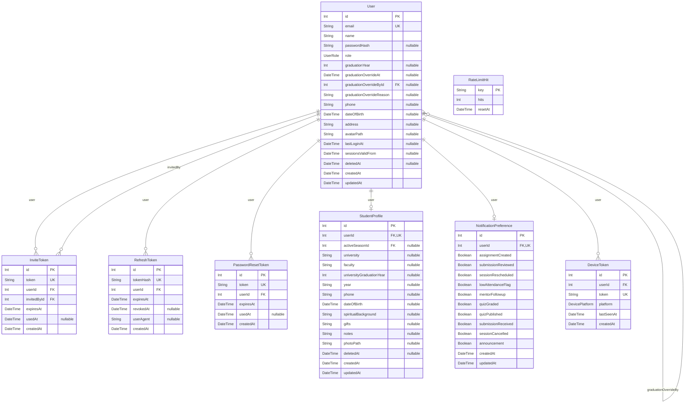
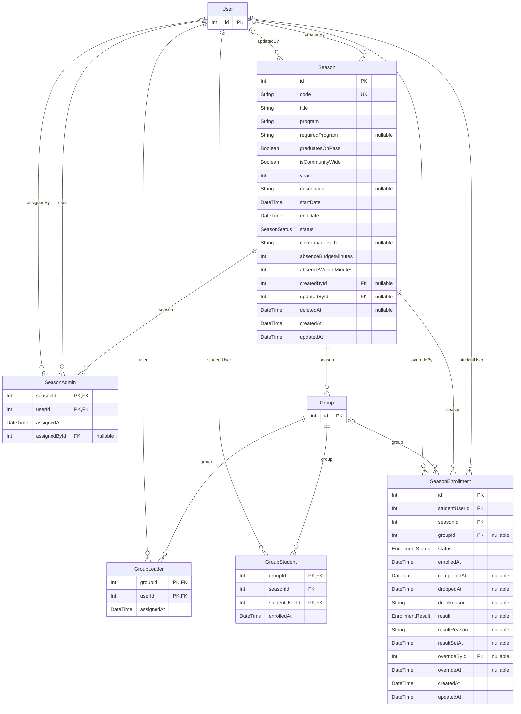
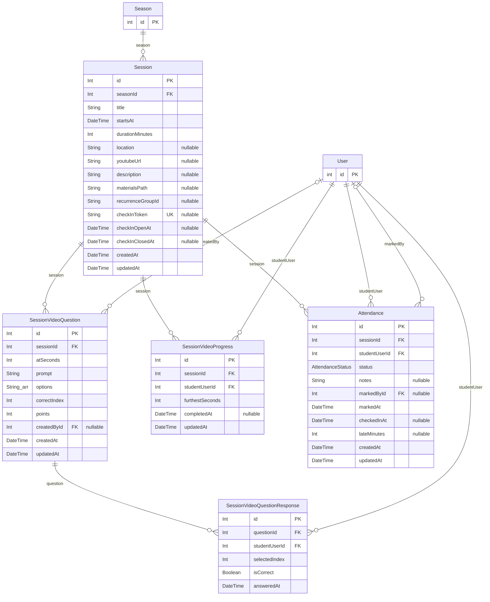
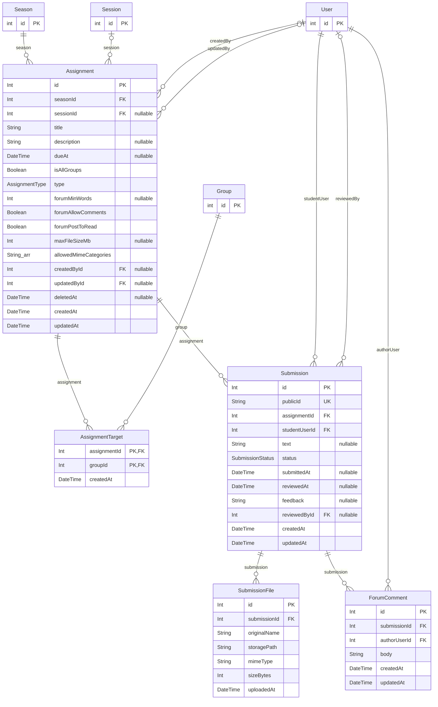
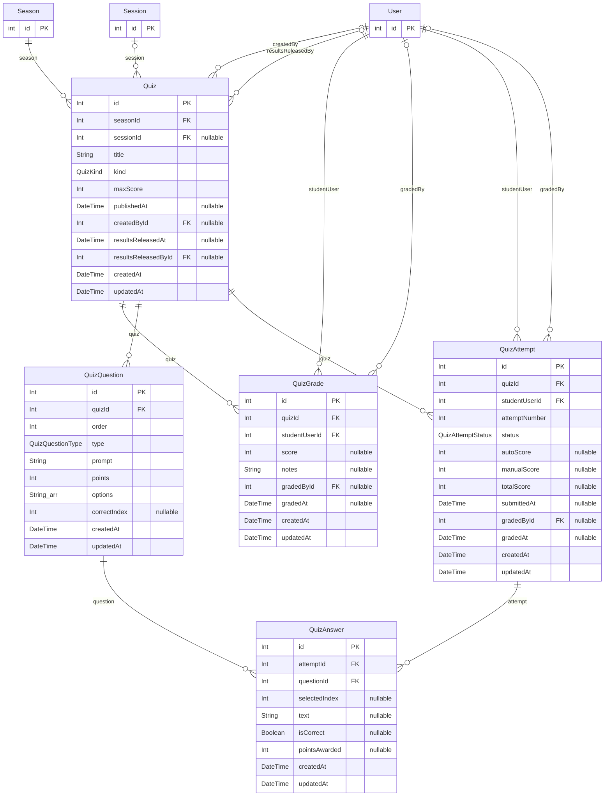
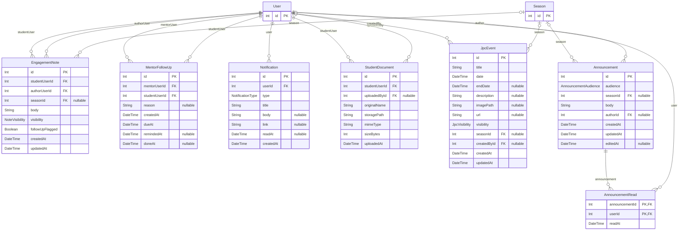

# space-v2 database schema audit (read-only)

Repo: `/home/mark/projects/JPC/space-v2-refactor` (branch as checked out on 2026-11-09).
Sources read: `CLAUDE.md`, `docs/superpowers/specs/domains/_DECISIONS.md`, v1's
`/home/mark/projects/JPC/jpc-space/DECISIONS.md` (read only; holds the Int-PK decision),
`apps/backend/prisma/schema.prisma` (36 models, 15 enums), all 35 migrations,
`apps/backend/src/__tests__/integration/__snapshots__/schema-snapshot.test.ts.snap`
(ground truth for the migrated DB: 333 columns, 72 FKs, 36 PKs, 1 CHECK, 108 indexes incl. PK indexes),
`apps/backend/src`, `apps/backend/scripts`, `apps/backend/vercel.json`.

**Nothing was connected to; no row counts were read.** Every size statement below is an estimate
from domain meaning. Usage counts come from helper scripts in the scratchpad
(`fields.py`, `entity.py`, `multi.py`, `fkidx.py`, `g.sh`) and are heuristic: they grep field names
as object keys (`field:`), property reads (`.field`) and quoted identifiers in raw SQL, scoped to
files that touch the model when the field name is shared between models. Everything flagged as
unused was then confirmed by eye. Tests (`__tests__`), generated client and OpenAPI docs are excluded
from the counts.

Waves used below: **3 = expand** (additive DDL, new indexes/constraints NOT VALID, backfills),
**4 = code switch** (code reads/writes the new shape, stops touching the old), **6 = contract**
(drop old columns/tables/indexes).

---

## 0. Summary of findings

| ID | Sev | Finding | Wave | Data migr. |
|---|---|---|---|---|
| DB-001 | Med | 7 dead `StudentProfile` columns (incl. PII: phone, DOB, spiritualBackground) + dead FK/index `activeSeasonId` | 4 (seed) / 6 | archive optional |
| DB-002 | Low | Never-read, never-written path columns `Season.coverImagePath`, `Session.materialsPath`, `JpcEvent.imagePath` | 6 | n |
| DB-003 | Med | `StudentDocument` table: zero references in v2 code (unneeded entity; may hold v1 PII) | 6 | archive y |
| DB-004 | Med | `User.email` unique is case-sensitive, every lookup is case-insensitive (no usable index; case duplicates possible) | 3 / 4 | y (dedupe check) |
| DB-005 | Low | `User.avatarPath` read and returned in 4 payloads, never written by v2 | owner | n |
| DB-006 | Low | Write-only / never-read columns (audit FKs, `RefreshToken.userAgent`, several `*At` defaults) | keep / 6 | n |
| DB-007 | Med | No retention: `RefreshToken` (1 row per refresh, never deleted), `Notification`, expired invite/reset tokens | 4 | n (purge job) |
| DB-008 | Med | 25 FK constraints without a leading-column index (24 + the composite GroupStudent FK, which the PK prefix covers in practice); 1 hot (`SeasonEnrollment.groupId`, 15 call sites) | 3 | n |
| DB-009 | Low | Prefix-redundant index `GroupStudent_groupId_idx` | 6 | n |
| DB-010 | Low | `StudentProfile.deletedAt` duplicates `User.deletedAt`, never read | 4 / 6 | n |
| DB-011 | Low | 1:1 splits `User`↔`StudentProfile` and `User`↔`NotificationPreference` assessed (keep; owner) | owner | — |
| DB-012 | Med | `GroupStudent` mirrors `SeasonEnrollment.groupId` (redundant stored data, drift risk) | 3 / 4 / 6 | n (parity check) |
| DB-013 | Low | `Assignment.isAllGroups` + `AssignmentTarget` kept for a targeting the product no longer offers | owner | maybe |
| DB-014 | Med | `UserRole` still admits `ADMIN`/`LEADER` in `User.role`; nothing in the DB enforces "stored role is SUPER/MENTOR/STUDENT" | 3 (after `roles:convert`) | y (convert) |
| DB-015 | Low | All timestamps are `timestamp without time zone` (except `RateLimitHit.resetAt`); `User.dateOfBirth` is a date stored as timestamp | owner | y if done |
| DB-016 | Low | Derived values stored (`Quiz.maxScore` for ONLINE, `QuizAttempt.totalScore`, `GroupStudent.seasonId`) | doc | n |
| DB-017 | Low | Free text where a reference/enum fits (`Season.program`/`requiredProgram`, `allowedMimeCategories`, `recurrenceGroupId` uuid-as-text) | 3 / owner | maybe |
| DB-018 | Low | Every string is unbounded `text`; Zod enforces limits only at the API | 3 (optional CHECKs) | n |
| DB-019 | Med | Uniqueness/invariants enforced only in code (group name per season, one IN_PROGRESS attempt, enrolment status/date coherence, correctIndex bounds) | 3 | y (dup check) |
| DB-020 | Low | `InviteToken.token` / `PasswordResetToken.token` hold SHA-256 hashes (RefreshToken calls it `tokenHash`) | naming wave | n |
| DB-021 | Low | Base-column compliance uneven (14 tables lack `updatedAt`, 8 lack `createdAt`) | owner | n |
| DB-022 | Low | Schema header comments contradict the schema | 4 | n |
| DB-023 | Info | Naming is PascalCase tables / camelCase columns, zero `@map`; snake_case rename blast radius quantified | owner | n |
| DB-024 | Med | Soft delete: 4 models, 153 hand-written `deletedAt` filters, 27 hard-delete sites, 99 relation reads into soft-deletable models | 4 | n |
| DB-025 | Info | Int → BIGINT ids: owner decision, blast radius quantified | owner | y if done |
| DB-026 | Med | `absentLatelyStudentIds` raw query windows over the whole `Attendance` table on every mentor Home | 4 | n |
| DB-027 | Info | Table size classes (estimates only) | — | — |
| DB-028 | Low | Partial unique `MentorFollowUp_one_open` exists only in SQL; `prisma migrate dev` would try to drop it | 3 | n |

---

## 1. ERD (current, generated from `schema.prisma`)

Cross-domain hubs (`User`, `Season`, `Session`, `Group`) appear as `id`-only stubs outside their home domain.
`StudentProfile.activeSeasonId → Season` (dead, DB-001) is omitted from the identity diagram because `Season`
is not in it. Cardinality: `||--o{` required parent, `|o--o{` nullable FK, `||--o|` 1:1 (FK is `@unique`).

### Identity & auth

### Seasons, groups & enrolment

### Sessions, attendance & video

### Assignments & submissions

### Quizzes

### Notes, follow-ups, notifications, announcements, events, misc

---

## 2. Per-entity column tables

Columns: Prisma declaration; DB type from the schema snapshot (`timestamp` = `timestamp without time zone`,
`NN` = NOT NULL); **Read** and **Written** = count of matching code sites and the first two examples
(heuristic classifier: a `field:` key whose nearest preceding keyword is `data`/`create`/`update`/`upsert`
counts as a write, `select`/`where`/`include`/`orderBy` or a `.field` property read counts as a read). Writes
that happen through a spread helper (e.g. `...assignmentColumns(body)`, `...seasonColumns(body)`) are
undercounted; every "0 written" below was checked by eye, and the Verdict column records the confirmed result.
`createdAt`/`updatedAt`/`id` are written by DB defaults / `@updatedAt` / the sequence.

#### User

| Column | Prisma | DB (snapshot) | Read (n, e.g.) | Written (n, e.g.) | Verdict |
|---|---|---|---|---|---|
| id | `Int @id @default(autoincrement())` | integer NN DEFAULT nextval('"User_id_seq"'::regclass) | 718: src/lib/invites.ts:64, src/lib/invites.ts:69 | 16: src/lib/invites.ts:190, src/lib/queries/students/writes.ts:250 |  |
| email | `String @unique` | text NN | 139: src/lib/invites.ts:36, src/lib/invites.ts:94 | 9: src/lib/queries/students/writes.ts:61, src/lib/auth/credentials.ts:33 |  |
| name | `String ` | text NN | 263: src/lib/follow-ups.ts:18, src/lib/follow-ups.ts:29 | 13: src/lib/queries/students/writes.ts:58, src/lib/auth/credentials.ts:34 | (name shared with other models; counts scoped to files touching this model) |
| passwordHash | `String? ` | text | 24: src/lib/invites.ts:156, src/lib/queries/students/detail.ts:206 | 2: src/routes/me.ts:176, src/routes/users/accounts.ts:296 |  |
| role | `UserRole ` | UserRole NN | 226: src/lib/follow-ups.ts:96, src/lib/announcement-notifications.ts:29 | 9: src/lib/queries/students/writes.ts:62, src/routes/dev.ts:82 |  |
| graduationYear | `Int? ` | integer | 72: src/lib/rbac.ts:14, src/lib/queries/season-start.ts:70 | 6: src/lib/queries/students/writes.ts:63, src/lib/queries/students/writes.ts:250 |  |
| graduationOverrideAt | `DateTime? ` | timestamp | 3: src/lib/queries/students/detail.ts:183, src/lib/queries/students/detail.ts:188 | 1: src/lib/queries/students/writes.ts:218 |  |
| graduationOverrideById | `Int? ` | integer | 0 | 1: src/lib/queries/students/writes.ts:219 | write-only FK; read via relation graduationOverrideBy (students/detail.ts:185) |
| graduationOverrideReason | `String? ` | text | 2: src/lib/queries/students/detail.ts:184, src/lib/queries/students/detail.ts:192 | 1: src/lib/queries/students/writes.ts:220 |  |
| phone | `String? ` | text | 12: src/lib/queries/me/profile.ts:17, src/lib/queries/me/profile.ts:33 | 3: src/lib/queries/students/writes.ts:64, src/routes/me.ts:130 | (name shared with other models; counts scoped to files touching this model) |
| dateOfBirth | `DateTime? ` | timestamp | 20: src/lib/queries/me/profile.ts:18, src/lib/queries/me/profile.ts:34 | 3: src/lib/queries/students/writes.ts:65, src/routes/me.ts:131 | (name shared with other models; counts scoped to files touching this model) |
| address | `String? ` | text | 3: src/routes/me.ts:51, src/routes/me.ts:58 | 1: src/routes/me.ts:132 |  |
| avatarPath | `String? ` | text | 10: src/lib/queries/me/profile.ts:11, src/lib/queries/me/profile.ts:31 | 0 | NEVER WRITTEN in v2 (no upload route); read+returned in 4 payloads -> always v1 data or null (DB-005) |
| lastLoginAt | `DateTime? ` | timestamp | 12: src/lib/invites.ts:156, src/lib/queries/students/detail.ts:206 | 3: src/lib/auth/credentials.ts:29, src/lib/auth/google.ts:67 |  |
| sessionsValidFrom | `DateTime? ` | timestamp | 5: src/lib/auth/session-validity.ts:6, src/lib/auth/session-validity.ts:32 | 1: src/lib/auth/session-validity.ts:70 |  |
| deletedAt | `DateTime? ` | timestamp | 163: src/lib/invites.ts:156, src/lib/follow-ups.ts:52 | 7: src/routes/users/accounts.ts:241, src/routes/users/accounts.ts:245 | (name shared with other models; counts scoped to files touching this model) |
| createdAt | `DateTime @default(now())` | timestamp NN DEFAULT CURRENT_TIMESTAMP | 46: src/lib/follow-ups.ts:11, src/lib/follow-ups.ts:20 | DB default / @updatedAt |  |
| updatedAt | `DateTime @updatedAt` | timestamp NN | 5: src/lib/queries/notes.ts:23, src/lib/queries/notes.ts:36 | DB default / @updatedAt |  |

#### InviteToken

| Column | Prisma | DB (snapshot) | Read (n, e.g.) | Written (n, e.g.) | Verdict |
|---|---|---|---|---|---|
| id | `Int @id @default(autoincrement())` | integer NN DEFAULT nextval('"InviteToken_id_seq"'::regclass) | 72: src/lib/invites.ts:64, src/lib/invites.ts:69 | 4: src/lib/invites.ts:190, src/lib/auth/password-reset.ts:116 |  |
| token | `String @unique` | text NN | 9: src/lib/invites.ts:77, src/lib/invites.ts:151 | 3: src/lib/invites.ts:68, src/lib/auth/password-reset.ts:50 | (name shared with other models; counts scoped to files touching this model) |
| userId | `Int ` | integer NN | 31: src/lib/invites.ts:42, src/lib/invites.ts:61 | 6: scripts/seed-sweep/more-roles.ts:38, scripts/seed-sweep/more-roles.ts:59 | (name shared with other models; counts scoped to files touching this model) |
| invitedById | `Int ` | integer NN | 5: src/lib/invites.ts:43, src/lib/invites.ts:62 | 1: scripts/seed-sweep/more-roles.ts:39 |  |
| expiresAt | `DateTime ` | timestamp NN | 20: src/lib/invites.ts:19, src/lib/invites.ts:47 | 6: src/lib/invites.ts:48, src/lib/invites.ts:78 | (name shared with other models; counts scoped to files touching this model) |
| usedAt | `DateTime? ` | timestamp | 17: src/lib/invites.ts:47, src/lib/invites.ts:77 | 2: src/lib/auth/password-reset.ts:113, src/routes/auth.ts:185 | (name shared with other models; counts scoped to files touching this model) |
| createdAt | `DateTime @default(now())` | timestamp NN DEFAULT CURRENT_TIMESTAMP | 5: src/lib/queries/students/detail.ts:211, src/lib/auth/password-reset.ts:68 | DB default / @updatedAt |  |

#### RefreshToken

| Column | Prisma | DB (snapshot) | Read (n, e.g.) | Written (n, e.g.) | Verdict |
|---|---|---|---|---|---|
| id | `Int @id @default(autoincrement())` | integer NN DEFAULT nextval('"RefreshToken_id_seq"'::regclass) | 4: src/lib/auth/tokens.ts:100, src/lib/auth/tokens.ts:101 | serial |  |
| tokenHash | `String @unique` | text NN | 3: src/lib/auth/tokens.ts:122, src/lib/auth/tokens.ts:139 | 1: src/lib/auth/tokens.ts:90 |  |
| userId | `Int ` | integer NN | 6: src/lib/auth/tokens.ts:15, src/lib/auth/tokens.ts:44 | 2: src/lib/auth/tokens.ts:84, src/lib/auth/tokens.ts:96 | (name shared with other models; counts scoped to files touching this model) |
| expiresAt | `DateTime ` | timestamp NN | 1: src/lib/auth/tokens.ts:123 | 1: src/lib/auth/tokens.ts:86 | (name shared with other models; counts scoped to files touching this model) |
| revokedAt | `DateTime? ` | timestamp | 4: src/lib/auth/tokens.ts:123, src/lib/auth/tokens.ts:128 | 3: src/lib/auth/tokens.ts:129, src/lib/auth/tokens.ts:140 |  |
| userAgent | `String? ` | text | 0 | 1: src/lib/auth/tokens.ts:90 | WRITE-ONLY (tokens.ts:90); never read (DB-006) |
| createdAt | `DateTime @default(now())` | timestamp NN DEFAULT CURRENT_TIMESTAMP | 0 | DB default / @updatedAt |  |

#### PasswordResetToken

| Column | Prisma | DB (snapshot) | Read (n, e.g.) | Written (n, e.g.) | Verdict |
|---|---|---|---|---|---|
| id | `Int @id @default(autoincrement())` | integer NN DEFAULT nextval('"PasswordResetToken_id_seq"'::regclass) | 7: src/lib/auth/password-reset.ts:64, src/lib/auth/password-reset.ts:68 | 1: src/lib/auth/password-reset.ts:116 |  |
| token | `String @unique` | text NN | 1: src/lib/auth/password-reset.ts:99 | 1: src/lib/auth/password-reset.ts:50 | (name shared with other models; counts scoped to files touching this model) |
| userId | `Int ` | integer NN | 9: src/lib/auth/password-reset.ts:23, src/lib/auth/password-reset.ts:44 | 0 | (name shared with other models; counts scoped to files touching this model) |
| expiresAt | `DateTime ` | timestamp NN | 6: src/lib/auth/password-reset.ts:27, src/lib/auth/password-reset.ts:45 | 2: src/lib/auth/password-reset.ts:28, src/lib/auth/password-reset.ts:120 | (name shared with other models; counts scoped to files touching this model) |
| usedAt | `DateTime? ` | timestamp | 5: src/lib/auth/password-reset.ts:27, src/lib/auth/password-reset.ts:100 | 1: src/lib/auth/password-reset.ts:113 | (name shared with other models; counts scoped to files touching this model) |
| createdAt | `DateTime @default(now())` | timestamp NN DEFAULT CURRENT_TIMESTAMP | 1: src/lib/auth/password-reset.ts:68 | DB default / @updatedAt |  |

#### StudentProfile

| Column | Prisma | DB (snapshot) | Read (n, e.g.) | Written (n, e.g.) | Verdict |
|---|---|---|---|---|---|
| id | `Int @id @default(autoincrement())` | integer NN DEFAULT nextval('"StudentProfile_id_seq"'::regclass) | 147: src/lib/queries/me/profile.ts:27, src/lib/queries/students/detail.ts:36 | 3: src/lib/queries/students/writes.ts:250, src/routes/me.ts:176 |  |
| userId | `Int @unique` | integer NN | 44: src/lib/queries/me/profile.ts:25, src/lib/queries/students/detail.ts:65 | 22: src/lib/queries/students/writes.ts:87, src/routes/me.ts:211 | (name shared with other models; counts scoped to files touching this model) |
| activeSeasonId | `Int? ` | integer | 23: src/lib/queries/dashboard.ts:69, src/lib/queries/events.ts:18 | 0 | UNUSED: never read/written (all hits are comments/token claim) - retired by owner (DB-001) |
| university | `String? ` | text | 18: src/lib/queries/me/profile.ts:14, src/lib/queries/me/profile.ts:37 | 6: src/lib/queries/students/writes.ts:88, src/routes/students/profile.ts:216 |  |
| faculty | `String? ` | text | 15: src/lib/queries/me/profile.ts:15, src/lib/queries/me/profile.ts:38 | 2: src/lib/queries/students/writes.ts:89, src/routes/students/profile.ts:217 |  |
| universityGraduationYear | `Int? ` | integer | 17: src/lib/queries/me/profile.ts:16, src/lib/queries/me/profile.ts:39 | 2: src/lib/queries/students/writes.ts:90, src/routes/students/profile.ts:218 |  |
| year | `String? ` | text | 4: src/lib/queries/students/writes.ts:271, src/lib/queries/students/writes.ts:273 | 3: scripts/seed-sweep/community.ts:134, scripts/seed-sweep/people.ts:35 | written only by seed-sweep (people.ts:70); never read by app (DB-001) |
| phone | `String? ` | text | 11: src/lib/queries/me/profile.ts:17, src/lib/queries/me/profile.ts:33 | 3: src/lib/queries/students/writes.ts:64, src/routes/me.ts:130 | UNUSED since 2026-11-06 (moved to User) (DB-001) |
| dateOfBirth | `DateTime? ` | timestamp | 14: src/lib/queries/me/profile.ts:18, src/lib/queries/me/profile.ts:34 | 3: src/lib/queries/students/writes.ts:65, src/routes/me.ts:131 | UNUSED since 2026-11-06 (moved to User) (DB-001) |
| spiritualBackground | `String? ` | text | 0 | 0 | UNUSED (DB-001) |
| gifts | `String? ` | text | 0 | 0 | UNUSED (DB-001) |
| notes | `String? ` | text | 7: src/lib/queries/students/detail.ts:66, src/lib/queries/students/detail.ts:68 | 2: src/lib/queries/students/writes.ts:91, src/routes/students/profile.ts:219 | (name shared with other models; counts scoped to files touching this model) |
| photoPath | `String? ` | text | 0 | 0 | UNUSED (DB-001) |
| deletedAt | `DateTime? ` | timestamp | 26: src/lib/queries/me/profile.ts:27, src/lib/queries/students/detail.ts:36 | 6: src/routes/users/accounts.ts:241, src/routes/users/accounts.ts:245 | written in step with User.deletedAt (me.ts:211, lifecycle.ts:109, accounts.ts:247); never filtered on (DB-010) |
| createdAt | `DateTime @default(now())` | timestamp NN DEFAULT CURRENT_TIMESTAMP | 1: src/lib/queries/students/detail.ts:211 | DB default / @updatedAt |  |
| updatedAt | `DateTime @updatedAt` | timestamp NN | 0 | DB default / @updatedAt |  |

#### Season

| Column | Prisma | DB (snapshot) | Read (n, e.g.) | Written (n, e.g.) | Verdict |
|---|---|---|---|---|---|
| id | `Int @id @default(autoincrement())` | integer NN DEFAULT nextval('"Season_id_seq"'::regclass) | 610: src/lib/assignment-writes.ts:34, src/lib/assignment-writes.ts:35 | 3: src/lib/queries/students/writes.ts:250, src/lib/roles/student-seats.ts:227 |  |
| code | `String @unique` | text NN | 158: src/lib/email-templates.ts:155, src/lib/email-templates.ts:168 | 6: src/lib/api-response.ts:7, src/routes/seasons/crud.ts:238 |  |
| title | `String ` | text NN | 189: src/lib/assignment-writes.ts:57, src/lib/assignment-writes.ts:104 | 14: src/routes/events.ts:196, src/routes/events.ts:256 | (name shared with other models; counts scoped to files touching this model) |
| program | `String ` | text NN | 22: src/lib/queries/seasons.ts:11, src/lib/queries/seasons.ts:41 | 5: src/routes/seasons/duplicate.ts:72, scripts/seed-sweep/community.ts:110 |  |
| requiredProgram | `String? ` | text | 20: src/lib/queries/season-start.ts:105, src/lib/queries/seasons.ts:42 | 1: src/routes/seasons/duplicate.ts:73 |  |
| graduatesOnPass | `Boolean @default(false)` | boolean NN DEFAULT false | 15: src/lib/queries/seasons.ts:43, src/lib/queries/seasons.ts:85 | 1: src/routes/seasons/duplicate.ts:74 |  |
| isCommunityWide | `Boolean @default(false)` | boolean NN DEFAULT false | 35: src/lib/queries/season-start.ts:28, src/lib/queries/season-start.ts:41 | 2: src/routes/seasons/duplicate.ts:75, scripts/seed-sweep/community.ts:136 |  |
| year | `Int ` | integer NN | 23: src/lib/queries/seasons.ts:16, src/lib/queries/seasons.ts:45 | 4: src/routes/seasons/duplicate.ts:76, scripts/seed-sweep/community.ts:134 | (name shared with other models; counts scoped to files touching this model) |
| description | `String? ` | text | 34: src/lib/assignment-writes.ts:58, src/lib/queries/seasons.ts:17 | 10: src/routes/events.ts:197, src/routes/events.ts:257 | (name shared with other models; counts scoped to files touching this model) |
| startDate | `DateTime ` | timestamp NN | 22: src/lib/queries/seasons.ts:19, src/lib/queries/seasons.ts:48 | 4: scripts/seed-sweep/community.ts:113, scripts/seed-sweep/community.ts:137 |  |
| endDate | `DateTime ` | timestamp NN | 36: src/lib/queries/seasons.ts:20, src/lib/queries/seasons.ts:49 | 5: src/routes/events.ts:262, scripts/seed-sweep/community.ts:114 | (name shared with other models; counts scoped to files touching this model) |
| status | `SeasonStatus @default(DRAFT)` | SeasonStatus NN DEFAULT 'DRAFT'::"SeasonStatus" | 261: src/lib/assignment-writes.ts:88, src/lib/assignment-writes.ts:89 | 21: src/lib/queries/students/writes.ts:136, src/lib/queries/students/writes.ts:229 | (name shared with other models; counts scoped to files touching this model) |
| coverImagePath | `String? ` | text | 0 | 0 | UNUSED (DB-002) |
| absenceBudgetMinutes | `Int @default(180)` | integer NN DEFAULT 180 | 14: src/lib/attendance-budget.ts:31, src/lib/attendance-budget.ts:39 | 0 |  |
| absenceWeightMinutes | `Int @default(90)` | integer NN DEFAULT 90 | 14: src/lib/attendance-budget.ts:30, src/lib/attendance-budget.ts:35 | 0 |  |
| createdById | `Int? ` | integer | 5: src/routes/events.ts:206, src/routes/seasons/duplicate.ts:83 | 7: src/routes/quizzes/authoring.ts:63, src/routes/seasons/crud.ts:151 | write-only audit (crud.ts:151) |
| updatedById | `Int? ` | integer | 2: src/routes/seasons/duplicate.ts:84, src/routes/seasons/duplicate.ts:165 | 7: src/routes/seasons/start.ts:70, src/routes/seasons/crud.ts:151 | write-only audit (crud.ts:233) |
| deletedAt | `DateTime? ` | timestamp | 139: src/lib/announcement-notifications.ts:21, src/lib/announcement-notifications.ts:28 | 1: src/routes/seasons/crud.ts:291 | (name shared with other models; counts scoped to files touching this model) |
| createdAt | `DateTime @default(now())` | timestamp NN DEFAULT CURRENT_TIMESTAMP | 27: src/lib/queries/announcements.ts:11, src/lib/queries/announcements.ts:97 | DB default / @updatedAt |  |
| updatedAt | `DateTime @updatedAt` | timestamp NN | 5: src/lib/queries/notes.ts:23, src/lib/queries/notes.ts:36 | DB default / @updatedAt |  |

#### SeasonAdmin

| Column | Prisma | DB (snapshot) | Read (n, e.g.) | Written (n, e.g.) | Verdict |
|---|---|---|---|---|---|
| seasonId | `Int ` | integer NN | 58: src/lib/announcement-notifications.ts:26, src/lib/announcement-notifications.ts:27 | 12: scripts/seed-sweep/community.ts:50, scripts/seed-sweep/community.ts:62 | (name shared with other models; counts scoped to files touching this model) |
| userId | `Int ` | integer NN | 81: src/lib/attendance-notifications.ts:49, src/lib/attendance-notifications.ts:53 | 6: scripts/seed-sweep/community.ts:39, scripts/seed-sweep/community.ts:118 | (name shared with other models; counts scoped to files touching this model) |
| assignedAt | `DateTime @default(now())` | timestamp NN DEFAULT CURRENT_TIMESTAMP | 2: src/routes/seasons/admins.ts:35, src/routes/seasons/admins.ts:46 | 0 | (name shared with other models; counts scoped to files touching this model) |
| assignedById | `Int? ` | integer | 0 | 3: src/routes/seasons/admins.ts:85, scripts/seed-sweep/community.ts:118 | write-only; read via relation assignedBy (seasons/admins.ts:37) |

#### Group

| Column | Prisma | DB (snapshot) | Read (n, e.g.) | Written (n, e.g.) | Verdict |
|---|---|---|---|---|---|
| id | `Int @id @default(autoincrement())` | integer NN DEFAULT nextval('"Group_id_seq"'::regclass) | 434: src/lib/assignment-writes.ts:34, src/lib/assignment-writes.ts:35 | 2: src/routes/seasons/children.ts:166, scripts/seed-sweep/more-roles.ts:44 |  |
| seasonId | `Int ` | integer NN | 226: src/lib/assignment-writes.ts:29, src/lib/assignment-writes.ts:81 | 18: src/routes/seasons/duplicate.ts:151, scripts/seed-sweep/more-roles.ts:50 | (name shared with other models; counts scoped to files touching this model) |
| name | `String ` | text NN | 187: src/lib/attendance-notifications.ts:61, src/lib/attendance-notifications.ts:63 | 7: src/routes/groups.ts:80, src/routes/seasons/children.ts:80 | (name shared with other models; counts scoped to files touching this model) |
| description | `String? ` | text | 24: src/lib/assignment-writes.ts:58, src/lib/queries/seasons.ts:17 | 9: src/routes/groups.ts:80, src/routes/seasons/duplicate.ts:77 | (name shared with other models; counts scoped to files touching this model) |
| createdAt | `DateTime @default(now())` | timestamp NN DEFAULT CURRENT_TIMESTAMP | 19: src/lib/queries/announcements.ts:11, src/lib/queries/announcements.ts:97 | DB default / @updatedAt |  |
| updatedAt | `DateTime @updatedAt` | timestamp NN | 5: src/lib/queries/notes.ts:23, src/lib/queries/notes.ts:36 | DB default / @updatedAt |  |

#### GroupLeader

| Column | Prisma | DB (snapshot) | Read (n, e.g.) | Written (n, e.g.) | Verdict |
|---|---|---|---|---|---|
| groupId | `Int ` | integer NN | 31: src/lib/queries/groups/read.ts:63, src/lib/queries/groups/read.ts:66 | 8: src/lib/queries/groups/membership.ts:163, src/lib/queries/groups/membership.ts:277 | (name shared with other models; counts scoped to files touching this model) |
| userId | `Int ` | integer NN | 92: src/lib/session-notifications.ts:58, src/lib/session-notifications.ts:62 | 10: scripts/seed-sweep/more-roles.ts:38, scripts/seed-sweep/more-roles.ts:59 | (name shared with other models; counts scoped to files touching this model) |
| assignedAt | `DateTime @default(now())` | timestamp NN DEFAULT CURRENT_TIMESTAMP | 0 | 0 | default-only; never read (DB-006) |

#### GroupStudent

| Column | Prisma | DB (snapshot) | Read (n, e.g.) | Written (n, e.g.) | Verdict |
|---|---|---|---|---|---|
| groupId | `Int ` | integer NN | 32: src/lib/queries/groups/membership.ts:68, src/lib/queries/groups/membership.ts:89 | 8: src/lib/queries/groups/membership.ts:163, src/lib/queries/groups/membership.ts:277 | (name shared with other models; counts scoped to files touching this model) |
| seasonId | `Int ` | integer NN | 62: src/lib/queries/seasons.ts:64, src/lib/queries/season-end.ts:13 | 12: scripts/seed-sweep/community.ts:50, scripts/seed-sweep/community.ts:62 | (name shared with other models; counts scoped to files touching this model) |
| studentUserId | `Int ` | integer NN | 57: src/lib/queries/seasons.ts:55, src/lib/queries/season-end.ts:28 | 10: src/lib/queries/students/writes.ts:134, scripts/seed-sweep/community.ts:49 | (name shared with other models; counts scoped to files touching this model) |
| enrolledAt | `DateTime @default(now())` | timestamp NN DEFAULT CURRENT_TIMESTAMP | 7: src/lib/queries/season-end.ts:29, src/lib/queries/season-end.ts:87 | 4: scripts/seed-sweep/community.ts:52, scripts/seed-sweep/community.ts:124 | default-only; never read (DB-006) |

#### SeasonEnrollment

| Column | Prisma | DB (snapshot) | Read (n, e.g.) | Written (n, e.g.) | Verdict |
|---|---|---|---|---|---|
| id | `Int @id @default(autoincrement())` | integer NN DEFAULT nextval('"SeasonEnrollment_id_seq"'::regclass) | 571: src/lib/quiz-scope.ts:56, src/lib/quiz-scope.ts:60 | 3: src/lib/queries/students/writes.ts:250, src/lib/roles/student-seats.ts:227 |  |
| studentUserId | `Int ` | integer NN | 286: src/lib/quiz-scope.ts:39, src/lib/quiz-scope.ts:42 | 23: src/lib/queries/students/writes.ts:134, src/routes/quizzes/paper-grades.ts:172 | (name shared with other models; counts scoped to files touching this model) |
| seasonId | `Int ` | integer NN | 333: src/lib/quiz-scope.ts:28, src/lib/assignment-writes.ts:29 | 21: src/routes/sessions/schedule.ts:48, scripts/seed-sweep/more-roles.ts:50 | (name shared with other models; counts scoped to files touching this model) |
| groupId | `Int? ` | integer | 103: src/lib/quiz-scope.ts:37, src/lib/assignment-writes.ts:90 | 10: src/lib/queries/groups/membership.ts:163, src/lib/queries/groups/membership.ts:277 | (name shared with other models; counts scoped to files touching this model) |
| status | `EnrollmentStatus @default(ACTIVE)` | EnrollmentStatus NN DEFAULT 'ACTIVE'::"EnrollmentStatus" | 251: src/lib/quiz-scope.ts:69, src/lib/assignment-writes.ts:88 | 28: src/lib/queries/students/writes.ts:136, src/lib/queries/students/writes.ts:229 | (name shared with other models; counts scoped to files touching this model) |
| enrolledAt | `DateTime @default(now())` | timestamp NN DEFAULT CURRENT_TIMESTAMP | 23: src/lib/queries/engagement.ts:69, src/lib/queries/engagement.ts:155 | 5: scripts/seed-sweep/scenarios.ts:157, scripts/seed-sweep/community.ts:52 | (name shared with other models; counts scoped to files touching this model) |
| completedAt | `DateTime? ` | timestamp | 13: src/lib/queries/video-quiz.ts:22, src/lib/queries/video-quiz.ts:67 | 6: src/lib/queries/students/writes.ts:229, src/lib/queries/students/writes.ts:254 | (name shared with other models; counts scoped to files touching this model) |
| droppedAt | `DateTime? ` | timestamp | 9: src/lib/queries/reports/summary.ts:110, src/lib/queries/reports/summary.ts:150 | 3: src/lib/roles/student-seats.ts:221, src/routes/students/enrollments.ts:140 |  |
| dropReason | `String? ` | text | 4: src/lib/queries/students/detail.ts:88, src/lib/queries/students/detail.ts:126 | 2: src/routes/students/enrollments.ts:140, scripts/seed-sweep/scenarios.ts:159 |  |
| result | `EnrollmentResult? ` | EnrollmentResult | 15: src/lib/queries/season-results.ts:13, src/lib/queries/season-results.ts:33 | 5: src/routes/seasons/end.ts:111, src/routes/seasons/end.ts:117 |  |
| resultReason | `String? ` | text | 2: src/lib/queries/season-results.ts:14, src/lib/queries/season-results.ts:34 | 3: src/routes/seasons/end.ts:111, src/routes/seasons/end.ts:117 |  |
| resultSetAt | `DateTime? ` | timestamp | 1: src/routes/seasons/end.ts:108 | 4: src/routes/seasons/results.ts:64, scripts/community-preflight.ts:206 | write-only (end.ts:108, results.ts:64) |
| overrideById | `Int? ` | integer | 1: src/routes/seasons/enrollments.ts:159 | 3: src/lib/queries/students/writes.ts:137, src/lib/roles/student-seats.ts:222 |  |
| overrideAt | `DateTime? ` | timestamp | 3: src/lib/queries/season-start.ts:54, src/lib/queries/season-start.ts:59 | 3: src/lib/queries/students/writes.ts:138, src/lib/roles/student-seats.ts:223 |  |
| createdAt | `DateTime @default(now())` | timestamp NN DEFAULT CURRENT_TIMESTAMP | 18: src/lib/queries/forum.ts:59, src/lib/queries/forum.ts:202 | DB default / @updatedAt |  |
| updatedAt | `DateTime @updatedAt` | timestamp NN | 0 | DB default / @updatedAt |  |

#### Session

| Column | Prisma | DB (snapshot) | Read (n, e.g.) | Written (n, e.g.) | Verdict |
|---|---|---|---|---|---|
| id | `Int @id @default(autoincrement())` | integer NN DEFAULT nextval('"Session_id_seq"'::regclass) | 400: src/lib/assignment-writes.ts:34, src/lib/assignment-writes.ts:35 | 2: src/lib/queries/students/writes.ts:250, scripts/seed-sweep/more-roles.ts:44 |  |
| seasonId | `Int ` | integer NN | 183: src/lib/assignment-writes.ts:29, src/lib/assignment-writes.ts:81 | 22: src/routes/quizzes/authoring.ts:56, src/routes/seasons/duplicate.ts:151 | (name shared with other models; counts scoped to files touching this model) |
| title | `String ` | text NN | 135: src/lib/assignment-writes.ts:57, src/lib/assignment-writes.ts:104 | 22: src/routes/quizzes/authoring.ts:58, src/routes/quizzes/authoring.ts:116 | (name shared with other models; counts scoped to files touching this model) |
| startsAt | `DateTime ` | timestamp NN | 113: src/lib/check-in.ts:45, src/lib/check-in.ts:51 | 6: src/routes/sessions/schedule.ts:120, scripts/seed-sweep/more-roles.ts:140 |  |
| durationMinutes | `Int @default(90)` | integer NN DEFAULT 90 | 15: src/lib/dashboard-figures.ts:14, src/lib/queries/dashboard.ts:46 | 1: src/routes/sessions/schedule.ts:51 |  |
| location | `String? ` | text | 13: src/lib/queries/dashboard.ts:47, src/lib/queries/sessions.ts:17 | 5: src/routes/sessions/schedule.ts:52, scripts/seed-sweep/more-roles.ts:140 |  |
| youtubeUrl | `String? ` | text | 13: src/lib/queries/dashboard.ts:48, src/lib/queries/sessions.ts:179 | 1: src/routes/sessions/schedule.ts:53 |  |
| description | `String? ` | text | 22: src/lib/assignment-writes.ts:58, src/lib/queries/seasons.ts:17 | 9: src/routes/seasons/duplicate.ts:77, src/routes/seasons/duplicate.ts:155 | (name shared with other models; counts scoped to files touching this model) |
| materialsPath | `String? ` | text | 0 | 0 | UNUSED (DB-002) |
| recurrenceGroupId | `String? ` | text | 11: src/lib/queries/sessions.ts:18, src/lib/queries/sessions.ts:34 | 0 |  |
| checkInToken | `String? @unique` | text | 8: src/lib/queries/sessions.ts:23, src/lib/queries/sessions.ts:35 | 0 |  |
| checkInOpenAt | `DateTime? ` | timestamp | 13: src/lib/check-in.ts:19, src/lib/check-in.ts:28 | 1: src/routes/sessions/check-in.ts:112 |  |
| checkInClosedAt | `DateTime? ` | timestamp | 9: src/lib/check-in.ts:20, src/lib/check-in.ts:29 | 2: src/routes/sessions/check-in.ts:112, src/routes/sessions/check-in.ts:132 |  |
| createdAt | `DateTime @default(now())` | timestamp NN DEFAULT CURRENT_TIMESTAMP | 6: src/lib/queries/reports/summary.ts:176, src/lib/queries/me/season-record.ts:44 | DB default / @updatedAt |  |
| updatedAt | `DateTime @updatedAt` | timestamp NN | 0 | DB default / @updatedAt |  |

#### SessionVideoQuestion

| Column | Prisma | DB (snapshot) | Read (n, e.g.) | Written (n, e.g.) | Verdict |
|---|---|---|---|---|---|
| id | `Int @id @default(autoincrement())` | integer NN DEFAULT nextval('"SessionVideoQuestion_id_seq"'::regclass) | 41: src/lib/queries/video-quiz.ts:6, src/lib/queries/video-quiz.ts:47 | serial |  |
| sessionId | `Int ` | integer NN | 7: src/lib/queries/video-quiz.ts:43, src/lib/queries/video-quiz.ts:142 | 0 | (name shared with other models; counts scoped to files touching this model) |
| atSeconds | `Int ` | integer NN | 10: src/lib/queries/video-quiz.ts:7, src/lib/queries/video-quiz.ts:58 | 2: src/routes/video-quiz/staff.ts:84, src/routes/video-quiz/staff.ts:125 |  |
| prompt | `String ` | text NN | 6: src/lib/queries/video-quiz.ts:8, src/lib/queries/video-quiz.ts:59 | 2: src/routes/video-quiz/staff.ts:85, src/routes/video-quiz/staff.ts:126 | (name shared with other models; counts scoped to files touching this model) |
| options | `String[] ` | ARRAY | 12: src/lib/queries/video-quiz.ts:9, src/lib/queries/video-quiz.ts:59 | 2: src/routes/video-quiz/staff.ts:86, src/routes/video-quiz/staff.ts:127 | (name shared with other models; counts scoped to files touching this model) |
| correctIndex | `Int ` | integer NN | 11: src/routes/video-quiz/staff.ts:18, src/routes/video-quiz/staff.ts:28 | 2: src/routes/video-quiz/staff.ts:87, src/routes/video-quiz/staff.ts:128 | (name shared with other models; counts scoped to files touching this model) |
| points | `Int @default(1)` | integer NN DEFAULT 1 | 13: src/lib/queries/video-quiz.ts:10, src/lib/queries/video-quiz.ts:59 | 2: src/routes/video-quiz/staff.ts:88, src/routes/video-quiz/staff.ts:129 | (name shared with other models; counts scoped to files touching this model) |
| createdById | `Int? ` | integer | 0 | 1: src/routes/video-quiz/staff.ts:89 | write-only audit (video-quiz/staff.ts:89) |
| createdAt | `DateTime @default(now())` | timestamp NN DEFAULT CURRENT_TIMESTAMP | 0 | DB default / @updatedAt |  |
| updatedAt | `DateTime @updatedAt` | timestamp NN | 0 | DB default / @updatedAt |  |

#### SessionVideoQuestionResponse

| Column | Prisma | DB (snapshot) | Read (n, e.g.) | Written (n, e.g.) | Verdict |
|---|---|---|---|---|---|
| id | `Int @id @default(autoincrement())` | integer NN DEFAULT nextval('"SessionVideoQuestionResponse_id_seq"'::regclass) | 40: src/lib/queries/video-quiz.ts:6, src/lib/queries/video-quiz.ts:47 | serial |  |
| questionId | `Int ` | integer NN | 9: src/lib/queries/video-quiz.ts:63, src/lib/queries/video-quiz.ts:71 | 1: src/routes/video-quiz/student.ts:128 | (name shared with other models; counts scoped to files touching this model) |
| studentUserId | `Int ` | integer NN | 20: src/lib/queries/video-quiz.ts:44, src/lib/queries/video-quiz.ts:111 | 3: src/routes/video-quiz/student.ts:129, src/routes/video-quiz/student.ts:148 | (name shared with other models; counts scoped to files touching this model) |
| selectedIndex | `Int ` | integer NN | 7: src/lib/queries/video-quiz.ts:12, src/lib/queries/video-quiz.ts:63 | 1: src/routes/video-quiz/student.ts:130 | (name shared with other models; counts scoped to files touching this model) |
| isCorrect | `Boolean ` | boolean NN | 12: src/lib/queries/video-quiz.ts:13, src/lib/queries/video-quiz.ts:63 | 1: src/routes/video-quiz/staff.ts:147 | (name shared with other models; counts scoped to files touching this model) |
| answeredAt | `DateTime @default(now())` | timestamp NN DEFAULT CURRENT_TIMESTAMP | 0 | 0 | default-only; never read (DB-006) |

#### SessionVideoProgress

| Column | Prisma | DB (snapshot) | Read (n, e.g.) | Written (n, e.g.) | Verdict |
|---|---|---|---|---|---|
| id | `Int @id @default(autoincrement())` | integer NN DEFAULT nextval('"SessionVideoProgress_id_seq"'::regclass) | 36: src/lib/queries/video-quiz.ts:6, src/lib/queries/video-quiz.ts:47 | serial |  |
| sessionId | `Int ` | integer NN | 5: src/lib/queries/video-quiz.ts:43, src/lib/queries/video-quiz.ts:142 | 0 | (name shared with other models; counts scoped to files touching this model) |
| studentUserId | `Int ` | integer NN | 22: src/lib/queries/video-quiz.ts:44, src/lib/queries/video-quiz.ts:111 | 3: src/routes/video-quiz/student.ts:129, src/routes/video-quiz/student.ts:148 | (name shared with other models; counts scoped to files touching this model) |
| furthestSeconds | `Int @default(0)` | integer NN DEFAULT 0 | 14: src/lib/queries/video-quiz.ts:21, src/lib/queries/video-quiz.ts:67 | 0 |  |
| completedAt | `DateTime? ` | timestamp | 17: src/lib/queries/video-quiz.ts:22, src/lib/queries/video-quiz.ts:67 | 0 | read/written in lib/queries/video-quiz.ts |
| updatedAt | `DateTime @updatedAt` | timestamp NN | 0 | DB default / @updatedAt |  |

#### Attendance

| Column | Prisma | DB (snapshot) | Read (n, e.g.) | Written (n, e.g.) | Verdict |
|---|---|---|---|---|---|
| id | `Int @id @default(autoincrement())` | integer NN DEFAULT nextval('"Attendance_id_seq"'::regclass) | 227: src/lib/attendance-notifications.ts:19, src/lib/attendance-notifications.ts:20 | 2: src/lib/queries/students/writes.ts:250, scripts/seed-sweep/more-roles.ts:44 |  |
| sessionId | `Int ` | integer NN | 33: src/lib/attendance-notifications.ts:10, src/lib/queries/engagement.ts:100 | 10: src/routes/sessions/check-in.ts:74, scripts/seed-sweep/more-roles.ts:147 | (name shared with other models; counts scoped to files touching this model) |
| studentUserId | `Int ` | integer NN | 118: src/lib/attendance-notifications.ts:11, src/lib/attendance-notifications.ts:15 | 18: src/lib/queries/students/writes.ts:134, src/routes/sessions/check-in.ts:75 | (name shared with other models; counts scoped to files touching this model) |
| status | `AttendanceStatus ` | AttendanceStatus NN | 91: src/lib/attendance-notifications.ts:11, src/lib/attendance-notifications.ts:14 | 18: src/lib/queries/students/writes.ts:136, src/lib/queries/students/writes.ts:229 | (name shared with other models; counts scoped to files touching this model) |
| notes | `String? ` | text | 5: src/lib/queries/sessions.ts:108, src/lib/queries/sessions.ts:142 | 3: src/lib/queries/students/writes.ts:91, src/routes/sessions/attendance.ts:98 | (name shared with other models; counts scoped to files touching this model) |
| markedById | `Int? ` | integer | 0 | 9: src/routes/sessions/check-in.ts:79, src/routes/sessions/attendance.ts:102 | write-only audit (attendance.ts:102, check-in.ts:79); no relation read (DB-006) |
| markedAt | `DateTime @default(now())` | timestamp NN DEFAULT CURRENT_TIMESTAMP | 3: src/lib/queries/dashboard.ts:240, src/lib/queries/dashboard.ts:245 | 2: src/routes/sessions/check-in.ts:80, src/routes/sessions/attendance.ts:103 |  |
| checkedInAt | `DateTime? ` | timestamp | 6: src/lib/queries/me/attendance.ts:19, src/lib/queries/me/attendance.ts:52 | 2: src/routes/sessions/check-in.ts:77, src/routes/sessions/check-in.ts:84 |  |
| lateMinutes | `Int? ` | integer | 12: src/lib/attendance-budget.ts:58, src/lib/queries/engagement.ts:44 | 5: src/routes/sessions/check-in.ts:78, src/routes/sessions/check-in.ts:85 |  |
| createdAt | `DateTime @default(now())` | timestamp NN DEFAULT CURRENT_TIMESTAMP | 6: src/lib/queries/reports/summary.ts:176, src/lib/queries/me/season-record.ts:44 | DB default / @updatedAt |  |
| updatedAt | `DateTime @updatedAt` | timestamp NN | 0 | DB default / @updatedAt |  |

#### Assignment

| Column | Prisma | DB (snapshot) | Read (n, e.g.) | Written (n, e.g.) | Verdict |
|---|---|---|---|---|---|
| id | `Int @id @default(autoincrement())` | integer NN DEFAULT nextval('"Assignment_id_seq"'::regclass) | 300: src/lib/assignment-writes.ts:34, src/lib/assignment-writes.ts:35 | 2: src/lib/queries/students/writes.ts:250, src/routes/seasons/children.ts:166 |  |
| seasonId | `Int ` | integer NN | 163: src/lib/assignment-writes.ts:29, src/lib/assignment-writes.ts:81 | 19: src/routes/submissions/writes.ts:89, src/routes/seasons/duplicate.ts:151 | (name shared with other models; counts scoped to files touching this model) |
| sessionId | `Int? ` | integer | 29: src/lib/assignment-writes.ts:30, src/lib/assignment-writes.ts:32 | 7: src/routes/seasons/duplicate.ts:153, scripts/seed-sweep/community.ts:63 | (name shared with other models; counts scoped to files touching this model) |
| title | `String ` | text NN | 87: src/lib/assignment-writes.ts:57, src/lib/assignment-writes.ts:104 | 19: src/routes/assignments.ts:191, src/routes/seasons/duplicate.ts:71 | (name shared with other models; counts scoped to files touching this model) |
| description | `String? ` | text | 18: src/lib/assignment-writes.ts:58, src/lib/queries/groups/read.ts:10 | 9: src/routes/groups.ts:80, src/routes/seasons/duplicate.ts:77 | (name shared with other models; counts scoped to files touching this model) |
| dueAt | `DateTime? ` | timestamp | 46: src/lib/assignment-writes.ts:59, src/lib/assignment-writes.ts:104 | 6: src/routes/assignments.ts:191, src/routes/seasons/duplicate.ts:156 | (name shared with other models; counts scoped to files touching this model) |
| isAllGroups | `Boolean @default(false)` | boolean NN DEFAULT false | 38: src/lib/assignment-writes.ts:61, src/lib/assignment-writes.ts:82 | 4: src/routes/seasons/duplicate.ts:157, scripts/seed-sweep/community.ts:67 | live, but product rule 'always whole season' makes it constant-true for new rows (DB-013) |
| type | `AssignmentType @default(STANDARD)` | AssignmentType NN DEFAULT 'STANDARD'::"AssignmentType" | 21: src/lib/assignment-writes.ts:62, src/lib/assignment-writes.ts:112 | 6: src/routes/seasons/duplicate.ts:158, scripts/seed-sweep/scenarios.ts:13 | (name shared with other models; counts scoped to files touching this model) |
| forumMinWords | `Int? ` | integer | 10: src/lib/assignment-writes.ts:63, src/lib/queries/forum.ts:26 | 0 |  |
| forumAllowComments | `Boolean @default(false)` | boolean NN DEFAULT false | 12: src/lib/assignment-writes.ts:64, src/lib/queries/forum.ts:27 | 0 |  |
| forumPostToRead | `Boolean @default(true)` | boolean NN DEFAULT true | 12: src/lib/assignment-writes.ts:65, src/lib/queries/forum.ts:28 | 0 |  |
| maxFileSizeMb | `Int? ` | integer | 8: src/lib/assignment-writes.ts:66, src/lib/queries/assignments/detail.ts:21 | 0 |  |
| allowedMimeCategories | `String[] @default([])` | ARRAY DEFAULT ARRAY[]::text[] | 8: src/lib/assignment-writes.ts:67, src/lib/queries/assignments/detail.ts:22 | 0 |  |
| createdById | `Int? ` | integer | 3: src/routes/seasons/duplicate.ts:83, src/routes/seasons/duplicate.ts:164 | 9: src/routes/seasons/children.ts:153, scripts/seed-sweep/scenarios.ts:147 | write-only audit |
| updatedById | `Int? ` | integer | 2: src/routes/seasons/duplicate.ts:84, src/routes/seasons/duplicate.ts:165 | 3: src/routes/assignments.ts:180, src/routes/assignments.ts:218 | write-only audit (assignments.ts:180) |
| deletedAt | `DateTime? ` | timestamp | 42: src/lib/queries/forum.ts:42, src/lib/queries/engagement.ts:62 | 1: src/routes/assignments.ts:218 | (name shared with other models; counts scoped to files touching this model) |
| createdAt | `DateTime @default(now())` | timestamp NN DEFAULT CURRENT_TIMESTAMP | 13: src/lib/queries/forum.ts:59, src/lib/queries/forum.ts:202 | DB default / @updatedAt |  |
| updatedAt | `DateTime @updatedAt` | timestamp NN | 0 | DB default / @updatedAt |  |

#### AssignmentTarget

| Column | Prisma | DB (snapshot) | Read (n, e.g.) | Written (n, e.g.) | Verdict |
|---|---|---|---|---|---|
| assignmentId | `Int ` | integer NN | 19: src/lib/queries/engagement.ts:124, src/lib/queries/engagement.ts:127 | 2: src/routes/assignments.ts:184, src/routes/seasons/children.ts:158 | (name shared with other models; counts scoped to files touching this model) |
| groupId | `Int ` | integer NN | 54: src/lib/queries/engagement.ts:41, src/lib/queries/engagement.ts:64 | 1: src/routes/groups.ts:214 | (name shared with other models; counts scoped to files touching this model) |
| createdAt | `DateTime @default(now())` | timestamp NN DEFAULT CURRENT_TIMESTAMP | 5: src/lib/queries/reports/summary.ts:176, src/lib/queries/assignments/staff.ts:23 | DB default / @updatedAt |  |

#### Submission

| Column | Prisma | DB (snapshot) | Read (n, e.g.) | Written (n, e.g.) | Verdict |
|---|---|---|---|---|---|
| id | `Int @id @default(autoincrement())` | integer NN DEFAULT nextval('"Submission_id_seq"'::regclass) | 271: src/lib/queries/forum.ts:23, src/lib/queries/forum.ts:42 | 2: src/lib/queries/students/writes.ts:250, scripts/seed-sweep/more-roles.ts:44 |  |
| publicId | `String @unique` | text NN | 57: src/lib/notification-target.ts:41, src/lib/submission-notifications.ts:17 | 6: src/routes/forum.ts:105, src/routes/submissions/writes.ts:87 |  |
| assignmentId | `Int ` | integer NN | 29: src/lib/queries/forum.ts:39, src/lib/queries/forum.ts:85 | 4: src/routes/assignments.ts:184, scripts/seed-sweep/scenarios.ts:40 | (name shared with other models; counts scoped to files touching this model) |
| studentUserId | `Int ` | integer NN | 142: src/lib/queries/forum.ts:65, src/lib/queries/forum.ts:109 | 24: src/lib/queries/students/writes.ts:134, src/routes/forum.ts:104 | (name shared with other models; counts scoped to files touching this model) |
| text | `String? ` | text | 17: src/lib/queries/forum.ts:67, src/lib/queries/forum.ts:76 | 8: src/routes/forum.ts:101, src/routes/forum.ts:106 | (name shared with other models; counts scoped to files touching this model) |
| status | `SubmissionStatus @default(DRAFT)` | SubmissionStatus NN DEFAULT 'DRAFT'::"SubmissionStatus" | 94: src/lib/queries/forum.ts:77, src/lib/queries/forum.ts:110 | 24: src/lib/queries/students/writes.ts:136, src/lib/queries/students/writes.ts:229 | (name shared with other models; counts scoped to files touching this model) |
| submittedAt | `DateTime? ` | timestamp | 32: src/lib/queries/forum.ts:68, src/lib/queries/forum.ts:190 | 7: src/routes/forum.ts:101, src/routes/forum.ts:108 | (name shared with other models; counts scoped to files touching this model) |
| reviewedAt | `DateTime? ` | timestamp | 25: src/lib/queries/forum.ts:81, src/lib/queries/forum.ts:110 | 2: src/routes/submissions/writes.ts:221, scripts/seed-sweep/community.ts:79 |  |
| feedback | `String? ` | text | 12: src/lib/queries/forum.ts:80, src/lib/queries/forum.ts:110 | 1: src/routes/submissions/writes.ts:219 |  |
| reviewedById | `Int? ` | integer | 1: scripts/seed-sweep/scenarios.ts:54 | 2: src/routes/submissions/writes.ts:222, scripts/seed-sweep/community.ts:80 | write-only audit (submissions/writes.ts:222) (DB-006) |
| createdAt | `DateTime @default(now())` | timestamp NN DEFAULT CURRENT_TIMESTAMP | 14: src/lib/queries/forum.ts:59, src/lib/queries/forum.ts:202 | DB default / @updatedAt |  |
| updatedAt | `DateTime @updatedAt` | timestamp NN | 0 | DB default / @updatedAt |  |

#### SubmissionFile

| Column | Prisma | DB (snapshot) | Read (n, e.g.) | Written (n, e.g.) | Verdict |
|---|---|---|---|---|---|
| id | `Int @id @default(autoincrement())` | integer NN DEFAULT nextval('"SubmissionFile_id_seq"'::regclass) | 21: src/routes/submissions/detail.ts:16, src/routes/submissions/detail.ts:43 | serial |  |
| submissionId | `Int ` | integer NN | 1: src/routes/submissions/writes.ts:68 | 1: src/routes/submissions/files.ts:121 | (name shared with other models; counts scoped to files touching this model) |
| originalName | `String ` | text NN | 4: src/routes/submissions/detail.ts:44, src/routes/submissions/files.ts:127 | 0 | (name shared with other models; counts scoped to files touching this model) |
| storagePath | `String ` | text NN | 4: src/routes/submissions/files.ts:144, src/routes/submissions/files.ts:179 | 1: src/routes/submissions/files.ts:123 | (name shared with other models; counts scoped to files touching this model) |
| mimeType | `String ` | text NN | 4: src/routes/submissions/detail.ts:45, src/routes/submissions/files.ts:127 | 1: src/routes/submissions/files.ts:124 | (name shared with other models; counts scoped to files touching this model) |
| sizeBytes | `Int ` | integer NN | 4: src/routes/submissions/detail.ts:46, src/routes/submissions/files.ts:127 | 1: src/routes/submissions/files.ts:125 | (name shared with other models; counts scoped to files touching this model) |
| uploadedAt | `DateTime @default(now())` | timestamp NN DEFAULT CURRENT_TIMESTAMP | 1: src/routes/submissions/detail.ts:48 | 0 | (name shared with other models; counts scoped to files touching this model) |

#### ForumComment

| Column | Prisma | DB (snapshot) | Read (n, e.g.) | Written (n, e.g.) | Verdict |
|---|---|---|---|---|---|
| id | `Int @id @default(autoincrement())` | integer NN DEFAULT nextval('"ForumComment_id_seq"'::regclass) | 35: src/lib/queries/forum.ts:23, src/lib/queries/forum.ts:42 | serial |  |
| submissionId | `Int ` | integer NN | 2: src/lib/queries/forum.ts:263, src/lib/permissions/forum.ts:31 | 1: src/routes/forum.ts:216 | (name shared with other models; counts scoped to files touching this model) |
| authorUserId | `Int ` | integer NN | 11: src/lib/queries/forum.ts:56, src/lib/queries/forum.ts:207 | 1: src/routes/forum.ts:216 | (name shared with other models; counts scoped to files touching this model) |
| body | `String ` | text NN | 9: src/lib/queries/forum.ts:58, src/lib/queries/forum.ts:208 | 1: src/routes/forum.ts:216 | (name shared with other models; counts scoped to files touching this model) |
| createdAt | `DateTime @default(now())` | timestamp NN DEFAULT CURRENT_TIMESTAMP | 8: src/lib/queries/forum.ts:59, src/lib/queries/forum.ts:202 | DB default / @updatedAt |  |
| updatedAt | `DateTime @updatedAt` | timestamp NN | 0 | DB default / @updatedAt |  |

#### EngagementNote

| Column | Prisma | DB (snapshot) | Read (n, e.g.) | Written (n, e.g.) | Verdict |
|---|---|---|---|---|---|
| id | `Int @id @default(autoincrement())` | integer NN DEFAULT nextval('"EngagementNote_id_seq"'::regclass) | 84: src/lib/queries/notes.ts:18, src/lib/queries/notes.ts:31 | 1: scripts/seed-sweep/more-roles.ts:44 |  |
| studentUserId | `Int ` | integer NN | 18: src/lib/queries/notes.ts:116, src/lib/queries/notes.ts:143 | 10: scripts/seed-sweep/more-roles.ts:48, scripts/seed-sweep/more-roles.ts:80 | (name shared with other models; counts scoped to files touching this model) |
| authorUserId | `Int ` | integer NN | 14: src/lib/queries/notes.ts:24, src/lib/queries/notes.ts:37 | 5: src/routes/notes.ts:217, scripts/seed-sweep/more-roles.ts:49 | (name shared with other models; counts scoped to files touching this model) |
| seasonId | `Int? ` | integer | 26: src/lib/queries/notes.ts:25, src/lib/queries/notes.ts:38 | 8: scripts/seed-sweep/more-roles.ts:50, scripts/seed-sweep/more-roles.ts:82 | (name shared with other models; counts scoped to files touching this model) |
| body | `String ` | text NN | 10: src/lib/queries/notes.ts:19, src/lib/queries/notes.ts:32 | 8: src/routes/notes.ts:219, src/routes/notes.ts:253 | (name shared with other models; counts scoped to files touching this model) |
| visibility | `NoteVisibility @default(LEADERS)` | NoteVisibility NN DEFAULT 'LEADERS'::"NoteVisibility" | 6: src/lib/queries/notes.ts:20, src/lib/queries/notes.ts:33 | 7: src/routes/notes.ts:220, scripts/seed-sweep/more-roles.ts:52 | (name shared with other models; counts scoped to files touching this model) |
| followUpFlagged | `Boolean @default(false)` | boolean NN DEFAULT false | 3: src/lib/queries/notes.ts:21, src/lib/queries/notes.ts:34 | 4: src/routes/notes.ts:221, scripts/seed-sweep/more-roles.ts:53 |  |
| createdAt | `DateTime @default(now())` | timestamp NN DEFAULT CURRENT_TIMESTAMP | 9: src/lib/queries/notes.ts:22, src/lib/queries/notes.ts:35 | DB default / @updatedAt |  |
| updatedAt | `DateTime @updatedAt` | timestamp NN | 5: src/lib/queries/notes.ts:23, src/lib/queries/notes.ts:36 | DB default / @updatedAt |  |

#### MentorFollowUp

| Column | Prisma | DB (snapshot) | Read (n, e.g.) | Written (n, e.g.) | Verdict |
|---|---|---|---|---|---|
| id | `Int @id @default(autoincrement())` | integer NN DEFAULT nextval('"MentorFollowUp_id_seq"'::regclass) | 14: src/lib/follow-ups.ts:16, src/lib/follow-ups.ts:27 | serial |  |
| mentorUserId | `Int ` | integer NN | 6: src/lib/follow-ups.ts:51, src/lib/follow-ups.ts:68 | 0 |  |
| studentUserId | `Int ` | integer NN | 7: src/lib/follow-ups.ts:17, src/lib/follow-ups.ts:28 | 0 | (name shared with other models; counts scoped to files touching this model) |
| reason | `String? ` | text | 26: src/lib/follow-ups.ts:19, src/lib/follow-ups.ts:30 | 0 |  |
| createdAt | `DateTime @default(now())` | timestamp NN DEFAULT CURRENT_TIMESTAMP | 5: src/lib/follow-ups.ts:11, src/lib/follow-ups.ts:20 | DB default / @updatedAt |  |
| dueAt | `DateTime ` | timestamp NN | 7: src/lib/follow-ups.ts:21, src/lib/follow-ups.ts:32 | 1: src/lib/follow-ups.ts:77 | (name shared with other models; counts scoped to files touching this model) |
| remindedAt | `DateTime? ` | timestamp | 6: src/lib/follow-ups.ts:22, src/lib/follow-ups.ts:33 | 1: src/lib/follow-ups.ts:107 |  |
| doneAt | `DateTime? ` | timestamp | 11: src/lib/follow-ups.ts:23, src/lib/follow-ups.ts:34 | 1: src/routes/follow-ups.ts:51 |  |

#### Notification

| Column | Prisma | DB (snapshot) | Read (n, e.g.) | Written (n, e.g.) | Verdict |
|---|---|---|---|---|---|
| id | `Int @id @default(autoincrement())` | integer NN DEFAULT nextval('"Notification_id_seq"'::regclass) | 84: src/routes/forum.ts:44, src/routes/forum.ts:68 | 1: scripts/seed-sweep/more-roles.ts:44 |  |
| userId | `Int ` | integer NN | 14: src/lib/notifications.ts:10, src/lib/notifications.ts:71 | 13: scripts/seed-sweep/more-roles.ts:38, scripts/seed-sweep/more-roles.ts:59 | (name shared with other models; counts scoped to files touching this model) |
| type | `NotificationType ` | NotificationType NN | 13: src/lib/notifications.ts:11, src/lib/notifications.ts:73 | 8: src/lib/notifications.ts:81, src/lib/notifications.ts:99 | (name shared with other models; counts scoped to files touching this model) |
| title | `String ` | text NN | 12: src/lib/notifications.ts:12, src/lib/notifications.ts:98 | 11: src/lib/notifications.ts:82, scripts/seed-sweep/more-roles.ts:61 | (name shared with other models; counts scoped to files touching this model) |
| body | `String? ` | text | 14: src/lib/notifications.ts:98, src/routes/forum.ts:81 | 8: src/lib/notifications.ts:83, src/routes/forum.ts:216 | (name shared with other models; counts scoped to files touching this model) |
| link | `String? ` | text | 24: src/lib/email-templates.ts:195, src/lib/assignment-writes.ts:115 | 8: src/lib/follow-ups.ts:114, src/lib/notifications.ts:87 |  |
| readAt | `DateTime? ` | timestamp | 14: src/routes/notifications.ts:25, src/routes/notifications.ts:35 | 1: src/routes/notifications.ts:148 | (name shared with other models; counts scoped to files touching this model) |
| createdAt | `DateTime @default(now())` | timestamp NN DEFAULT CURRENT_TIMESTAMP | 5: src/routes/forum.ts:221, src/routes/forum.ts:234 | DB default / @updatedAt |  |

#### NotificationPreference

| Column | Prisma | DB (snapshot) | Read (n, e.g.) | Written (n, e.g.) | Verdict |
|---|---|---|---|---|---|
| id | `Int @id @default(autoincrement())` | integer NN DEFAULT nextval('"NotificationPreference_id_seq"'::regclass) | 8: src/routes/me.ts:50, src/routes/me.ts:56 | 2: src/routes/me.ts:176, src/routes/me.ts:210 |  |
| userId | `Int @unique` | integer NN | 25: src/lib/notifications.ts:10, src/lib/notifications.ts:71 | 3: src/routes/me.ts:211, src/routes/me.ts:284 | (name shared with other models; counts scoped to files touching this model) |
| assignmentCreated | `Boolean @default(true)` | boolean NN DEFAULT true | 1: src/routes/me.ts:295 | 0 |  |
| submissionReviewed | `Boolean @default(true)` | boolean NN DEFAULT true | 1: src/routes/me.ts:296 | 0 |  |
| sessionRescheduled | `Boolean @default(true)` | boolean NN DEFAULT true | 1: src/routes/me.ts:297 | 0 |  |
| lowAttendanceFlag | `Boolean @default(true)` | boolean NN DEFAULT true | 1: src/routes/me.ts:298 | 0 |  |
| mentorFollowup | `Boolean @default(true)` | boolean NN DEFAULT true | 1: src/routes/me.ts:299 | 0 |  |
| quizGraded | `Boolean @default(true)` | boolean NN DEFAULT true | 1: src/routes/me.ts:300 | 0 |  |
| quizPublished | `Boolean @default(true)` | boolean NN DEFAULT true | 1: src/routes/me.ts:301 | 0 |  |
| submissionReceived | `Boolean @default(true)` | boolean NN DEFAULT true | 1: src/routes/me.ts:302 | 0 |  |
| sessionCancelled | `Boolean @default(true)` | boolean NN DEFAULT true | 1: src/routes/me.ts:303 | 0 |  |
| announcement | `Boolean @default(true)` | boolean NN DEFAULT true | 13: src/lib/permissions/announcement.ts:8, src/routes/me.ts:304 | 0 |  |
| createdAt | `DateTime @default(now())` | timestamp NN DEFAULT CURRENT_TIMESTAMP | 0 | DB default / @updatedAt |  |
| updatedAt | `DateTime @updatedAt` | timestamp NN | 0 | DB default / @updatedAt |  |

#### StudentDocument

| Column | Prisma | DB (snapshot) | Read (n, e.g.) | Written (n, e.g.) | Verdict |
|---|---|---|---|---|---|
| id | `Int @id @default(autoincrement())` | integer NN DEFAULT nextval('"StudentDocument_id_seq"'::regclass) | 0 | serial |  |
| studentUserId | `Int ` | integer NN | 0 | 0 | (name shared with other models; counts scoped to files touching this model) |
| uploadedById | `Int? ` | integer | 0 | 0 |  |
| originalName | `String ` | text NN | 0 | 0 | (name shared with other models; counts scoped to files touching this model) |
| storagePath | `String ` | text NN | 0 | 0 | (name shared with other models; counts scoped to files touching this model) |
| mimeType | `String ` | text NN | 0 | 0 | (name shared with other models; counts scoped to files touching this model) |
| sizeBytes | `Int ` | integer NN | 0 | 0 | (name shared with other models; counts scoped to files touching this model) |
| uploadedAt | `DateTime @default(now())` | timestamp NN DEFAULT CURRENT_TIMESTAMP | 0 | 0 | (name shared with other models; counts scoped to files touching this model) |

#### Quiz

| Column | Prisma | DB (snapshot) | Read (n, e.g.) | Written (n, e.g.) | Verdict |
|---|---|---|---|---|---|
| id | `Int @id @default(autoincrement())` | integer NN DEFAULT nextval('"Quiz_id_seq"'::regclass) | 227: src/lib/quiz-scope.ts:56, src/lib/quiz-scope.ts:60 | 5: src/lib/queries/students/writes.ts:250, src/routes/quizzes/questions.ts:38 |  |
| seasonId | `Int ` | integer NN | 70: src/lib/quiz-scope.ts:28, src/lib/queries/quiz-participation.ts:20 | 16: src/routes/quizzes/questions.ts:288, src/routes/quizzes/authoring.ts:56 | (name shared with other models; counts scoped to files touching this model) |
| sessionId | `Int? ` | integer | 15: src/lib/queries/dashboard.ts:97, src/lib/queries/season-end.ts:67 | 8: src/routes/quizzes/authoring.ts:57, src/routes/quizzes/authoring.ts:118 | (name shared with other models; counts scoped to files touching this model) |
| title | `String ` | text NN | 78: src/lib/queries/dashboard.ts:42, src/lib/queries/dashboard.ts:53 | 14: src/routes/quizzes/questions.ts:288, src/routes/quizzes/authoring.ts:58 | (name shared with other models; counts scoped to files touching this model) |
| kind | `QuizKind @default(PAPER)` | QuizKind NN DEFAULT 'PAPER'::"QuizKind" | 145: src/lib/quiz-scope.ts:37, src/lib/quiz-scope.ts:56 | 5: src/lib/permissions/report.ts:29, src/routes/quizzes/authoring.ts:59 |  |
| maxScore | `Int @default(100)` | integer NN DEFAULT 100 | 24: src/lib/exports/season-workbook.ts:130, src/lib/exports/season-workbook.ts:147 | 5: src/routes/quizzes/questions.ts:38, src/routes/quizzes/authoring.ts:62 | derived for ONLINE: sum(QuizQuestion.points) (questions.ts:38) (DB-016) |
| publishedAt | `DateTime? ` | timestamp | 22: src/lib/dashboard-figures.ts:77, src/lib/dashboard-figures.ts:82 | 6: src/routes/quizzes/questions.ts:285, src/routes/quizzes/questions.ts:288 |  |
| createdById | `Int? ` | integer | 1: scripts/seed-sweep/community.ts:139 | 8: src/routes/quizzes/authoring.ts:63, scripts/seed-sweep/community.ts:68 | write-only audit (quizzes/authoring.ts:63) |
| resultsReleasedAt | `DateTime? ` | timestamp | 19: src/lib/queries/me/season-record.ts:49, src/lib/queries/me/season-record.ts:100 | 1: src/routes/quizzes/release.ts:46 |  |
| resultsReleasedById | `Int? ` | integer | 0 | 1: src/routes/quizzes/release.ts:46 | write-only audit (release.ts:46) |
| createdAt | `DateTime @default(now())` | timestamp NN DEFAULT CURRENT_TIMESTAMP | 6: src/lib/queries/me/season-record.ts:44, src/lib/exports/season-workbook.ts:340 | DB default / @updatedAt |  |
| updatedAt | `DateTime @updatedAt` | timestamp NN | 0 | DB default / @updatedAt |  |

#### QuizGrade

| Column | Prisma | DB (snapshot) | Read (n, e.g.) | Written (n, e.g.) | Verdict |
|---|---|---|---|---|---|
| id | `Int @id @default(autoincrement())` | integer NN DEFAULT nextval('"QuizGrade_id_seq"'::regclass) | 103: src/lib/quiz-scope.ts:56, src/lib/quiz-scope.ts:60 | 3: src/lib/queries/students/writes.ts:250, src/routes/me.ts:176 |  |
| quizId | `Int ` | integer NN | 16: src/lib/quiz-scope.ts:64, src/lib/quiz-scope.ts:69 | 3: src/routes/quizzes/paper-grades.ts:171, scripts/seed-sweep/activity.ts:101 | (name shared with other models; counts scoped to files touching this model) |
| studentUserId | `Int ` | integer NN | 62: src/lib/quiz-scope.ts:39, src/lib/quiz-scope.ts:42 | 6: src/lib/queries/students/writes.ts:134, src/routes/quizzes/paper-grades.ts:172 | (name shared with other models; counts scoped to files touching this model) |
| score | `Int? ` | integer | 25: src/lib/quiz-scope.ts:64, src/lib/queries/reports/rows.ts:16 | 3: src/routes/quizzes/paper-grades.ts:173, src/routes/quizzes/paper-grades.ts:179 |  |
| notes | `String? ` | text | 6: src/lib/queries/students/writes.ts:13, src/routes/quizzes/paper-grades.ts:34 | 3: src/lib/queries/students/writes.ts:91, src/routes/quizzes/paper-grades.ts:174 | (name shared with other models; counts scoped to files touching this model) |
| gradedById | `Int? ` | integer | 0 | 3: src/routes/quizzes/paper-grades.ts:175, src/routes/quizzes/paper-grades.ts:181 | written; read via relation gradedBy (grading.ts:66) |
| gradedAt | `DateTime? ` | timestamp | 6: src/routes/quizzes/paper-grades.ts:34, src/routes/quizzes/paper-grades.ts:63 | 3: src/routes/quizzes/paper-grades.ts:176, src/routes/quizzes/paper-grades.ts:182 | (name shared with other models; counts scoped to files touching this model) |
| createdAt | `DateTime @default(now())` | timestamp NN DEFAULT CURRENT_TIMESTAMP | 3: src/lib/queries/me/season-record.ts:44, src/lib/exports/season-workbook.ts:340 | DB default / @updatedAt |  |
| updatedAt | `DateTime @updatedAt` | timestamp NN | 0 | DB default / @updatedAt |  |

#### QuizQuestion

| Column | Prisma | DB (snapshot) | Read (n, e.g.) | Written (n, e.g.) | Verdict |
|---|---|---|---|---|---|
| id | `Int @id @default(autoincrement())` | integer NN DEFAULT nextval('"QuizQuestion_id_seq"'::regclass) | 216: src/lib/queries/video-quiz.ts:6, src/lib/queries/video-quiz.ts:47 | 4: src/routes/quizzes/questions.ts:38, src/routes/quizzes/questions.ts:183 |  |
| quizId | `Int ` | integer NN | 32: src/routes/quizzes/questions.ts:36, src/routes/quizzes/questions.ts:51 | 8: src/routes/quizzes/questions.ts:109, src/routes/quizzes/grading.ts:316 | (name shared with other models; counts scoped to files touching this model) |
| order | `Int ` | integer NN | 15: src/lib/queries/events.ts:93, src/lib/permissions/note.ts:83 | 5: src/routes/quizzes/questions.ts:109, src/routes/quizzes/questions.ts:183 |  |
| type | `QuizQuestionType ` | QuizQuestionType NN | 22: src/routes/quizzes/questions.ts:21, src/routes/quizzes/questions.ts:248 | 5: scripts/seed-sweep/scenarios.ts:13, scripts/seed-sweep/scenarios.ts:112 | (name shared with other models; counts scoped to files touching this model) |
| prompt | `String ` | text NN | 15: src/lib/queries/video-quiz.ts:8, src/lib/queries/video-quiz.ts:59 | 4: src/routes/video-quiz/staff.ts:85, src/routes/video-quiz/staff.ts:126 | (name shared with other models; counts scoped to files touching this model) |
| points | `Int @default(1)` | integer NN DEFAULT 1 | 31: src/lib/queries/video-quiz.ts:10, src/lib/queries/video-quiz.ts:59 | 4: src/routes/video-quiz/staff.ts:88, src/routes/video-quiz/staff.ts:129 | (name shared with other models; counts scoped to files touching this model) |
| options | `String[] ` | ARRAY | 24: src/lib/queries/video-quiz.ts:9, src/lib/queries/video-quiz.ts:59 | 4: src/routes/video-quiz/staff.ts:86, src/routes/video-quiz/staff.ts:127 | (name shared with other models; counts scoped to files touching this model) |
| correctIndex | `Int? ` | integer | 21: src/routes/video-quiz/staff.ts:18, src/routes/video-quiz/staff.ts:28 | 4: src/routes/video-quiz/staff.ts:87, src/routes/video-quiz/staff.ts:128 | (name shared with other models; counts scoped to files touching this model) |
| createdAt | `DateTime @default(now())` | timestamp NN DEFAULT CURRENT_TIMESTAMP | 3: src/routes/quizzes/grading.ts:63, src/routes/quizzes/grading.ts:131 | DB default / @updatedAt |  |
| updatedAt | `DateTime @updatedAt` | timestamp NN | 0 | DB default / @updatedAt |  |

#### QuizAttempt

| Column | Prisma | DB (snapshot) | Read (n, e.g.) | Written (n, e.g.) | Verdict |
|---|---|---|---|---|---|
| id | `Int @id @default(autoincrement())` | integer NN DEFAULT nextval('"QuizAttempt_id_seq"'::regclass) | 173: src/lib/quiz-scope.ts:56, src/lib/quiz-scope.ts:60 | 5: src/lib/queries/students/writes.ts:250, src/routes/quizzes/questions.ts:38 |  |
| quizId | `Int ` | integer NN | 38: src/lib/quiz-scope.ts:64, src/lib/quiz-scope.ts:69 | 6: src/routes/quizzes/questions.ts:109, src/routes/quizzes/grading.ts:316 | (name shared with other models; counts scoped to files touching this model) |
| studentUserId | `Int ` | integer NN | 62: src/lib/quiz-scope.ts:39, src/lib/quiz-scope.ts:42 | 14: src/lib/queries/students/writes.ts:134, src/routes/quizzes/grading.ts:317 | (name shared with other models; counts scoped to files touching this model) |
| attemptNumber | `Int @default(1)` | integer NN DEFAULT 1 | 18: src/lib/queries/me/season-record.ts:52, src/routes/quizzes/list.ts:48 | 2: src/routes/quizzes/grading.ts:319, src/routes/quizzes/attempts.ts:110 |  |
| status | `QuizAttemptStatus @default(IN_PROGRESS)` | QuizAttemptStatus NN DEFAULT 'IN_PROGRESS'::"QuizAttemptStatus" | 54: src/lib/quiz-scope.ts:69, src/lib/queries/quiz-participation.ts:34 | 17: src/lib/queries/students/writes.ts:136, src/lib/queries/students/writes.ts:229 | (name shared with other models; counts scoped to files touching this model) |
| autoScore | `Int? ` | integer | 6: src/routes/quizzes/grading.ts:59, src/routes/quizzes/grading.ts:101 | 2: scripts/seed-sweep/scenarios.ts:72, scripts/seed-sweep/community.ts:98 |  |
| manualScore | `Int? ` | integer | 4: src/routes/quizzes/grading.ts:60, src/routes/quizzes/grading.ts:102 | 1: src/routes/quizzes/attempts.ts:306 |  |
| totalScore | `Int? ` | integer | 12: src/lib/queries/me/season-record.ts:54, src/lib/queries/me/season-record.ts:103 | 2: src/routes/quizzes/attempts.ts:307, scripts/seed-sweep/community.ts:98 | derived autoScore+manualScore (DB-016) |
| submittedAt | `DateTime? ` | timestamp | 8: src/routes/quizzes/student-detail.ts:27, src/routes/quizzes/student-detail.ts:109 | 6: src/routes/quizzes/attempts.ts:301, src/routes/quizzes/attempts.ts:304 | (name shared with other models; counts scoped to files touching this model) |
| gradedById | `Int? ` | integer | 0 | 1: src/routes/quizzes/grading.ts:226 | written; read via relation gradedBy (grading.ts:250) |
| gradedAt | `DateTime? ` | timestamp | 7: src/routes/quizzes/list.ts:27, src/routes/quizzes/list.ts:50 | 3: src/routes/quizzes/grading.ts:227, src/routes/quizzes/attempts.ts:308 | (name shared with other models; counts scoped to files touching this model) |
| createdAt | `DateTime @default(now())` | timestamp NN DEFAULT CURRENT_TIMESTAMP | 3: src/lib/queries/me/season-record.ts:44, src/routes/quizzes/grading.ts:63 | DB default / @updatedAt |  |
| updatedAt | `DateTime @updatedAt` | timestamp NN | 0 | DB default / @updatedAt |  |

#### QuizAnswer

| Column | Prisma | DB (snapshot) | Read (n, e.g.) | Written (n, e.g.) | Verdict |
|---|---|---|---|---|---|
| id | `Int @id @default(autoincrement())` | integer NN DEFAULT nextval('"QuizAnswer_id_seq"'::regclass) | 86: src/routes/quizzes/student-detail.ts:32, src/routes/quizzes/student-detail.ts:52 | 1: src/routes/quizzes/attempts.ts:154 |  |
| attemptId | `Int ` | integer NN | 10: src/lib/queries/season-end.ts:102, src/routes/quizzes/student-detail.ts:134 | 4: src/routes/quizzes/attempts.ts:208, scripts/seed-sweep/scenarios.ts:78 |  |
| questionId | `Int ` | integer NN | 14: src/routes/quizzes/student-detail.ts:113, src/routes/quizzes/student-detail.ts:122 | 4: src/routes/quizzes/attempts.ts:209, scripts/seed-sweep/scenarios.ts:78 | (name shared with other models; counts scoped to files touching this model) |
| selectedIndex | `Int? ` | integer | 10: src/routes/quizzes/student-detail.ts:40, src/routes/quizzes/student-detail.ts:58 | 4: src/routes/quizzes/attempts.ts:210, src/routes/quizzes/attempts.ts:214 | (name shared with other models; counts scoped to files touching this model) |
| text | `String? ` | text | 9: src/routes/quizzes/student-detail.ts:41, src/routes/quizzes/student-detail.ts:59 | 4: src/routes/quizzes/attempts.ts:211, src/routes/quizzes/attempts.ts:214 | (name shared with other models; counts scoped to files touching this model) |
| isCorrect | `Boolean? ` | boolean | 5: src/routes/quizzes/student-detail.ts:42, src/routes/quizzes/student-detail.ts:62 | 3: src/routes/quizzes/attempts.ts:295, scripts/seed-sweep/scenarios.ts:78 | (name shared with other models; counts scoped to files touching this model) |
| pointsAwarded | `Int? ` | integer | 5: src/routes/quizzes/student-detail.ts:43, src/routes/quizzes/student-detail.ts:63 | 4: src/routes/quizzes/grading.ts:217, src/routes/quizzes/attempts.ts:295 |  |
| createdAt | `DateTime @default(now())` | timestamp NN DEFAULT CURRENT_TIMESTAMP | 2: src/routes/quizzes/grading.ts:63, src/routes/quizzes/grading.ts:131 | DB default / @updatedAt |  |
| updatedAt | `DateTime @updatedAt` | timestamp NN | 0 | DB default / @updatedAt |  |

#### JpcEvent

| Column | Prisma | DB (snapshot) | Read (n, e.g.) | Written (n, e.g.) | Verdict |
|---|---|---|---|---|---|
| id | `Int @id @default(autoincrement())` | integer NN DEFAULT nextval('"JpcEvent_id_seq"'::regclass) | 71: src/routes/events.ts:38, src/routes/events.ts:57 | 1: scripts/seed-sweep/more-roles.ts:44 |  |
| title | `String ` | text NN | 14: src/routes/events.ts:39, src/routes/events.ts:45 | 12: src/routes/events.ts:196, src/routes/events.ts:256 | (name shared with other models; counts scoped to files touching this model) |
| date | `DateTime ` | timestamp NN | 22: src/lib/org-time.ts:37, src/lib/org-time.ts:42 | 4: src/routes/events.ts:203, src/routes/events.ts:261 |  |
| endDate | `DateTime? ` | timestamp | 6: src/routes/events.ts:41, src/routes/events.ts:60 | 1: src/routes/events.ts:262 | (name shared with other models; counts scoped to files touching this model) |
| description | `String? ` | text | 4: src/routes/events.ts:48, src/routes/events.ts:94 | 5: src/routes/events.ts:197, src/routes/events.ts:257 | (name shared with other models; counts scoped to files touching this model) |
| imagePath | `String? ` | text | 0 | 0 | UNUSED (DB-002) |
| url | `String? ` | text | 7: src/lib/sentry.ts:126, src/lib/config.ts:30 | 2: src/routes/events.ts:198, src/routes/events.ts:258 |  |
| visibility | `JpcVisibility @default(ALL)` | JpcVisibility NN DEFAULT 'ALL'::"JpcVisibility" | 9: src/routes/events.ts:43, src/routes/events.ts:62 | 8: src/routes/events.ts:199, src/routes/events.ts:259 | (name shared with other models; counts scoped to files touching this model) |
| seasonId | `Int? ` | integer | 13: src/routes/events.ts:44, src/routes/events.ts:63 | 8: scripts/seed-sweep/more-roles.ts:50, scripts/seed-sweep/more-roles.ts:82 | (name shared with other models; counts scoped to files touching this model) |
| createdById | `Int? ` | integer | 1: src/routes/events.ts:206 | 2: scripts/seed-sweep/more-roles.ts:159, scripts/seed-sweep/scenarios.ts:147 | write-only audit (events.ts:206) |
| createdAt | `DateTime @default(now())` | timestamp NN DEFAULT CURRENT_TIMESTAMP | 0 | DB default / @updatedAt |  |
| updatedAt | `DateTime @updatedAt` | timestamp NN | 0 | DB default / @updatedAt |  |

#### DeviceToken

| Column | Prisma | DB (snapshot) | Read (n, e.g.) | Written (n, e.g.) | Verdict |
|---|---|---|---|---|---|
| id | `Int @id @default(autoincrement())` | integer NN DEFAULT nextval('"DeviceToken_id_seq"'::regclass) | 8: src/routes/me.ts:50, src/routes/me.ts:56 | 2: src/routes/me.ts:176, src/routes/me.ts:210 |  |
| userId | `Int ` | integer NN | 23: src/lib/push.ts:36, src/routes/me.ts:91 | 5: src/routes/me-devices.ts:33, src/routes/me-devices.ts:34 | (name shared with other models; counts scoped to files touching this model) |
| token | `String @unique` | text NN | 5: src/lib/push.ts:37, src/lib/push.ts:39 | 1: src/routes/me-devices.ts:34 | (name shared with other models; counts scoped to files touching this model) |
| platform | `DevicePlatform ` | DevicePlatform NN | 1: src/routes/me-devices.ts:30 | 0 |  |
| lastSeenAt | `DateTime @default(now())` | timestamp NN DEFAULT CURRENT_TIMESTAMP | 0 | 1: src/routes/me-devices.ts:33 | write-only (me-devices.ts:33); indexed but nothing prunes by it (DB-006) |
| createdAt | `DateTime @default(now())` | timestamp NN DEFAULT CURRENT_TIMESTAMP | 0 | DB default / @updatedAt |  |

#### RateLimitHit

| Column | Prisma | DB (snapshot) | Read (n, e.g.) | Written (n, e.g.) | Verdict |
|---|---|---|---|---|---|
| key | `String @id` | text NN | 13: src/lib/dashboard-figures.ts:113, src/lib/dashboard-figures.ts:129 | 6: src/lib/storage/index.ts:26, src/lib/storage/local.ts:37 |  |
| hits | `Int ` | integer NN | 4: src/lib/rate-limit/postgres-store.ts:18, src/lib/rate-limit/postgres-store.ts:80 | 5: src/lib/rate-limit/postgres-store.ts:62, src/lib/rate-limit/postgres-store.ts:69 |  |
| resetAt | `DateTime @db.Timestamptz(3)` | timestamp with time zone NN | 6: src/lib/rate-limit/postgres-store.ts:19, src/lib/rate-limit/postgres-store.ts:80 | 6: src/lib/rate-limit/postgres-store.ts:62, src/lib/rate-limit/postgres-store.ts:69 |  |

#### Announcement

| Column | Prisma | DB (snapshot) | Read (n, e.g.) | Written (n, e.g.) | Verdict |
|---|---|---|---|---|---|
| id | `Int @id @default(autoincrement())` | integer NN DEFAULT nextval('"Announcement_id_seq"'::regclass) | 34: src/lib/permissions/announcement.ts:7, src/lib/permissions/announcement.ts:10 | 2: src/routes/me.ts:176, src/routes/me.ts:210 |  |
| audience | `AnnouncementAudience ` | AnnouncementAudience NN | 22: src/lib/announcement-notifications.ts:7, src/lib/announcement-notifications.ts:22 | 3: src/routes/announcements/write.ts:37, scripts/seed-sweep/announcements.ts:26 |  |
| seasonId | `Int? ` | integer | 12: src/lib/permissions/announcement.ts:23, src/lib/permissions/announcement.ts:37 | 0 | (name shared with other models; counts scoped to files touching this model) |
| body | `String ` | text NN | 9: src/routes/me.ts:119, src/routes/me.ts:143 | 2: src/routes/announcements/write.ts:37, scripts/seed-sweep/announcements.ts:27 | (name shared with other models; counts scoped to files touching this model) |
| authorId | `Int? ` | integer | 9: src/lib/announcement-notifications.ts:50, src/lib/announcement-notifications.ts:56 | 2: src/routes/announcements/write.ts:37, scripts/seed-sweep/announcements.ts:28 |  |
| createdAt | `DateTime @default(now())` | timestamp NN DEFAULT CURRENT_TIMESTAMP | 4: src/routes/announcements/read.ts:25, src/routes/announcements/read.ts:29 | DB default / @updatedAt |  |
| updatedAt | `DateTime @updatedAt` | timestamp NN | 0 | DB default / @updatedAt |  |
| editedAt | `DateTime? ` | timestamp | 3: src/routes/announcements/serialize.ts:15, src/routes/announcements/serialize.ts:27 | 1: src/routes/announcements/write.ts:68 |  |

#### AnnouncementRead

| Column | Prisma | DB (snapshot) | Read (n, e.g.) | Written (n, e.g.) | Verdict |
|---|---|---|---|---|---|
| announcementId | `Int ` | integer NN | 0 | 1: src/routes/announcements/read.ts:101 |  |
| userId | `Int ` | integer NN | 4: src/lib/queries/announcements.ts:26, src/lib/queries/announcements.ts:98 | 1: src/routes/announcements/read.ts:101 | (name shared with other models; counts scoped to files touching this model) |
| readAt | `DateTime @default(now())` | timestamp NN DEFAULT CURRENT_TIMESTAMP | 0 | 0 | default-only; never read (existence of row is the signal) |

---

## 3. Findings

### DB-001 — Dead `StudentProfile` columns (Medium)
- **Evidence.** `schema.prisma:271-280` says year/phone/dateOfBirth/spiritualBackground/gifts are unused since 2026-11-06;
  CLAUDE.md says `StudentProfile.activeSeasonId` "stays as an unused column … nothing reads or writes it". Confirmed:
  - `activeSeasonId`: 0 Prisma reads/writes; every hit is a comment or the token claim of the same name
    (`lib/auth/scopes.ts:94` "that column is retired"; `routes/students/profile.ts:28,32`). Still carries an FK
    (`StudentProfile_activeSeasonId_fkey`, ON DELETE SET NULL) and an index (`StudentProfile_activeSeasonId_idx`).
  - `spiritualBackground`, `gifts`, `photoPath`: 0 references anywhere (src, scripts).
  - `phone`, `dateOfBirth`: the only references are to the `User` columns of the same name (detail.ts:44-45, me/profile.ts:33-34).
  - `year`: written only by the sweep seed `scripts/seed-sweep/people.ts:70` (`year: "3"`); never read.
- **Why it matters.** Phone, date of birth and spiritual background are personal data retained with no purpose
  (data-minimisation; managed policy "Minimize … retention of personal or regulated data").
- **Proposed change.** Wave 4: drop `year` from `seed-sweep/people.ts:70`. Wave 6: one migration
  `ALTER TABLE "StudentProfile" DROP CONSTRAINT "StudentProfile_activeSeasonId_fkey"; DROP INDEX "StudentProfile_activeSeasonId_idx";
  ALTER TABLE "StudentProfile" DROP COLUMN "activeSeasonId", DROP COLUMN "year", DROP COLUMN "phone", DROP COLUMN "dateOfBirth",
  DROP COLUMN "spiritualBackground", DROP COLUMN "gifts", DROP COLUMN "photoPath";` plus the `Season.activeForStudents` back-relation.
- **Risk.** `DROP COLUMN` is metadata-only in Postgres but takes ACCESS EXCLUSIVE briefly; table is medium-sized → fine.
  Irreversible: if the owner wants v1's values (e.g. phone/DOB not yet copied to `User` for some rows — migration
  `20261106100000_user_contact_fields` did an `UPDATE "User"` copy), export first.
- **Data migration:** no (optional archive export). **Wave:** 4 (seed) + 6.

### DB-002 — Never-used file path columns (Low)
- **Evidence.** `Season.coverImagePath`, `Session.materialsPath`, `JpcEvent.imagePath`: 0 reads, 0 writes in src/scripts.
  CLAUDE.md: file/image handling is moving to a CMS.
- **Proposed change.** Owner decides: drop in wave 6, or keep as the CMS hook. If kept, document as reserved.
- **Risk.** None functionally; v1 data in them is lost on drop. **Data migration:** n. **Wave:** 6.

### DB-003 — `StudentDocument` is an unneeded entity (Medium)
- **Evidence.** 0 references to `studentDocument` / `StudentDocument` in `apps/backend/src` and `scripts` (excluding generated client).
  Still has 2 FKs (`studentUserId` CASCADE, `uploadedById` SET NULL, the latter unindexed) and 2 User back-relations.
- **Proposed change.** Owner: report row count and whether stored files exist (v1 data). Wave 6: archive rows + files, `DROP TABLE "StudentDocument"`,
  remove relations `studentDocuments`/`studentDocumentsUploaded` from `User`.
- **Risk.** Documents about students may be regulated data; archive per retention policy before drop.
  **Data migration:** y (archive). **Wave:** 6.

### DB-004 — Case-sensitive email uniqueness vs case-insensitive lookups (Medium)
- **Evidence.** Only `User_email_key` (btree on `email`). Lookups:
  `lib/auth/find-user-by-email.ts:16-21` (exact, then `equals … mode: "insensitive"`, i.e. `ILIKE` → seq scan on every non-exact sign-in),
  `lib/imports/students/validation.ts:120-124` (`WHERE lower(email) = ANY(...)` raw SQL → seq scan),
  `scripts/create-super-admin/create.ts:38`. The code itself states "two rows differing only in case (possible in the shared v1 data)" (find-user-by-email.ts:9).
  New writes lowercase (`packages/shared/src/user.ts:120` `.trim().toLowerCase()`), older rows may not.
- **Proposed change.** Wave 3: owner runs `SELECT lower(email), count(*) FROM "User" GROUP BY 1 HAVING count(*) > 1;` and resolves duplicates;
  then `CREATE UNIQUE INDEX CONCURRENTLY IF NOT EXISTS "User_email_lower_key" ON "User" (lower(email));` (expression index: not expressible
  in `schema.prisma`, raw SQL + snapshot update; see §3.I). Optionally backfill `UPDATE "User" SET email = lower(email) WHERE email <> lower(email)`.
  Wave 4: switch `findUserByEmail` to a single `lower(email)` lookup. Wave 6 (optional): drop `User_email_key`.
- **Risk.** Unique index build fails if duplicates remain; CONCURRENTLY avoids blocking sign-ins. **Data migration:** y. **Wave:** 3/4/6.

### DB-005 — `User.avatarPath` is never written (Low)
- **Evidence.** Read in `lib/queries/students/detail.ts:41,151`, `students/list.ts:93,113`, `me/profile.ts:31,50`, `routes/me.ts:50,80`; no write anywhere (uploads disabled; no avatar route).
- **Proposed change.** Owner: keep for the CMS, or drop column + response field (mobile contract change). **Wave:** owner.

### DB-006 — Write-only / never-read columns (Low)
| Column | Written at | Read | Proposal |
|---|---|---|---|
| `RefreshToken.userAgent` | `lib/auth/tokens.ts:90` | never | keep only if a "your devices" screen is planned; else drop (wave 6) — it is mildly identifying data |
| `DeviceToken.lastSeenAt` (+ `DeviceToken_lastSeenAt_idx`) | `routes/me-devices.ts:33` | never; nothing prunes stale tokens | add a stale-token prune (wave 4) or drop column+index |
| `GroupLeader.assignedAt` | default only | never | keep (cheap history) |
| `GroupStudent.enrolledAt` | default only | never | goes with DB-012 |
| `SessionVideoQuestionResponse.answeredAt` | default only | never | keep (audit) |
| `AnnouncementRead.readAt` | default only (`routes/announcements/read.ts:100`) | never (row existence is the signal) | keep |
| Audit FKs `Season.createdById/updatedById`, `Assignment.createdById/updatedById`, `Quiz.createdById/resultsReleasedById`, `SessionVideoQuestion.createdById`, `JpcEvent.createdById`, `Attendance.markedById`, `Submission.reviewedById`, `SeasonEnrollment.resultSetAt` | e.g. `seasons/crud.ts:151,233`, `assignments.ts:180`, `quizzes/release.ts:46`, `sessions/attendance.ts:102`, `submissions/writes.ts:222`, `seasons/end.ts:108` | never (no relation read) | keep: intentional audit trail. Not a defect, but nobody can see it; `lib/audit.ts` is the actual audit log |

### DB-007 — No retention on token and notification tables (Medium)
- **Evidence.** `rotateRefreshToken` (`lib/auth/tokens.ts:117-133`) revokes the old row and **inserts a new one on every refresh**
  (access TTL 900 s, refresh TTL 30 days, `tokens.ts:11`). No code deletes `RefreshToken`, `InviteToken`, `PasswordResetToken` or
  `Notification` rows (hard-delete inventory §5). `RefreshToken_expiresAt_idx` and `InviteToken_expiresAt_idx` exist but no query uses them.
- **Proposed change.** Wave 4: a purge in the existing daily cron route style (`vercel.json` cron → `/api/v1/internal/...` with `CRON_SECRET`),
  deleting in batches: `DELETE FROM "RefreshToken" WHERE id IN (SELECT id FROM "RefreshToken" WHERE "expiresAt" < now() - interval '7 days' OR "revokedAt" < now() - interval '7 days' LIMIT 5000)`
  (keep revoked rows a few days for reuse-detection forensics). Same for expired/used invite and reset tokens. Notification retention (e.g. 180 days) is an owner decision.
- **Risk.** Batch deletes create dead tuples; autovacuum handles it at this scale. **Data migration:** n. **Wave:** 4.

### DB-008 — FK columns without a covering index (Medium for one, Low for the rest)
From the snapshot (`fkidx.py`): 72 FKs, 25 without an index whose leading columns match.
- **Hot:** `SeasonEnrollment.groupId` — filtered in 15 call sites (see §3.I, IDX-1). Add.
- **Warm:** `GroupStudent.studentUserId` (IDX-2; moot if DB-012 drops the table), `SessionVideoProgress.studentUserId`
  (all reads also filter `sessionId`, covered by the unique → no index needed), `MentorFollowUp.studentUserId` (cascade target; reads use the partial unique on (mentorUserId, studentUserId)).
- **Audit FKs to `User`** (no index, deliberately not recommended): `Announcement.authorId`, `Assignment.createdById/updatedById`, `Attendance.markedById`,
  `InviteToken.invitedById`, `JpcEvent.createdById`, `Quiz.createdById/resultsReleasedById`, `QuizAttempt.gradedById`, `QuizGrade.gradedById`,
  `Season.createdById/updatedById`, `SeasonAdmin.assignedById`, `SeasonEnrollment.overrideById`, `SessionVideoQuestion.createdById`,
  `StudentDocument.uploadedById`, `Submission.reviewedById`, `User.graduationOverrideById`. Users are only ever soft-deleted (§5: no `user.delete`),
  so the ON DELETE scan these would serve never runs, and no query filters on them. Indexing them adds write cost for nothing.
  **If hard user deletion (e.g. GDPR erasure) is ever introduced, index them first** — each `DELETE FROM "User"` would otherwise seq-scan ~19 tables, including large ones (`Attendance.markedById`).
- **Small parents:** `EngagementNote.seasonId`, `JpcEvent.seasonId` → `Season` (soft-deleted only; queries don't filter on them: `permissions/note.ts:91,111` by id, `routes/events.ts:135-167` by visibility/date). Not needed.

### DB-009 — Redundant index (Low)
`GroupStudent_groupId_idx ("groupId")` is a strict prefix of `GroupStudent_pkey ("groupId","studentUserId")`. Drop (IDX-D1). The composite FK
`GroupStudent(groupId, seasonId) → Group(id, seasonId)` is served by the PK's `groupId` prefix (groupId alone is unique in `Group`).

### DB-010 — `StudentProfile.deletedAt` duplicates `User.deletedAt` (Low)
- **Evidence.** Written in lockstep with the user: `routes/me.ts:211`, `routes/students/lifecycle.ts:109`, `routes/users/accounts.ts:247` (restore);
  never read or filtered (all 153 `deletedAt: null` filters target User/Season/Assignment or relations to them).
- **Proposed change.** Wave 4: stop writing; wave 6: drop column. **Data migration:** n.

### DB-011 — 1:1 relations (Low; owner decision)
- **User ↔ StudentProfile** (`StudentProfile.userId @unique`, CASCADE). Loaded together via nested `select` in every read
  (`students/list.ts:95`, `students/detail.ts:46`, `me/profile.ts:35`), except `notes`, which is read in its own query on purpose so no
  other view holds the staff-only note in memory (`students/detail.ts:57-68`, REG-97). Created only for students (`users/accounts.ts:297`,
  `students/writes.ts:85`) and upserted elsewhere (`students/profile.ts:211`, `me.ts:282`, `scripts/convert-stored-roles.ts:74`).
  After DB-001/DB-010 it holds 4 live columns (university, faculty, universityGraduationYear, notes).
  *Split justified?* Partly: it is an optional student/alumni extension and it isolates the staff-only `notes`. Lifecycle is identical
  to User (same soft delete). Merging into `User` would remove one join and the upsert-hazard (`students/profile.ts:204-207` comment),
  at a cost of ~13 delegate sites + 4 nested selects + 5 script sites. Recommendation to the owner: keep, after shrinking it.
- **User ↔ NotificationPreference** (`userId @unique`). Never loaded with User: read alone (`routes/me.ts:321`, bulk `lib/notifications.ts:70`),
  created lazily by upsert (`me.ts:345`); an absent row means "all defaults". Split is justified (sparse, own lifecycle).
  Structural smell: 10 boolean columns mirror the 10 `NotificationType` values, so every new type needs an enum value **and** a column.
  Alternative (owner): `NotificationOptOut(userId, type NotificationType, PK(userId,type))` — a row only when a user turns something off.

### DB-012 — `GroupStudent` duplicates `SeasonEnrollment.groupId` (Medium)
- **Evidence.** Schema comment `schema.prisma:381-385`: "Mirrors SeasonEnrollment.groupId, which stays the authority (ruling C9)".
  Both written in step: `lib/queries/groups/membership.ts:118-119,165,274`, `students/writes.ts:165`, `routes/groups.ts:213`.
  `GroupStudent` reads: `students/current-group.ts:42,49`, `students/detail.ts:53,135`, `students/list.ts:84,255`, `lib/queries/seasons.ts:55-63`.
- **Proposed change.** Wave 3: IDX-1 (`SeasonEnrollment(groupId, status)`); run a parity query
  (`SELECT … FROM "GroupStudent" gs LEFT JOIN "SeasonEnrollment" se ON se."studentUserId"=gs."studentUserId" AND se."seasonId"=gs."seasonId" WHERE se."groupId" IS DISTINCT FROM gs."groupId"`).
  Wave 4: move the 7 read sites to `SeasonEnrollment` (current group = newest enrolment with a groupId in the scoped seasons), stop writing GroupStudent.
  Wave 6: `DROP TABLE "GroupStudent"`; remove `Group.@@unique([id, seasonId])` (only exists for GroupStudent's composite FK) if nothing else uses it.
- **Risk.** Behaviour: "current group" semantics (`CURRENT_MEMBERSHIP_ORDER`) must be reproduced; withdrawn enrolments keep `groupId` (check what the mirror does on drop:
  `membership.ts:274` deletes the GroupStudent row while the enrolment keeps its group). **Data migration:** n (parity check only).

### DB-013 — Group targeting kept for a feature the product removed (Low; owner)
CLAUDE.md: "Assignments always go to the whole season: the form has no 'Assign to' (the API still accepts `groupIds`; saving an older
group-targeted assignment widens it to the season)". The API still writes targets (`routes/assignments.ts:181-185`, `lib/assignment-writes.ts:61`)
and 10+ read paths branch on `isAllGroups` / `targets` (reports, engagement, exports, permissions/forum.ts:120). If the owner confirms targeting is gone
for good: wave 4 reject `isAllGroups=false`; wave 6 drop `AssignmentTarget` and `isAllGroups` **only after** deciding what historic group-targeted
assignments mean for C5 denominators (widening them changes past percentages). **Data migration:** maybe.

### DB-014 — DB does not enforce the stored-role rule (Medium)
`UserRole` = SUPER, ADMIN, LEADER, STUDENT, MENTOR; CLAUDE.md: stored `User.role` means SUPER, MENTOR or STUDENT only (ADMIN/LEADER are derived claims).
`pnpm roles:convert --apply` converts legacy rows. Wave 3, after the convert has run on that database:
`ALTER TABLE "User" ADD CONSTRAINT "User_role_stored_check" CHECK (role IN ('SUPER','MENTOR','STUDENT')) NOT VALID;` then
`ALTER TABLE "User" VALIDATE CONSTRAINT "User_role_stored_check";` (VALIDATE takes SHARE UPDATE EXCLUSIVE, does not block writes).
Keep the enum values (the TS type doubles as the token claim; removing PG enum values needs a type swap). Prisma cannot declare CHECKs → raw SQL, snapshot update.

### DB-015 — Timestamp types (Low; owner)
Snapshot: every DateTime is `timestamp without time zone` (Prisma default `timestamp(3)`), except `RateLimitHit.resetAt timestamptz(3)`.
Prisma writes UTC, so values are correct; the risk is raw SQL comparing against `now()` under a non-UTC session TimeZone (current raw SQL passes JS Dates —
`absent-lately.ts:22` — except `RateLimitHit`, which is already timestamptz). `User.dateOfBirth` is a calendar day stored at UTC midnight (`schema.prisma:142`) → `@db.Date` fits.
Converting to `timestamptz` (`ALTER COLUMN … TYPE timestamptz USING "x" AT TIME ZONE 'UTC'`) rewrites each table under ACCESS EXCLUSIVE — fine for small tables,
plan a window for Attendance/Notification/RefreshToken. Owner decision; not required for correctness today.

### DB-016 — Derived values stored (Low)
`Quiz.maxScore` for ONLINE quizzes is recomputed as `sum(QuizQuestion.points)` (`routes/quizzes/questions.ts:38`); `QuizAttempt.totalScore` = auto + manual;
`GroupStudent.seasonId` denormalised from `Group` (protected by composite FK — fine); `SessionVideoQuestionResponse.isCorrect` is a legitimate snapshot.
Keep (ruling C4 wants derived values computed once), but add `CHECK ("totalScore" IS NULL OR "totalScore" = COALESCE("autoScore",0)+COALESCE("manualScore",0))`
only after a data check. Wave 3 optional.

### DB-017 — Free text where a reference/enum fits (Low)
- `Season.program` / `Season.requiredProgram` (`schema.prisma:297-298`): `requiredProgram` refers to a program by string with no FK; a typo blocks
  nobody (or everybody). Option: `Program(code PK)` lookup + FKs, or a CHECK that `requiredProgram` exists among seasons' programs (trigger). Owner.
- `Assignment.allowedMimeCategories text[]`: Zod enum `["image","pdf","doc","audio","video","text"]` (`packages/shared/src/assignment.ts:16`); DB accepts anything.
  Option: `CHECK ("allowedMimeCategories" <@ ARRAY['image','pdf','doc','audio','video','text'])`.
- `Session.recurrenceGroupId` is a UUID stored as text → `@db.Uuid` (rewrite; small table).
- `SessionVideoQuestion.options` / `QuizQuestion.options` are `text[]` with `correctIndex` — acceptable (ordered, owned by the question), but add
  `CHECK ("correctIndex" >= 0 AND "correctIndex" < cardinality(options))` (nullable for QuizQuestion ESSAY).
- No money columns; no JSON columns; no FK type mismatches (all FKs int4 → int4).

### DB-018 — Unbounded `text` vs Zod limits (Low)
All strings are `text`. Zod caps include: Announcement body 5000 (CLAUDE.md), `season.ts:73` program 60, `season.ts:81` description 2000,
`event.ts:69` title 200, `session.ts:101` title 120, `assignment.ts:182-183` title 160 / description 20000, `attendance.ts:9` notes 500,
`submission.ts:13,30` text/feedback 20000, `quiz/writes.ts:56` prompt 2000, `student/lifecycle.ts:34` overrideReason 1000, `student/writes.ts:12` name 120.
Keep `text` (Postgres best practice); optionally add `CHECK (char_length(col) <= N)` NOT VALID on user-authored columns as defence in depth — but then
Zod and DB limits must change together. Wave 3 optional.

### DB-019 — Invariants enforced only in code (Medium)
| Invariant | Today | Proposed DB guard (wave 3, after a duplicate/violation check) |
|---|---|---|
| Group name unique per season | check-then-insert, `lib/queries/groups/membership.ts:32` (race) | `CREATE UNIQUE INDEX CONCURRENTLY "Group_seasonId_name_key" ON "Group" ("seasonId", lower(name))` |
| One IN_PROGRESS attempt per quiz+student | row lock + status check, `routes/quizzes/attempts.ts:85,153` | `CREATE UNIQUE INDEX CONCURRENTLY "QuizAttempt_one_in_progress" ON "QuizAttempt" ("quizId","studentUserId") WHERE status = 'IN_PROGRESS'` |
| Enrolment coherence | code in `lib/roles`, `seasons/end.ts` | `CHECK ((status = 'WITHDRAWN') = ("droppedAt" IS NOT NULL))`, `CHECK (result IS NULL OR status = 'COMPLETED')` — **verify on data first** (results can be corrected later; preflight backfilled results) |
| Dates ordered | Zod (`season.ts:102`) | `CHECK ("endDate" >= "startDate")` on Season; `CHECK ("endDate" IS NULL OR "endDate" >= date)` on JpcEvent |
| Positive quantities | Zod | `CHECK ("durationMinutes" > 0)`, `CHECK ("absenceBudgetMinutes" >= 0 AND "absenceWeightMinutes" > 0)`, `CHECK (points >= 0)` |
| Stored role (DB-014) | code | see DB-014 |
All CHECKs: `ADD CONSTRAINT … NOT VALID` then `VALIDATE CONSTRAINT` (no long write lock). Prisma can't declare CHECK or partial/expression unique indexes → raw SQL, kept in the snapshot test.

### DB-020 — Hash columns named `token` (Low)
`InviteToken.token` and `PasswordResetToken.token` store `hashToken(raw)` (`lib/invites.ts:68`, `lib/auth/password-reset.ts:50`); `RefreshToken` names the
same thing `tokenHash`. Rename to `tokenHash` in the naming wave (`ALTER TABLE … RENAME COLUMN`, metadata only) or via `@map`.

### DB-021 — Base-column compliance (Low)
| Model | id | createdAt | updatedAt | deletedAt | other timestamps |
|---|---|---|---|---|---|
| User | Int serial | Y | Y | Y | graduationOverrideAt, dateOfBirth, lastLoginAt, sessionsValidFrom |
| InviteToken | Int serial | Y | - | - | expiresAt, usedAt |
| RefreshToken | Int serial | Y | - | - | expiresAt, revokedAt |
| PasswordResetToken | Int serial | Y | - | - | expiresAt, usedAt |
| StudentProfile | Int serial | Y | Y | Y (redundant, DB-010) | dateOfBirth (dead) |
| Season | Int serial | Y | Y | Y | startDate, endDate |
| SeasonAdmin | composite PK | - | - | - | assignedAt |
| Group | Int serial | Y | Y | - (hard delete) | |
| GroupLeader | composite PK | - | - | - | assignedAt |
| GroupStudent | composite PK | - | - | - | enrolledAt |
| SeasonEnrollment | Int serial | Y | Y | - | enrolledAt, completedAt, droppedAt, resultSetAt, overrideAt |
| Session | Int serial | Y | Y | - (hard delete) | startsAt, checkInOpenAt, checkInClosedAt |
| SessionVideoQuestion | Int serial | Y | Y | - | |
| SessionVideoQuestionResponse | Int serial | - | - | - | answeredAt (acts as createdAt) |
| SessionVideoProgress | Int serial | - | Y | - | completedAt |
| Attendance | Int serial | Y | Y | - | markedAt, checkedInAt |
| Assignment | Int serial | Y | Y | Y | dueAt |
| AssignmentTarget | composite PK | Y | - | - | |
| Submission | Int serial | Y | Y | - | submittedAt, reviewedAt |
| SubmissionFile | Int serial | - | - | - | uploadedAt (acts as createdAt) |
| ForumComment | Int serial | Y | Y | - | |
| EngagementNote | Int serial | Y | Y | - | |
| MentorFollowUp | Int serial | Y | - | - | dueAt, remindedAt, doneAt |
| Notification | Int serial | Y | - | - | readAt |
| NotificationPreference | Int serial | Y | Y | - | |
| StudentDocument | Int serial | - | - | - | uploadedAt |
| Quiz | Int serial | Y | Y | - | publishedAt, resultsReleasedAt |
| QuizGrade / QuizQuestion / QuizAttempt / QuizAnswer | Int serial | Y | Y | - | gradedAt / – / submittedAt, gradedAt / – |
| JpcEvent | Int serial | Y | Y | - | date, endDate |
| DeviceToken | Int serial | Y | - | - | lastSeenAt |
| RateLimitHit | `key text` PK | - | - | - | resetAt (timestamptz) |
| Announcement | Int serial | Y | Y | - | editedAt |
| AnnouncementRead | composite PK | - | - | - | readAt |

Missing `updatedAt` on append-only/immutable rows (tokens, Notification, links) is fine. Gaps worth filling if a convention is adopted:
`MentorFollowUp.updatedAt` (rows are updated: remindedAt, doneAt — `lib/follow-ups.ts:105`, `routes/follow-ups.ts:49`), `SessionVideoProgress.createdAt`.
Adding `updatedAt` needs a default for existing rows (`DEFAULT now()` then drop default to match Prisma's `@updatedAt`).

### Join-table classification
| Table | Columns beyond the two keys | Class |
|---|---|---|
| SeasonAdmin (`PK(seasonId,userId)`) | assignedAt, assignedById (read: `seasons/admins.ts:35-46`) | link with audit data (entity-ish) |
| GroupLeader (`PK(groupId,userId)`) | assignedAt (never read) | pure link |
| GroupStudent (`PK(groupId,studentUserId)`, `UQ(seasonId,studentUserId)`) | seasonId (denormalised), enrolledAt (never read) | link + denormalised mirror (DB-012) |
| AssignmentTarget (`PK(assignmentId,groupId)`) | createdAt | pure link (DB-013) |
| AnnouncementRead (`PK(announcementId,userId)`) | readAt (never read) | pure link (read marker) |
| SeasonEnrollment (`id`, `UQ(studentUserId,seasonId)`) | status, result, dates, override, groupId | entity (history), not a link |
| QuizGrade, Attendance, SessionVideoProgress, SessionVideoQuestionResponse (`UQ(parent,student)`) | own data | entities keyed by (parent, student); surrogate `id` is unused as a natural key — could be composite PKs, not worth changing |

### DB-022 — Stale schema header comments (Low)
`schema.prisma:5-7` say soft delete is on "User, Season, StudentProfile" (Assignment has `deletedAt` too) and audit columns are on
"Season, Assignment, Submission" (Submission has none; Quiz/SessionVideoQuestion/JpcEvent do), and "`createdAt`/`updatedAt` on every domain table" (false for 14 tables).
Fix the comments in wave 4.

### DB-026 — `absentLatelyStudentIds` scans all of `Attendance` (Medium, grows)
`lib/queries/students/absent-lately.ts:11-27` runs `ROW_NUMBER() OVER (PARTITION BY studentUserId ORDER BY startsAt DESC)` over every Attendance row
joined to Session/Season (only `startsAt <= now` filters), then keeps 2 per student; called for the mentor's Home figure and Students filter.
Cost is O(all attendance ever). Wave 4: bound it (e.g. `s."startsAt" >= now - interval '180 days'`, with IDX-5) or use a `LATERAL (… ORDER BY startsAt DESC LIMIT 2)` per
student over `Attendance_studentUserId_idx`. No schema change required.

### DB-028 — SQL-only partial unique index (Low)
`MentorFollowUp_one_open` (migration `20261107180000_mentor_follow_ups:19`) is not in `schema.prisma` (Prisma has no partial-index syntax without a preview
feature; I have not verified the preview status in Prisma 7). `prisma migrate dev` diffs the schema against the DB and would propose dropping it. The project applies
migrations with `prisma migrate deploy` / `scripts/apply-migrations.sh` and pins the result in the schema snapshot test, so it survives today; every new SQL-only
index (IDX-1's partial variant, DB-004, DB-019) inherits the same caveat. Document it next to the schema.

---

### 3.I Indexes to add (concrete)

**Applying CONCURRENTLY.** `CREATE/DROP INDEX CONCURRENTLY` cannot run inside a transaction block. `scripts/apply-migrations.sh` runs
`psql -f` without `--single-transaction`, so each statement autocommits and CONCURRENTLY works there. `prisma migrate deploy` is commonly reported to fail
on CONCURRENTLY when a migration file holds more than one statement (Prisma executes the file as one batch); the usual workaround is **one CONCURRENTLY
statement per migration file**. I have not verified this against Prisma 7 here — test it on the local `space_test` DB first. Fallback: a separate,
reviewed, non-transactional SQL script run with `psql` against each environment, followed by a migration that records the index with `IF NOT EXISTS`
so `migrate deploy` is a no-op. At the estimated sizes, a plain (blocking) `CREATE INDEX` would take well under a second on every table except possibly
`SeasonEnrollment`/`Attendance` at scale; CONCURRENTLY is still the safe default for the serverless production DB.
After each: update `schema.prisma` (`@@index`) where expressible, regenerate the client, and update `schema-snapshot.test.ts.snap`.

| ID | Table | Columns (order rationale) | Partial | SQL | Prisma | Size | Sev | Call sites |
|---|---|---|---|---|---|---|---|---|
| IDX-1 | SeasonEnrollment | `("groupId","status")` — every site filters groupId by equality/IN first (selective); status second because `seasonParticipant`/`status: "ACTIVE"` is ANDed in most sites; also covers the FK (ON DELETE SET NULL from Group hard delete, `routes/groups.ts:216`) | optional `WHERE "groupId" IS NOT NULL` (ungrouped rows never searched by group); the partial form is SQL-only (DB-028) — prefer the full index | `CREATE INDEX CONCURRENTLY IF NOT EXISTS "SeasonEnrollment_groupId_status_idx" ON "SeasonEnrollment" ("groupId", "status");` | `@@index([groupId, status])` | medium-growing | Med | `lib/quiz-scope.ts:33`, `lib/queries/dashboard.ts:138`, `lib/queries/sessions.ts:126`, `lib/queries/video-quiz.ts:158`, `lib/queries/groups/read.ts:61,119,190`, `lib/queries/groups/membership.ts:155,161`, `lib/queries/me/season.ts:83`, `lib/queries/assignments/staff.ts:136`, `lib/permissions/submission.ts:125`, `routes/engagement.ts:164`, `routes/groups.ts:206,214` |
| IDX-2 | GroupStudent | `("studentUserId")` — lookups by student across seasons; the unique `(seasonId, studentUserId)` leads with seasonId so cannot serve them | no | `CREATE INDEX CONCURRENTLY IF NOT EXISTS "GroupStudent_studentUserId_idx" ON "GroupStudent" ("studentUserId");` | `@@index([studentUserId])` | medium | Low (skip if DB-012 lands) | `lib/queries/students/current-group.ts:49`, `lib/queries/students/detail.ts:53` (`groupStudentMemberships` relation of a User), `lib/queries/students/detail.ts:135`, `lib/queries/students/list.ts:84,255`, `lib/queries/seasons.ts:55` |
| IDX-3 | User | `(lower(email))` UNIQUE — expression matches the lookups | no | `CREATE UNIQUE INDEX CONCURRENTLY IF NOT EXISTS "User_email_lower_key" ON "User" (lower(email));` (after the DB-004 duplicate check) | not expressible; raw SQL only | medium | Med | `lib/auth/find-user-by-email.ts:19`, `lib/imports/students/validation.ts:120`, `scripts/create-super-admin/create.ts:38` (code must switch to `lower(email) = lower($1)` to use it; Prisma's `mode: "insensitive"` emits ILIKE, which this index does not serve) |
| IDX-4 | MentorFollowUp | `("dueAt")` restricted to open, un-reminded rows — the daily cron's exact predicate | `WHERE "doneAt" IS NULL AND "remindedAt" IS NULL` | `CREATE INDEX CONCURRENTLY IF NOT EXISTS "MentorFollowUp_due_open_idx" ON "MentorFollowUp" ("dueAt") WHERE "doneAt" IS NULL AND "remindedAt" IS NULL;` then drop `MentorFollowUp_dueAt_idx` | not expressible (keep `@@index([dueAt])` out; SQL-only like `MentorFollowUp_one_open`) | small | Low | `lib/follow-ups.ts:91-97` |
| IDX-5 | Session | `("startsAt")` — cross-season range scans; the existing `(seasonId, startsAt)` only serves single-season queries | no | `CREATE INDEX CONCURRENTLY IF NOT EXISTS "Session_startsAt_idx" ON "Session" ("startsAt");` | `@@index([startsAt])` | small (~16/season) | Low (only matters with DB-026's bounded query) | `lib/queries/sessions.ts:91-98` (calendar `startsAt: { gte, lt }` with `season: {status ACTIVE}`), `lib/queries/students/absent-lately.ts:22` |
| IDX-6 | QuizAttempt | `("quizId","studentUserId")` UNIQUE partial (DB-019) | `WHERE status = 'IN_PROGRESS'` | `CREATE UNIQUE INDEX CONCURRENTLY IF NOT EXISTS "QuizAttempt_one_in_progress" ON "QuizAttempt" ("quizId","studentUserId") WHERE status = 'IN_PROGRESS';` | not expressible | large-ish | Low | integrity, `routes/quizzes/attempts.ts:85,153` |
| IDX-7 | Group | `("seasonId", lower(name))` UNIQUE (DB-019) | no | `CREATE UNIQUE INDEX CONCURRENTLY IF NOT EXISTS "Group_seasonId_name_key" ON "Group" ("seasonId", lower(name));` | not expressible | small | Low | integrity, `lib/queries/groups/membership.ts:32` |

Considered and **not** recommended: the 19 audit FKs to `User` (DB-008: users are never hard-deleted, nothing filters on them);
`EngagementNote.seasonId`, `JpcEvent.seasonId` (small tables, no filter); `Notification` partial unread index (existing `(userId, readAt)` serves
`readAt IS NULL` already); `User.name`/`email` trigram indexes for `contains` search (`students/list.ts:65-67`, `users/list.ts:63-64`) — table is a few thousand rows; revisit only if the owner reports slow search.

### 3.II Indexes to drop

| ID | Index | Evidence | SQL | Wave |
|---|---|---|---|---|
| IDX-D1 | `GroupStudent_groupId_idx ("groupId")` | strict prefix of `GroupStudent_pkey ("groupId","studentUserId")` | `DROP INDEX CONCURRENTLY IF EXISTS "GroupStudent_groupId_idx";` + remove `@@index([groupId])` | 6 (or with DB-012's table drop) |
| IDX-D2 | `StudentProfile_activeSeasonId_idx` | column is dead (DB-001) | dropped with the column | 6 |
| IDX-D3 | `MentorFollowUp_dueAt_idx` | superseded by IDX-4 | `DROP INDEX CONCURRENTLY IF EXISTS "MentorFollowUp_dueAt_idx";` | 6, after IDX-4 |
| IDX-D4 (conditional) | `DeviceToken_lastSeenAt_idx` | no query uses `lastSeenAt` (DB-006) | drop if no prune job is added | 6 |
| — (keep) | `RefreshToken_expiresAt_idx`, `InviteToken_expiresAt_idx` | unused today, but the DB-007 purge needs them | keep | — |
| — (keep, low value) | `User_role_idx`, `User_deletedAt_idx`, `Season_status_idx` | low-cardinality on small tables; `User_role_idx` does serve `super-guard.ts:26` (`role = 'SUPER'`) | keep; negligible cost | — |

No exact duplicates found. Other "prefix" pairs (`Notification (userId,readAt)` / `(userId,createdAt)`; `SeasonEnrollment` unique `(studentUserId,seasonId)` /
`(seasonId,status)`; `MentorFollowUp (mentorUserId,doneAt)` / partial unique `(mentorUserId,studentUserId)`) serve different queries.

---

## 4. Naming

- **Current:** no `@map`/`@@map` anywhere (`grep -c "@map\|@@map" schema.prisma` = 0). Tables are the PascalCase model names (36, quoted:
  `"User"`, `"SeasonEnrollment"`, …), columns camelCase (333, quoted: `"studentUserId"`), enum types PascalCase (15), constraint/index names
  Prisma-generated from those (108 indexes incl. PK indexes, 72 FKs, 36 PKs, 1 CHECK).
- **Blast radius of snake_case via `@map`/`@@map`** (the Prisma client API keeps its names, so route/query code is untouched):
  - DDL: 36 `ALTER TABLE … RENAME TO`, 333 → up to ~300 `RENAME COLUMN` (single-word columns like `email`, `name`, `id` don't change),
    15 enum types (`ALTER TYPE … RENAME`), and Prisma will also want ~180 index/constraint renames to match its naming convention for mapped names
    (or it shows drift). All metadata-only, but each takes ACCESS EXCLUSIVE briefly.
  - Raw SQL in app code: **15 call sites in 9 files** (`absent-lately.ts:11`, `invites.ts:190`, `super-guard.ts:26`, `roles/active-role.ts:86,110,111`
    (`:124` is an advisory lock, unaffected), `imports/students/validation.ts:120`, `rate-limit/postgres-store.ts:61,84,93,99,110`,
    `quizzes/attempts.ts:153`, `health.ts:10` unaffected).
  - Tests: **40 raw-SQL call sites in 9 files** under `src/__tests__` and `scripts`, plus the schema snapshot (regenerate) and its query
    (`schema-snapshot.test.ts:30,43`).
  - Scripts: `scripts/apply-migrations.sh` is name-agnostic; preflight scripts use Prisma delegates (no raw SQL found).
  - Migrations history (35 files, 1281 lines) stays as is; the rename is one new migration.
  - **Deployment hazard:** a rename is not expand/contract-friendly. Old serverless instances still running the previous build will fail on renamed
    tables/columns until they drain. Needs a coordinated cutover (maintenance window, or updatable views with the old names during the switch).
  - Mobile and `packages/shared`: unaffected (they never see DB names).

## 5. Soft delete

- **Soft-deletable models (4):** `User`, `Season`, `Assignment`, `StudentProfile` (the last redundant, DB-010). Writers: `routes/me.ts:211` (DELETE /me),
  `routes/students/lifecycle.ts:109`, `routes/users/accounts.ts:241-247`, `routes/seasons/crud.ts:291`, `routes/assignments.ts:216-219`.
- **Hand-written `deletedAt` filters: 153 sites** (`deletedAt: null` and raw `"deletedAt" IS NULL`) in 83 files; top: `routes/seasons/crud.ts` 8,
  `lib/queries/dashboard.ts` 8, `routes/assignments.ts` 5, `routes/users/accounts.ts` 4, `routes/seasons/end.ts` 4, `lib/follow-ups.ts` 4,
  `lib/exports/season-workbook.ts` 4. Plus 2 `deletedAt: { not: null }` (`routes/users/list.ts:43`, `routes/seasons/end.ts:122`) and raw SQL in
  `absent-lately.ts:22`, `super-guard.ts:28`, `imports/students/validation.ts:121` (selects it). Full list: scratchpad `dnull.txt`.
- **Hard deletes: 27 sites** (scratchpad `harddeletes.txt`):

| Model | Sites |
|---|---|
| GroupLeader | `lib/queries/groups/membership.ts:93`, `routes/groups.ts:211` |
| GroupStudent | `membership.ts:118,165,274`, `lib/queries/students/writes.ts:165`, `routes/groups.ts:213` |
| SeasonEnrollment | `lib/queries/students/writes.ts:166` (removing someone from a **draft** roster; the schema calls the table "append-only history", `schema.prisma:399` — comment is now inaccurate) |
| SeasonAdmin | `routes/seasons/admins.ts:116` |
| Group | `routes/groups.ts:216` |
| AssignmentTarget | `routes/groups.ts:215`, `routes/assignments.ts:181` |
| Session (+ its Attendance, SessionVideoProgress) | `routes/sessions/schedule.ts:184-186` |
| SessionVideoQuestion | `routes/video-quiz/staff.ts:183` |
| QuizQuestion | `routes/quizzes/questions.ts:174` |
| QuizGrade | `routes/quizzes/paper-grades.ts:167` |
| SubmissionFile | `routes/submissions/files.ts:181` |
| ForumComment | `routes/forum.ts:258` |
| JpcEvent | `routes/events.ts:280` |
| Announcement | `routes/announcements/write.ts:84` (by design: "delete is permanent") |
| DeviceToken | `lib/push.ts:71`, `routes/me-devices.ts:63`, `routes/me.ts:212` |
| RateLimitHit (raw SQL) | `lib/rate-limit/postgres-store.ts:100,111` |

  Plus DB cascades from those (Session → Attendance/SVQ/…; Group → GroupLeader/GroupStudent/AssignmentTarget; Announcement → AnnouncementRead).
  Notes are not deletable (`routes/notes.ts:273` answers 501). `Season` hard delete never happens (soft only, and only when it has no enrolments/sessions — `seasons/crud.ts:283-286`).
- **Central filter.** Prisma 7 has no `$use` middleware; the replacement is a `$extends({ query: { user: { findMany(...) } } })` query extension that injects
  `deletedAt: null`. **Known limitation:** query extensions intercept only the top-level operation on that model; they do **not** rewrite nested relation reads
  (`include`/`select` of a relation) nor relation filters (`where: { season: { … } }`), and to-one relations cannot take a `where` at all.
  In this codebase **99 relation reads** (`select`/`include`/`true`) target a soft-deletable model, across 53 files: `season` 33, `studentUser` 27,
  `assignment` 13, `user` 11, `authorUser` 4, `studentProfile` 4, `gradedBy` 3, `graduationOverrideBy`/`invitedBy`/`author`/`assignedBy` 1 each.
  Those keep needing explicit handling (most to-one reads intentionally return the deleted parent, e.g. `announcements/serialize.ts:17,46`
  shows "Former member" for a deleted author). An extension would also change the semantics of the code paths that *must* see deleted rows
  (restore at `users/accounts.ts:247`, `users/list.ts:43` "inactive", `seasons/end.ts:122`, email-taken checks on deleted accounts). Recommendation:
  keep explicit filters, but centralise them as named `where` fragments (as `seasonParticipant` already is) rather than a global extension.

## 6. Ids (Int vs BIGINT) — owner decision

- **Decision text** (v1, `/home/mark/projects/JPC/jpc-space/DECISIONS.md` §1, cited by `schema.prisma:4`; there is no `DECISIONS.md` in v2, only
  `docs/superpowers/specs/domains/_DECISIONS.md`, which does not cover ids):
  > "## 1. `Int` primary keys, not `BigInt` — The brief mentioned `BIGSERIAL`, but `@id @default(autoincrement())` in Prisma maps to `serial4` (PostgreSQL int4).
  > We kept it as `Int`: ~2 billion rows is wildly beyond this app's scale (a few thousand users, tens of thousands of submissions). `int4` indexes are half
  > the size of `int8` … JS `BigInt` ergonomics are awkward: literals, JSON serialization, math operators all need special handling.
  > Switch to `BigInt` is a search-and-replace if scale ever demands it."
- **Headroom.** Fastest-growing tables (DB-007/DB-027): `RefreshToken` gets one row per refresh; even 5,000 users refreshing every 15 minutes, 12 h/day,
  is ~240k rows/day → ~2.1e9 in ~24 years. Everything else is orders of magnitude below. int4 is not at risk; the retention job (DB-007) matters more.
- **Blast radius if converted.** Prisma `BigInt` → JS `bigint`; `JSON.stringify` throws `TypeError: Do not know how to serialize a BigInt`.
  Every response carrying an id would need a serialiser (`toString()` → string ids, or `Number()` which silently loses precision past 2^53):
  - backend: 72 FK columns + 30 surrogate PKs change type (`ALTER COLUMN … TYPE bigint` rewrites every table and every index under ACCESS EXCLUSIVE,
    including the large ones); 118 `parseId(...)` call sites in 49 files return `number`; raw SQL casts `::int[]` (`roles/active-role.ts:86`);
    `Number(r.studentUserId)` style coercions; jose token subject is `String(userId)` (fine either way);
  - `packages/shared`: ~200 id fields declared `z.number()` across 34 files would become `z.string()` (or `z.coerce.bigint()`), a breaking API contract;
  - mobile: typed routes/params, query keys and ~24 `Number(...)`/`parseInt` id coercions; every older TestFlight build breaks against a string-id API.
  - Alternative with no JS impact: `int8` columns with Prisma `Int` is not possible (Prisma maps `BigInt` only), so the choice is all-or-nothing.
- **Not recommended by this audit; recorded for the owner.**

## 7. Table size classes (estimates; real counts must come from the owner)

Run on each environment (read-only) to replace these estimates:
`SELECT relname, n_live_tup, pg_size_pretty(pg_total_relation_size(relid)) FROM pg_stat_user_tables ORDER BY n_live_tup DESC;`

| Class | Tables | Basis |
|---|---|---|
| **Large, growing** | `RefreshToken` (1 row per refresh, never purged — likely the largest), `Notification` (fan-out: one row per recipient per event, never purged), `Attendance` (students × sessions), `QuizAnswer` (attempts × questions), `AnnouncementRead` (users × posts), `SessionVideoQuestionResponse` (students × video questions) | grows with activity, no retention |
| **Medium** (users × seasons) | `User`, `StudentProfile`, `SeasonEnrollment`, `GroupStudent`, `Submission`, `SubmissionFile`, `ForumComment`, `QuizAttempt`, `QuizGrade`, `SessionVideoProgress`, `EngagementNote`, `InviteToken`, `PasswordResetToken`, `DeviceToken` | bounded by people and seasons |
| **Small** | `Season`, `SeasonAdmin`, `Group`, `GroupLeader`, `Session`, `Assignment`, `AssignmentTarget`, `Quiz`, `QuizQuestion`, `SessionVideoQuestion`, `JpcEvent`, `Announcement`, `MentorFollowUp`, `NotificationPreference` (sparse), `StudentDocument` (frozen v1 data), `RateLimitHit` (self-sweeping, `postgres-store.ts:111`) | config/content |

## 8. Checks run / not run

- Run: static reads and greps of the repo; helper scripts over `schema.prisma`, the migrations, the schema snapshot and `apps/backend/{src,scripts,api}`.
- Not run: no database connection, no `.env` read, no tests, no Prisma commands. Usage counts are heuristic (§2 preface). The Prisma-7 behaviour of
  `CREATE INDEX CONCURRENTLY` inside `migrate deploy`, and the status of partial-index support in Prisma 7's schema language, were **not verified**.
